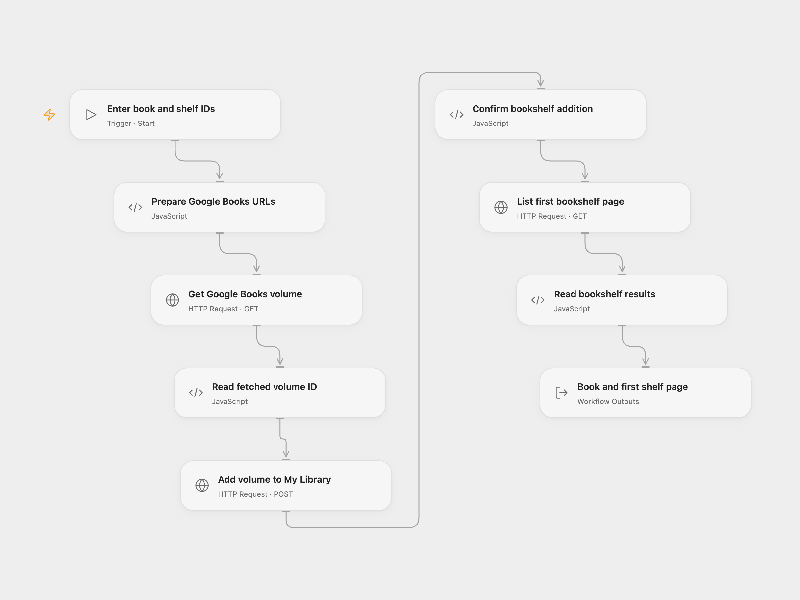

# Google Books Add to Shelf

Get a Google Books volume, add its returned ID to one of your My Library bookshelves and list that shelf’s first page.

<picture>
  <source media="(prefers-color-scheme: dark)" srcset="preview-dark.png">
  
</picture>

[Open Flow JSON](templates/google-books-add-to-shelf.openflow.json) · [n8n JSON](templates/google-books-add-to-shelf.n8n.json)

## Setup

Enable the Books API for your Google project and authorize a user for `https://www.googleapis.com/auth/books`. Use that user’s writable My Library bookshelf. The source example uses shelf `2` (To Read). This workflow does not search for books.

In Open Flow, store a valid OAuth access token in the **GOOGLE_BOOKS_ACCESS_TOKEN** Variable and bind it to **Auth Token** in all three HTTP nodes. Run with **Volume ID** and **Shelf ID**. The token is short-lived: update the Variable when it expires. This template does not acquire or refresh tokens, and an API key cannot authorize the private bookshelf write. Keep the token out of run inputs and shared JSON.

In n8n, edit **Configure book and shelf** and select the same Google Books OAuth2 account in both **Google Books** nodes and **Add volume to My Library**. n8n uses managed OAuth2 credentials and can refresh tokens. The two formats have different token management requirements.

Each run gets one volume, adds the returned volume ID to the selected shelf, then lists up to 40 shelf volumes. It does not page through the rest or prove that the added book appears on the first page. Open Flow returns the fetched volume, complete first-page response, items and count; n8n returns one item per listed volume. An empty shelf produces an empty items array in Open Flow and no n8n result items.

A failed read stops the write. A failed write stops the list. If listing fails after addition, the shelf change remains. There is no rollback or duplicate check. No workflow retry is configured. Check My Library before rerunning an uncertain write.

Inspiration &amp; credits

## Changes to the source

- Require configurable volume and shelf IDs.
- Send the add request with the documented volumeId query parameter and no body, accepting its empty successful response. In n8n this step uses HTTP Request with managed Google Books credentials.
- Make the source’s default first-page limit of 40 explicit.
- Use a manually updated OAuth token Variable in Open Flow and retain managed OAuth2 in n8n.

Adapted from [Google Books volume and bookshelf workflow](https://github.com/Zie619/n8n-workflows/blob/ae8cf6dc5b873cbb4f74587aa9180ed3a9f70682/workflows/Manual/0037_Manual_Googlebooks_Create_Triggered.json) in [Zie619/n8n-workflows](https://github.com/Zie619/n8n-workflows). The source export does not identify a separate template author or license.

The collection’s [MIT notice](https://github.com/Zie619/n8n-workflows/blob/94007c1445d9258a7da116646b79473e7c7c3282/LICENSE) is pinned at a later revision. This is the collection notice at that revision; it does not establish a separate original template author's license. Our changes are listed above; see [repository licensing](../../README.md#licensing).

> MIT License
>
> Copyright (c) 2025 Zie619
>
> Permission is hereby granted, free of charge, to any person obtaining a copy
> of this software and associated documentation files (the "Software"), to deal
> in the Software without restriction, including without limitation the rights
> to use, copy, modify, merge, publish, distribute, sublicense, and/or sell
> copies of the Software, and to permit persons to whom the Software is
> furnished to do so, subject to the following conditions:
>
> The above copyright notice and this permission notice shall be included in all
> copies or substantial portions of the Software.
>
> THE SOFTWARE IS PROVIDED "AS IS", WITHOUT WARRANTY OF ANY KIND, EXPRESS OR
> IMPLIED, INCLUDING BUT NOT LIMITED TO THE WARRANTIES OF MERCHANTABILITY,
> FITNESS FOR A PARTICULAR PURPOSE AND NONINFRINGEMENT. IN NO EVENT SHALL THE
> AUTHORS OR COPYRIGHT HOLDERS BE LIABLE FOR ANY CLAIM, DAMAGES OR OTHER
> LIABILITY, WHETHER IN AN ACTION OF CONTRACT, TORT OR OTHERWISE, ARISING FROM,
> OUT OF OR IN CONNECTION WITH THE SOFTWARE OR THE USE OR OTHER DEALINGS IN THE
> SOFTWARE.

