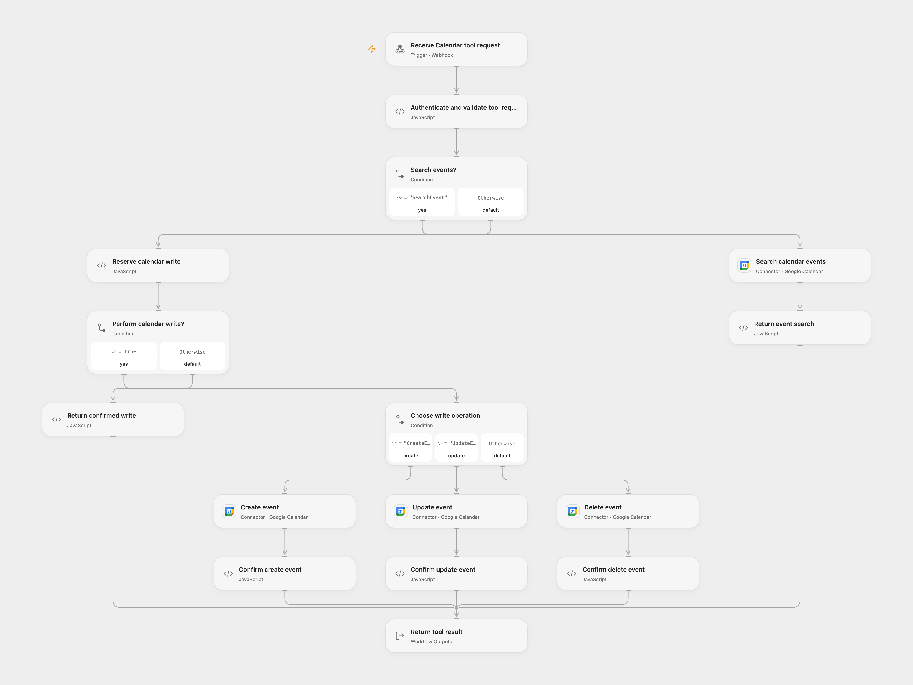

# Google Calendar MCP Event Tools

Expose Calendar event search, creation, update and deletion as MCP tools.

<!-- template-actions:start -->
 
<!-- template-actions:end -->

<picture>
  <source media="(prefers-color-scheme: dark)" srcset="preview-dark.png">
  
</picture>

## Setup

Configure a Google Calendar connection and the same calendar ID in both formats. Import n8n, configure an authenticated MCP endpoint and connect the four tools. Select a Data Table with item_key, status and fingerprint text columns. Set a unique requestId for each write. Select one execution mode and prevent concurrent requests with the same ID. For Open Flow configure persistent State and set CALENDAR_MCP_RELAY_AUTH to a secret authorization header. In **Validate tool input** set mode to relay and the Open Flow URL, then configure the matching HTTP Header Auth credential in **Forward tool request**. The bundled n8n workflow provides the MCP endpoint.

## Behavior

SearchEvent accepts After, Before and Limit. CreateEvent accepts Start, End, title and description; UpdateEvent additionally requires Event_ID; DeleteEvent requires Event_ID. Create and update use event_title and event_description. Each write also requires a unique requestId. These operations may create, change or delete real Calendar events. The sender must explicitly request each write.

If a write has an unknown outcome, inspect the Calendar first. For Open Flow enter its pending key and confirmed or absent in **Reserve calendar write**, replay the same request, then clear the fields. In n8n mark its pending Data Table row done only if the write happened, or delete it only after verifying it did not. Use a fresh requestId for an intentional new write; a reused ID with different inputs is rejected. Open Flow treats a Calendar 404 on delete as already absent; n8n reports that as an error. Open Flow updates read and then replace the event; avoid concurrent edits to the same event. Event content can appear in execution history.

Inspiration &amp; credits

## Changes to the source

- Keep the independent MCP tool service and remove its separate chat client and memory. Protect the endpoint and persist each external write before execution.

Adapted from [Build an MCP Server with Google Calendar](https://github.com/Zie619/n8n-workflows/blob/ae8cf6dc5b873cbb4f74587aa9180ed3a9f70682/workflows/Googlecalendartool/1071_Googlecalendartool_Stickynote_Create_Triggered.json) in [Zie619/n8n-workflows](https://github.com/Zie619/n8n-workflows). The source export does not identify a separate template author or license.

The collection’s [MIT notice](https://github.com/Zie619/n8n-workflows/blob/94007c1445d9258a7da116646b79473e7c7c3282/LICENSE) is pinned at a later revision. This is the collection notice at that revision; it does not establish a separate original template author's license. Our changes are listed above; see [repository licensing](../../README.md#licensing).

> MIT License
>
> Copyright (c) 2025 Zie619
>
> Permission is hereby granted, free of charge, to any person obtaining a copy
> of this software and associated documentation files (the "Software"), to deal
> in the Software without restriction, including without limitation the rights
> to use, copy, modify, merge, publish, distribute, sublicense, and/or sell
> copies of the Software, and to permit persons to whom the Software is
> furnished to do so, subject to the following conditions:
>
> The above copyright notice and this permission notice shall be included in all
> copies or substantial portions of the Software.
>
> THE SOFTWARE IS PROVIDED "AS IS", WITHOUT WARRANTY OF ANY KIND, EXPRESS OR
> IMPLIED, INCLUDING BUT NOT LIMITED TO THE WARRANTIES OF MERCHANTABILITY,
> FITNESS FOR A PARTICULAR PURPOSE AND NONINFRINGEMENT. IN NO EVENT SHALL THE
> AUTHORS OR COPYRIGHT HOLDERS BE LIABLE FOR ANY CLAIM, DAMAGES OR OTHER
> LIABILITY, WHETHER IN AN ACTION OF CONTRACT, TORT OR OTHERWISE, ARISING FROM,
> OUT OF OR IN CONNECTION WITH THE SOFTWARE OR THE USE OR OTHER DEALINGS IN THE
> SOFTWARE.

