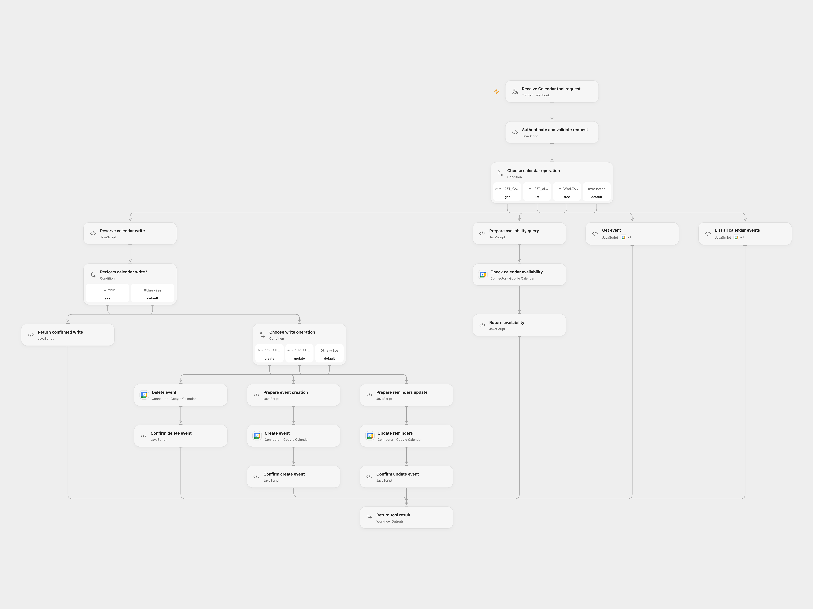

# Google Calendar Six MCP Tools

Expose event lookup, listing, availability, creation, reminders update and deletion through MCP.

<!-- template-actions:start -->
 
<!-- template-actions:end -->

<picture>
  <source media="(prefers-color-scheme: dark)" srcset="preview-dark.png">
  
</picture>

## Setup

Configure the same Calendar ID. In Open Flow enable persistent State and set CALENDAR_MCP_RELAY_AUTH.

## Behavior

The six tools get an event by ID, list all events between After and Before, check availability between Start_Time and End_Time in America/Sao_Paulo, create an event with Start, End, Description and Use_Default_Reminders, update only the reminders setting, or delete by Event_ID. As in the source, an update with Use_Default_Reminders true sends no reminder change; false sets useDefault false. Dates should include offsets. The caller must explicitly request writes. Event data may appear in execution history. The Open Flow list runs through Code, which has a 1 MiB input/output limit.

If a write outcome is unknown, inspect Calendar before retrying. In Open Flow enter the pending key and confirmed or absent in **Reserve calendar write**, replay the request, then clear both fields. Use a fresh requestId for intentional new writes. Open Flow treats a delete 404 as already absent.

In n8n

Connect Google Calendar and an authenticated n8n MCP server. Select a Data Table with item_key, status and fingerprint text columns, set a unique requestId for each write, and prevent overlapping runs for a request. In n8n select relay mode and configure the matching Header Auth credential and Open Flow URL. In n8n mark the pending Data Table row done only after confirming the write, or delete it only after confirming it did not occur. N8n returns an error.

Inspiration &amp; credits

Adapted from [MCP_CALENDAR](https://github.com/Zie619/n8n-workflows/blob/ae8cf6dc5b873cbb4f74587aa9180ed3a9f70682/workflows/Googlecalendartool/1872_Googlecalendartool_Automation_Triggered.json) in [Zie619/n8n-workflows](https://github.com/Zie619/n8n-workflows). The source export does not identify a separate template author or license.

The collection’s [MIT notice](https://github.com/Zie619/n8n-workflows/blob/94007c1445d9258a7da116646b79473e7c7c3282/LICENSE) is pinned at a later revision. This is the collection notice at that revision; it does not establish a separate original template author's license. Our changes are listed above; see [repository licensing](../../README.md#licensing).

> MIT License
>
> Copyright (c) 2025 Zie619
>
> Permission is hereby granted, free of charge, to any person obtaining a copy
> of this software and associated documentation files (the "Software"), to deal
> in the Software without restriction, including without limitation the rights
> to use, copy, modify, merge, publish, distribute, sublicense, and/or sell
> copies of the Software, and to permit persons to whom the Software is
> furnished to do so, subject to the following conditions:
>
> The above copyright notice and this permission notice shall be included in all
> copies or substantial portions of the Software.
>
> THE SOFTWARE IS PROVIDED "AS IS", WITHOUT WARRANTY OF ANY KIND, EXPRESS OR
> IMPLIED, INCLUDING BUT NOT LIMITED TO THE WARRANTIES OF MERCHANTABILITY,
> FITNESS FOR A PARTICULAR PURPOSE AND NONINFRINGEMENT. IN NO EVENT SHALL THE
> AUTHORS OR COPYRIGHT HOLDERS BE LIABLE FOR ANY CLAIM, DAMAGES OR OTHER
> LIABILITY, WHETHER IN AN ACTION OF CONTRACT, TORT OR OTHERWISE, ARISING FROM,
> OUT OF OR IN CONNECTION WITH THE SOFTWARE OR THE USE OR OTHER DEALINGS IN THE
> SOFTWARE.

