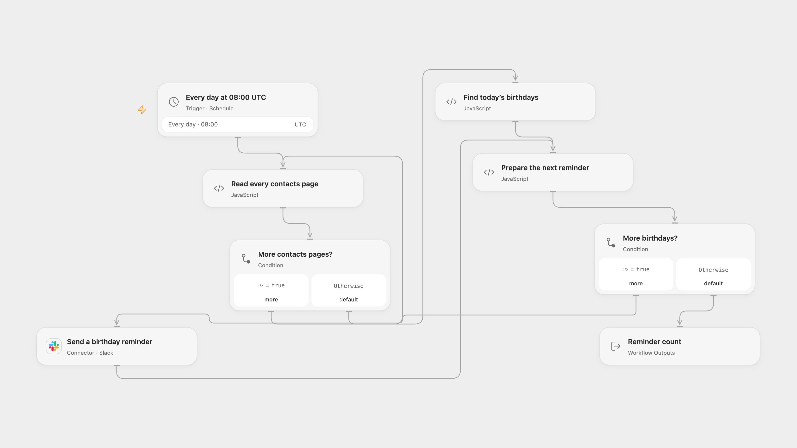

# Google Contacts Birthday Reminders to Slack

Check Google Contacts each morning and send a Slack reminder for each birthday today.

<picture>
  <source media="(prefers-color-scheme: dark)" srcset="preview-dark.png">
  
</picture>

[Open Flow JSON](templates/google-contacts-birthday-reminders-to-slack.openflow.json) · [n8n JSON](templates/google-contacts-birthday-reminders-to-slack.n8n.json)

## Setup

Enable the People API in your Google Cloud project and obtain OAuth client credentials plus an offline refresh token with `https://www.googleapis.com/auth/contacts.readonly` consent. In Open Flow, create secret Variables for the client ID, client secret and refresh token, and bind them in **Read every contacts page**. Connect Slack and set the channel ID in **Prepare the next reminder**. The workflow reads the authenticated user’s contacts.

In n8n, connect Google Contacts and Slack, and select the Slack channel. Both the schedule and birthday comparison use UTC. Activate one format.

## Behavior

At 08:00 UTC each day, the workflow reads contacts, matches structured birthday month and day, and sends one Slack reminder per matching contact. A missing birth year does not prevent a match; February 29 matches only on February 29. Names use the primary display name, then given and family names, a nickname or “your friend”. No matches send nothing. Open Flow compares the scheduled occurrence date; n8n compares the execution date, so a run delayed across UTC midnight can differ.

Open Flow refreshes its Google access token for each contacts page. A page error or invalid or repeated page token stops before reminders; each response must fit the 1 MiB Code fetch limit and the collected contacts must fit the run’s execution limits. Google OAuth refresh tokens can expire or be revoked. A Slack failure stops later reminders; earlier sends are not undone, and rerunning can duplicate them.

Inspiration &amp; credits

## Changes to the source

- The source never sets `today`, compares a structured birthday as a string, and its Slack block is invalid. Both formats now compare month/day and send a valid block with the contact’s name. n8n disables its automatic workflow link.
- Open Flow uses Google OAuth refresh and the People API for complete pagination because no Google Contacts Provider or Action is available. n8n keeps its Google Contacts node with raw fields. The original channel was unconfigured.

Adapted from [Send Daily Birthday Reminders from Google Contacts to Slack](https://github.com/Zie619/n8n-workflows/blob/ae8cf6dc5b873cbb4f74587aa9180ed3a9f70682/workflows/Googlecontacts/1239_Googlecontacts_Schedule_Send_Scheduled.json) in [Zie619/n8n-workflows](https://github.com/Zie619/n8n-workflows). The source export does not identify a separate template author or license.

The collection’s [MIT notice](https://github.com/Zie619/n8n-workflows/blob/94007c1445d9258a7da116646b79473e7c7c3282/LICENSE) is pinned at a later revision. This is the collection notice at that revision; it does not establish a separate original template author's license. Our changes are listed above; see [repository licensing](../../README.md#licensing).

> MIT License
>
> Copyright (c) 2025 Zie619
>
> Permission is hereby granted, free of charge, to any person obtaining a copy
> of this software and associated documentation files (the "Software"), to deal
> in the Software without restriction, including without limitation the rights
> to use, copy, modify, merge, publish, distribute, sublicense, and/or sell
> copies of the Software, and to permit persons to whom the Software is
> furnished to do so, subject to the following conditions:
>
> The above copyright notice and this permission notice shall be included in all
> copies or substantial portions of the Software.
>
> THE SOFTWARE IS PROVIDED "AS IS", WITHOUT WARRANTY OF ANY KIND, EXPRESS OR
> IMPLIED, INCLUDING BUT NOT LIMITED TO THE WARRANTIES OF MERCHANTABILITY,
> FITNESS FOR A PARTICULAR PURPOSE AND NONINFRINGEMENT. IN NO EVENT SHALL THE
> AUTHORS OR COPYRIGHT HOLDERS BE LIABLE FOR ANY CLAIM, DAMAGES OR OTHER
> LIABILITY, WHETHER IN AN ACTION OF CONTRACT, TORT OR OTHERWISE, ARISING FROM,
> OUT OF OR IN CONNECTION WITH THE SOFTWARE OR THE USE OR OTHER DEALINGS IN THE
> SOFTWARE.

