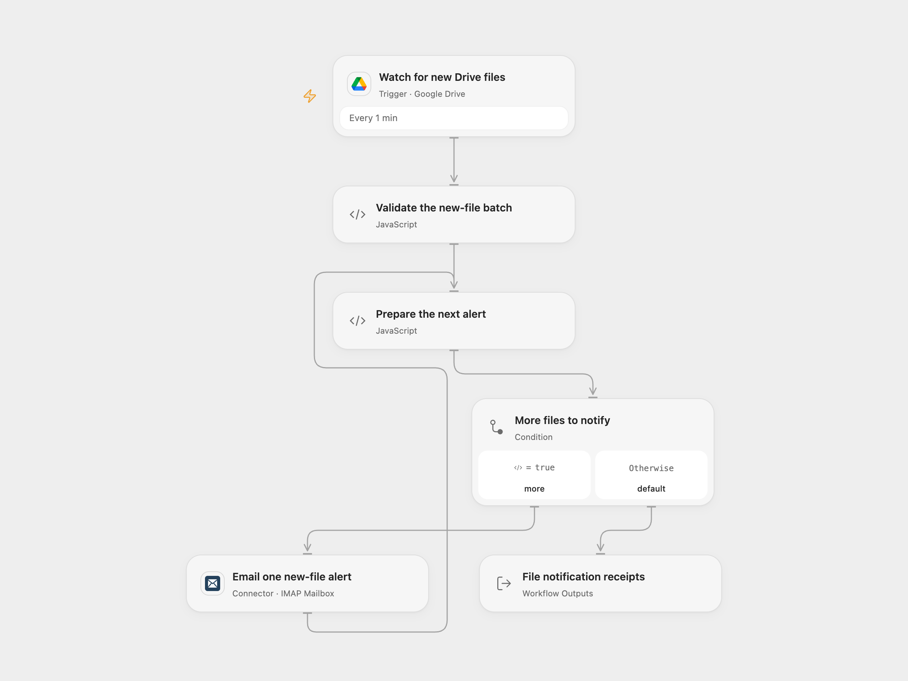

# Google Drive New File Email Alert

Send a plain-text email when a new file is created directly inside a selected Google Drive folder.

<picture>
  <source media="(prefers-color-scheme: dark)" srcset="preview-dark.png">
  
</picture>

[Open Flow JSON](templates/google-drive-new-file-email-alert.openflow.json) · [n8n JSON](templates/google-drive-new-file-email-alert.n8n.json)

## Setup

Connect Google Drive in **Watch for new Drive files** and set **Folder ID** to the actual folder ID, without a URL. The account must be able to read that folder. For a shared drive, also configure its **Drive ID**. Keep **Change Type** set to `created` and **Item Types** set to files. The template polls every minute. Its first activation without a saved checkpoint starts at the current time, without backfilling older files. A saved checkpoint can resume after a pause.

In **Email one new-file alert**, connect the sending mailbox and replace `recipient@example.com` with the real recipient. Open Flow uses the connected mailbox address as the sender. This connection requires a public IMAP server on port 993 and a public SMTP server on port 465 with TLS, or a port supporting STARTTLS, plus the mailbox address and app password.

In n8n, connect **Google Drive OAuth2 API** on the trigger and **SMTP** on the email node. Configure the same folder and recipient, and set **From Email** to the SMTP mailbox address. Use one format for this process to avoid duplicate notifications.

## Behavior

Only new files directly inside the selected folder are monitored. Folder creation, file updates and nested descendants are outside this selection. Polling uses creation timestamps and current parent-folder membership; moving a file does not itself change its creation timestamp. Each email has subject **File Update** and contains the source’s notice followed by the new file’s name. No file bytes or attachments are downloaded, and no file is modified.

Open Flow reads pages of up to 50 file candidates and keeps the poll’s continuation checkpoint for later pages. n8n uses its own timestamp checkpoint and reads all result pages in a poll. Open Flow retains a short overlap window and bounded boundary identities to reduce repeated events; neither format guarantees exactly-once email delivery. Poll and connection failures require attention. A workflow failure does not automatically replay notifications after its trigger checkpoint advances.

The complete supplied batch is validated before email submission starts. Emails are submitted one at a time in the received event order. A failed or uncertain submission stops later emails and keeps earlier submissions made. Check the mailbox before replaying a failed run; another run can send the same alert again. SMTP acceptance confirms submission to the server, not delivery to an inbox. No workflow retry is added.

The Open Flow result contains each file ID with its SMTP receipt and a count. Complete batches and accumulated receipts must fit the inspected host’s 1 MiB per-Code input/result budget; oversized data fails rather than being truncated.

## Changes to the source

- Remove the source’s personal addresses and folder/credential identities.
- Make the one-minute schedule and created-file filter explicit.
- Validate complete event batches and confirm SMTP acceptance without adding file operations or attachments.

Source and license

Adapted from [Google Drive new-file email notification](https://github.com/Zie619/n8n-workflows/blob/ae8cf6dc5b873cbb4f74587aa9180ed3a9f70682/workflows/Emailsend/0113_Emailsend_GoogleDrive_Send_Triggered.json) in [Zie619/n8n-workflows](https://github.com/Zie619/n8n-workflows). The source export does not identify a separate template author or license.

The collection’s [MIT notice](https://github.com/Zie619/n8n-workflows/blob/94007c1445d9258a7da116646b79473e7c7c3282/LICENSE) is pinned at a later revision. This is the collection notice at that revision; it does not establish a separate original template author's license. Our changes are listed above; see [repository licensing](../../README.md#licensing).

> MIT License
>
> Copyright (c) 2025 Zie619
>
> Permission is hereby granted, free of charge, to any person obtaining a copy
> of this software and associated documentation files (the "Software"), to deal
> in the Software without restriction, including without limitation the rights
> to use, copy, modify, merge, publish, distribute, sublicense, and/or sell
> copies of the Software, and to permit persons to whom the Software is
> furnished to do so, subject to the following conditions:
>
> The above copyright notice and this permission notice shall be included in all
> copies or substantial portions of the Software.
>
> THE SOFTWARE IS PROVIDED "AS IS", WITHOUT WARRANTY OF ANY KIND, EXPRESS OR
> IMPLIED, INCLUDING BUT NOT LIMITED TO THE WARRANTIES OF MERCHANTABILITY,
> FITNESS FOR A PARTICULAR PURPOSE AND NONINFRINGEMENT. IN NO EVENT SHALL THE
> AUTHORS OR COPYRIGHT HOLDERS BE LIABLE FOR ANY CLAIM, DAMAGES OR OTHER
> LIABILITY, WHETHER IN AN ACTION OF CONTRACT, TORT OR OTHERWISE, ARISING FROM,
> OUT OF OR IN CONNECTION WITH THE SOFTWARE OR THE USE OR OTHER DEALINGS IN THE
> SOFTWARE.

