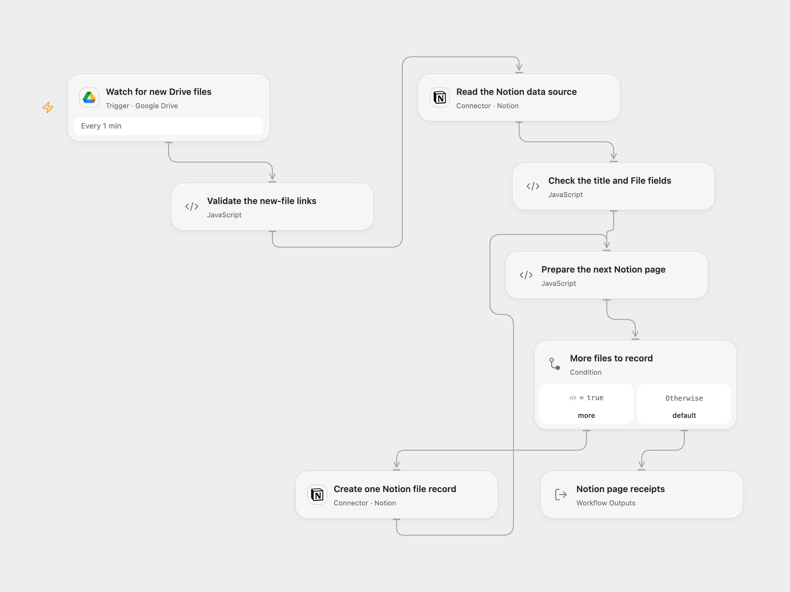

# Google Drive New Files to Notion

Create a Notion record for each new file in a Google Drive folder, using its original name and viewer link.

<picture>
  <source media="(prefers-color-scheme: dark)" srcset="preview-dark.png">
  
</picture>

[Open Flow JSON](templates/google-drive-new-files-to-notion.openflow.json) · [n8n JSON](templates/google-drive-new-files-to-notion.n8n.json)

## Setup

Connect Google Drive in **Watch for new Drive files** and replace **Folder ID**. For a shared drive, also set **Drive ID**. Keep created files selected. The workflow polls every minute.

Connect Notion on both Notion nodes. In **Read the Notion data source**, replace **Data Source ID** with the data source ID inside the destination database. Share that destination with the integration and allow page insertion. It must have exactly one title property and a property named **File** with type **Files & media**. The title property name is read from the schema. A database container ID is different from its data source ID.

In n8n, select **Google Drive OAuth2 API** on the trigger and **Notion API** credentials on both HTTP Request nodes. Set the same folder and data source IDs. Keep the fixed Notion endpoints, `Notion-Version: 2026-03-11`, JSON bodies, response mode and redirect settings. Activate one format for this process.

## Behavior

Only files created directly inside the selected folder are selected. Folder creation, file updates and nested descendants are outside that selection. Polling uses creation timestamps and current parent membership. The first activation without a checkpoint starts at the current time, without backfilling older files; a saved checkpoint can resume after a pause.

Each record keeps the original file name as its title and stores the same name and original Google Drive `webViewLink` in **File** as an external file reference. An empty file name leaves the Notion title unset, as in the source. No file content is downloaded or uploaded, and Drive sharing permissions are not changed.

Notion external files require accessible HTTPS URLs. A Drive viewer link opens the file in a browser; it is not a file-content download URL. Configure file access for the intended readers and verify that Notion accepts the links you use. Recording a link does not grant access to a private Drive file or make a copy in Notion.

The batch is checked before page creation starts. The data source schema is read once per batch, then pages are created one at a time in event order. Invalid links, an incompatible schema or an invalid page receipt fail the run. A failed or uncertain creation stops later pages and keeps any pages already created. Check Notion before replaying a failed run; repeating it can create duplicate records. No workflow retry or cross-run history is added.

Open Flow reads up to 50 file candidates per page and preserves the continuation checkpoint; n8n reads all native result pages in a poll. Their checkpoint and overlap rules differ, and neither guarantees exactly-once recording. A workflow failure does not automatically replay events after its poll checkpoint advances. Full batches, schemas and accumulated page receipts must fit the inspected host’s 1 MiB per-Code budget; oversized data fails without truncation.

The result contains each file ID with its full Notion page receipt and a count.

## Changes to the source

- Remove the source folder, database and credential identities.
- Use the current Notion data source API while preserving dynamic title discovery and the original File external-link property.
- Validate complete file batches and page receipts without changing file permissions or fetching file bytes.

Source and license

Adapted from [Google Drive new files recorded in Notion](https://github.com/Zie619/n8n-workflows/blob/ae8cf6dc5b873cbb4f74587aa9180ed3a9f70682/workflows/Notion/0272_Notion_GoogleDrive_Create_Triggered.json) in [Zie619/n8n-workflows](https://github.com/Zie619/n8n-workflows). The source export does not identify a separate template author or license.

The collection’s [MIT notice](https://github.com/Zie619/n8n-workflows/blob/94007c1445d9258a7da116646b79473e7c7c3282/LICENSE) is pinned at a later revision. This is the collection notice at that revision; it does not establish a separate original template author's license. Our changes are listed above; see [repository licensing](../../README.md#licensing).

> MIT License
>
> Copyright (c) 2025 Zie619
>
> Permission is hereby granted, free of charge, to any person obtaining a copy
> of this software and associated documentation files (the "Software"), to deal
> in the Software without restriction, including without limitation the rights
> to use, copy, modify, merge, publish, distribute, sublicense, and/or sell
> copies of the Software, and to permit persons to whom the Software is
> furnished to do so, subject to the following conditions:
>
> The above copyright notice and this permission notice shall be included in all
> copies or substantial portions of the Software.
>
> THE SOFTWARE IS PROVIDED "AS IS", WITHOUT WARRANTY OF ANY KIND, EXPRESS OR
> IMPLIED, INCLUDING BUT NOT LIMITED TO THE WARRANTIES OF MERCHANTABILITY,
> FITNESS FOR A PARTICULAR PURPOSE AND NONINFRINGEMENT. IN NO EVENT SHALL THE
> AUTHORS OR COPYRIGHT HOLDERS BE LIABLE FOR ANY CLAIM, DAMAGES OR OTHER
> LIABILITY, WHETHER IN AN ACTION OF CONTRACT, TORT OR OTHERWISE, ARISING FROM,
> OUT OF OR IN CONNECTION WITH THE SOFTWARE OR THE USE OR OTHER DEALINGS IN THE
> SOFTWARE.

