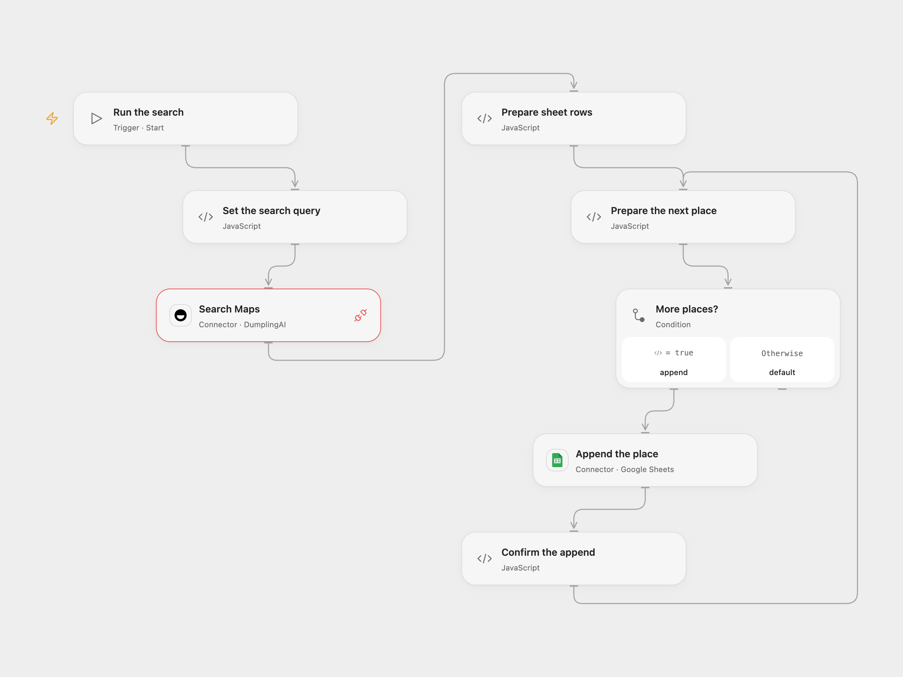

# Save Google Maps Business Leads to Sheets

Search Google Maps for businesses and append their details to Google Sheets.

<picture>
  <source media="(prefers-color-scheme: dark)" srcset="preview-dark.png">
  
</picture>

[Open Flow JSON](templates/google-maps-leads-to-sheets.openflow.json) · [n8n JSON](templates/google-maps-leads-to-sheets.n8n.json)

## Setup

Connect DumplingAI in **Search Maps** with Provider API Request permission and Google Sheets in **Append the place**. Set the search query in **Set the search query**, spreadsheet ID and A1 range in **Append the place**. The default range is Sheet1 columns A:I. Prepare columns in this order: Name, Address, rating, priceLevel, type, Booking Link, Website, Phone number, Position. Adjust the range to your sheet while keeping that order. In n8n, set the query in **Set the search query**, connect a DumplingAI Header Auth credential with Authorization set to Bearer followed by your API key, and connect Google Sheets and select the spreadsheet and sheet. Use the listed column names as headers in n8n. Run one format.

## Behavior

One run searches one page in English and appends each returned place as a new row. Optional missing details are blank. No places means no rows. The workflow does not deduplicate, so repeated runs can append the same business again. Values are written as RAW so names and other text beginning with an equals sign remain text. The original first booking link is used when available.

A search failure stops before writes. Open Flow appends one place at a time; n8n submits the prepared rows as one append. An Open Flow append failure stops the run, but earlier rows may already exist. An uncertain append in either format may have succeeded. Inspect the sheet before retrying.

Inspiration &amp; credits

## Changes to the source

- Replace the example query and private spreadsheet, and configure the output columns explicitly.
- Validate returned places before writing, use RAW cell input, and confirm each Open Flow append.

Adapted from [Extract Business Leads from Google Maps with Dumpling AI to Google Sheets](https://github.com/Zie619/n8n-workflows/blob/ae8cf6dc5b873cbb4f74587aa9180ed3a9f70682/workflows/Splitout/1774_Splitout_Manual_Automation_Webhook.json) in [Zie619/n8n-workflows](https://github.com/Zie619/n8n-workflows). The matching [n8n community listing](https://n8n.io/workflows/3593-extract-business-leads-from-google-maps-with-dumpling-ai-to-google-sheets/) credits Yang. The original template does not state a separate license.

The collection’s [MIT notice](https://github.com/Zie619/n8n-workflows/blob/94007c1445d9258a7da116646b79473e7c7c3282/LICENSE) is pinned at a later revision. This is the collection notice at that revision; it does not establish a separate original template author's license. Our changes are listed above; see [repository licensing](../../README.md#licensing).

> MIT License
>
> Copyright (c) 2025 Zie619
>
> Permission is hereby granted, free of charge, to any person obtaining a copy
> of this software and associated documentation files (the "Software"), to deal
> in the Software without restriction, including without limitation the rights
> to use, copy, modify, merge, publish, distribute, sublicense, and/or sell
> copies of the Software, and to permit persons to whom the Software is
> furnished to do so, subject to the following conditions:
>
> The above copyright notice and this permission notice shall be included in all
> copies or substantial portions of the Software.
>
> THE SOFTWARE IS PROVIDED "AS IS", WITHOUT WARRANTY OF ANY KIND, EXPRESS OR
> IMPLIED, INCLUDING BUT NOT LIMITED TO THE WARRANTIES OF MERCHANTABILITY,
> FITNESS FOR A PARTICULAR PURPOSE AND NONINFRINGEMENT. IN NO EVENT SHALL THE
> AUTHORS OR COPYRIGHT HOLDERS BE LIABLE FOR ANY CLAIM, DAMAGES OR OTHER
> LIABILITY, WHETHER IN AN ACTION OF CONTRACT, TORT OR OTHERWISE, ARISING FROM,
> OUT OF OR IN CONNECTION WITH THE SOFTWARE OR THE USE OR OTHER DEALINGS IN THE
> SOFTWARE.

