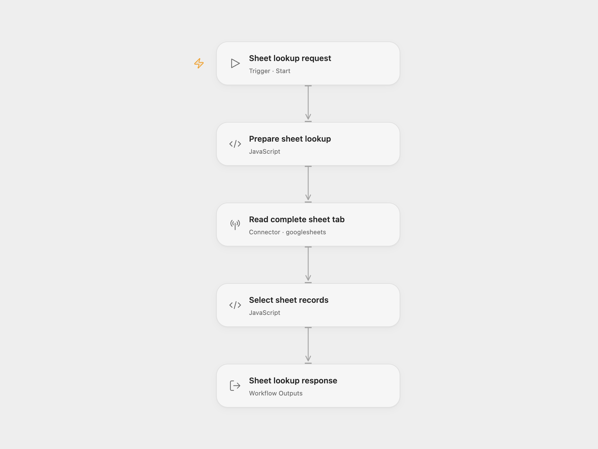

# Google Sheet Record Lookup

Read a Google Sheet to list its columns, retrieve one column with row numbers, or find a record by its physical row number.

<picture>
  <source media="(prefers-color-scheme: dark)" srcset="preview-dark.png">
  
</picture>

[Open Flow JSON](templates/google-sheet-record-lookup.openflow.json) · [n8n JSON](templates/google-sheet-record-lookup.n8n.json)

## Setup and use

Connect Google Sheets in **Read complete sheet tab**. In **Prepare sheet lookup**, replace `YOUR_SPREADSHEET_ID` with your spreadsheet ID and set `range` to the complete tab in [A1 notation](https://developers.google.com/workspace/sheets/api/guides/concepts#cell), such as `'Sheet1'` or `'Customer Records'`. Keep the surrounding single quotes; double an apostrophe inside a tab name. Cell subranges are rejected so row numbers stay relative to the spreadsheet. The connected account needs read access to that spreadsheet.

For n8n, select your Google Sheets OAuth2 credential in **Read Complete Sheet Tab**. Set the spreadsheet ID and tab range in **Sheet Settings**. Edit **Lookup Query**, then run **Run Sheet Lookup**. Another workflow can supply `operation` and `query` through **Execute Workflow Trigger**.

Use Run in Open Flow with one request:

| Operation | Example input | Decoded `response` |
| --- | --- | --- |
| List columns | `{"operation":"column_names"}` | `["row_number","Name","Email"]` |
| Read a column | `{"operation":"column_values","query":"Email"}` | `[{"row_number":2,"Email":"ada@example.com"}]` |
| Read a row | `{"operation":"row","query":"2"}` | `[{"row_number":2,"Name":"Ada","Email":"ada@example.com"}]` |

The `response` field is JSON text, as in the source. Parse it when the caller needs an array. Column names are case-sensitive and retain their exact spelling. A row query must be a positive whole-number string. `row_number` refers to the spreadsheet's physical one-based row number.

## Sheet layout and behavior

The first nonempty row supplies the column headers. Use unique nonempty text headers; `row_number` is reserved. Each populated column needs a header. Invalid headers stop the run instead of silently overwriting data. Empty data rows are skipped while their physical row positions are preserved. Missing cells at the end of a row become empty strings. Zero and `false` remain valid values.

The workflow reads the complete configured tab with [Values Get](https://developers.google.com/workspace/sheets/api/reference/rest/v4/spreadsheets.values/get). It keeps unformatted numeric and boolean values and requests formatted date/time strings, matching the source's read options. It does not set a fixed row limit. Large sheets can still reach the platform or Google API's request and response limits.

Column names are returned once, including for a header-only tab. Empty tabs, missing rows and column reads with no data records return `[]` as JSON text. When data records exist, an empty column still returns those records with empty cell strings and row numbers. A column name absent from an existing header causes an error. Google API failures stop the run. There are no writes, persistent state or workflow-level retries. Each run reads the tab again.

## Changes to the source

- Extract the independently callable sheet-query branch from the source's chat workflow and keep its three operations.
- Replace the source spreadsheet URL and credentials with user configuration.
- Read raw cell values in both formats and apply the same table rules. This preserves an explicit empty response when the sheet has no records.
- Return one column-name list and retain cell types and numeric row numbers, replacing repeated lists and implicit string conversion.
- Validate requests and headers, add a manual n8n entry, and retain the callable entry.

## Source and license

Adapted from the sheet-query sub-workflow in [Chat with a Google Sheet using AI](https://github.com/enescingoz/awesome-n8n-templates/blob/827110332c21cbe000ab13f6d292d5adb1f1f8db/Google_Drive_and_Google_Sheets/Chat%20with%20a%20Google%20Sheet%20using%20AI.json) in [enescingoz/awesome-n8n-templates](https://github.com/enescingoz/awesome-n8n-templates). This template publishes that callable query component; the source's conversational agent is separate.

Source collection notice: © 2024–2026 Enes Cingoz, [CC BY 4.0](https://github.com/enescingoz/awesome-n8n-templates/blob/827110332c21cbe000ab13f6d292d5adb1f1f8db/LICENSE). The source export does not identify a separate template author or license. This adaptation includes the changes above; see [repository licensing](../../README.md#licensing) for OOMOL contributions and third-party material.
