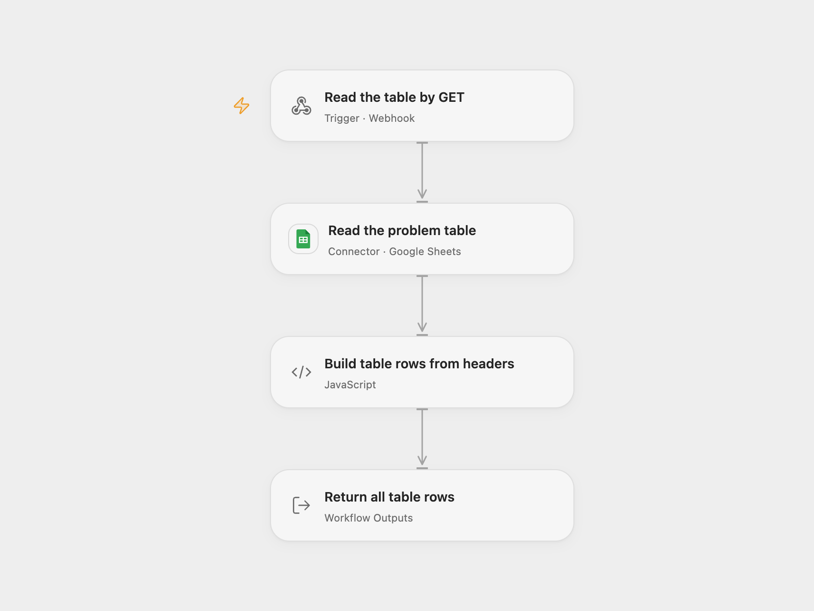

# Google Sheet Table JSON API

Expose a configured Google Sheet table through a GET endpoint. The HTTP response contains every data row as a JSON object using the first row as column labels.

<picture>
  <source media="(prefers-color-scheme: dark)" srcset="preview-dark.png">
  
</picture>

[Open Flow JSON](templates/google-sheet-table-json-api.openflow.json) · [n8n JSON](templates/google-sheet-table-json-api.n8n.json)

## Setup

Connect Google Sheets in **Read the problem table** with permission to read the spreadsheet. Replace **Spreadsheet ID** with the ID from its Google Sheets URL. Set **Range** to the A1 range to expose; the source uses `Problems!A:D`. The first row in that range supplies the column labels, and data starts on the second row.

In n8n, set **Authentication** to **Service Account** and select **Google Service Account API** credentials on its read node. Share the spreadsheet with that service account’s `client_email`; Viewer access is sufficient for this read. Set the spreadsheet ID and range there. Open Flow uses the selected Google user Connection, so its account must separately have read access.

Enable the GET webhook behind the access controls your deployment requires and copy its URL. The template itself adds no caller authentication. Callers who can reach it can read the configured range through your selected account; the caller does not need a Google account. Only activate the format you intend to serve.

## Use

```sh
curl 'YOUR_WEBHOOK_URL'
```

For a table whose first row is `Email`, `Name`, `Severity`, `Problem`, a response can look like:

```json
[{"Email":"reporter@example.com","Name":"Ada","Severity":8,"Problem":"A reported issue"}]
```

The endpoint reads the whole configured range once on every call. Its spreadsheet ID and range are configuration, not query parameters. It returns the full JSON array after the read completes, with a 60-second Open Flow response window. It does not append, update or delete spreadsheet rows.

Values use **UNFORMATTED_VALUE**, preserving numbers and booleans; dates and times use Google’s serial numbers. Formula cells return their calculated values. Literal labels such as `a.b` remain single JSON keys. Blank or other falsy labels are ignored, and later duplicate labels overwrite earlier values in the same row. Unlabelled cells are excluded. Missing trailing cells remain absent, explicit empty strings/nulls remain present, and rows with no labelled cells are skipped. A header-only or empty range returns `[]`.

The complete table, header mapping and JSON result must fit the inspected Open Flow host’s 1 MiB per-Code input/result budget. Oversized tables fail without truncation. Choose a suitable range before exposing large sheets. Read errors, invalid cell values, cancellation or response timeout fail instead of returning a partial array. Repeating a request performs another read; no workflow retry or response cache is added.

<details>
<summary>Inspiration &amp; credits</summary>

## Changes to the source

- Restore the GET → spreadsheet read → complete JSON-array response and replace the fixed spreadsheet ID with setup.
- Make the original read, service-account authentication, header row, data start and unformatted values explicit.
- Build literal JSON keys safely, including names such as `__proto__`, using the same row mapping in both formats.

Adapted from [Google Sheets table read with an all-entries webhook response](https://github.com/Zie619/n8n-workflows/blob/ae8cf6dc5b873cbb4f74587aa9180ed3a9f70682/workflows/Googlesheets/0035_GoogleSheets_Webhook_Automate_Webhook.json) in [Zie619/n8n-workflows](https://github.com/Zie619/n8n-workflows). The source export does not identify a separate template author or license.

The collection’s [MIT notice](https://github.com/Zie619/n8n-workflows/blob/94007c1445d9258a7da116646b79473e7c7c3282/LICENSE) is pinned at a later revision. This is the collection notice at that revision; it does not establish a separate original template author's license. Our changes are listed above; see [repository licensing](../../README.md#licensing).

> MIT License
>
> Copyright (c) 2025 Zie619
>
> Permission is hereby granted, free of charge, to any person obtaining a copy
> of this software and associated documentation files (the "Software"), to deal
> in the Software without restriction, including without limitation the rights
> to use, copy, modify, merge, publish, distribute, sublicense, and/or sell
> copies of the Software, and to permit persons to whom the Software is
> furnished to do so, subject to the following conditions:
>
> The above copyright notice and this permission notice shall be included in all
> copies or substantial portions of the Software.
>
> THE SOFTWARE IS PROVIDED "AS IS", WITHOUT WARRANTY OF ANY KIND, EXPRESS OR
> IMPLIED, INCLUDING BUT NOT LIMITED TO THE WARRANTIES OF MERCHANTABILITY,
> FITNESS FOR A PARTICULAR PURPOSE AND NONINFRINGEMENT. IN NO EVENT SHALL THE
> AUTHORS OR COPYRIGHT HOLDERS BE LIABLE FOR ANY CLAIM, DAMAGES OR OTHER
> LIABILITY, WHETHER IN AN ACTION OF CONTRACT, TORT OR OTHERWISE, ARISING FROM,
> OUT OF OR IN CONNECTION WITH THE SOFTWARE OR THE USE OR OTHER DEALINGS IN THE
> SOFTWARE.

</details>
