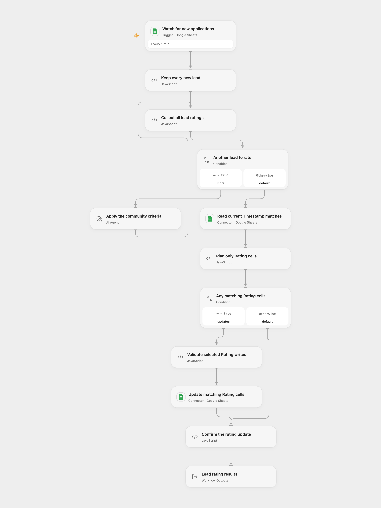

# Google Sheets Community Lead Rating

Qualify new community applications using the original team-responsibility and email-domain criteria, preserving every lead and updating only Rating.

<picture>
  <source media="(prefers-color-scheme: dark)" srcset="preview-dark.png">
  
</picture>

[Open Flow JSON](templates/google-sheets-community-lead-rating.openflow.json) · [n8n JSON](templates/google-sheets-community-lead-rating.n8n.json)

## Setup

Use a Google Sheet with exactly one of each `Timestamp`, `Email Address`, `Your name`, `Your business area`, `Your team size` and `Rating` header. A Google Form response sheet works. Select a Sheets connection with read/write access.

In Open Flow, replace the spreadsheet ID in the trigger, read and write nodes. Keep the same worksheet title in the trigger, read range and the planning node’s `sheetName` input. In n8n, select the trigger, Sheets HTTP and OpenAI credentials; replace the spreadsheet ID in the trigger and both HTTP URLs. Select the target tab ID in the trigger (the initial `0` is a configurable first-tab value). The read range and planner initially use `Form Responses 1`; update both if your worksheet has another title.

Configure the Open Flow deployment’s model gateway to serve `gpt-4.1`. n8n uses the same model with temperature `0.3`. Open Flow uses a single-round native Agent without tools and a structured result schema; its service-managed generation settings differ from the original chat node’s explicit temperature. Review sample applications against your community rules before enabling automatic updates.

The original `gpt-4-turbo-preview` alias pointed to `gpt-4-0125-preview`; OpenAI shut it down on March 26, 2026 and lists `gpt-5` or `gpt-4.1` as replacements. This template uses the documented `gpt-4.1` replacement for this classification task. OpenAI also lists GPT-4.1 (`gpt-4.1-2025-04-14`) for shutdown on January 14, 2027. Update the model in both formats and recheck generation settings before that date. Model access depends on the configured account or gateway. [OpenAI deprecations](https://developers.openai.com/api/docs/deprecations), [GPT-4 Turbo Preview](https://developers.openai.com/api/docs/models/gpt-4-turbo-preview), [GPT-4.1](https://developers.openai.com/api/docs/models/gpt-4.1).

## Behavior

The original qualification instructions are retained. Applicants qualify when they have responsibility for a company or team, or use a nonstandard email domain; team responsibility is the primary criterion. Each result contains `rating` (`qualified` or `not qualified`) and an explanation. Both formats reject malformed results before writing. Only `Rating` is written to the sheet; the explanation remains in the workflow’s model/merged results. Open Flow also returns all structured results.

All applications in a run are rated before the current sheet is read and any Rating cell is changed. Matching uses the string value of a nonempty `Timestamp`, as in the source. Empty application fields, numeric zero and false are supplied to the model as empty text, retaining the original trigger’s conversion. The first matching existing row is updated; missing matches are skipped. Duplicate input timestamps remain in order and can target the same first row repeatedly. Use unique timestamps and avoid editing keys while a run is active. Other cells and formulas are preserved. Values are written with the original `USER_ENTERED` setting. n8n uses standard Sheets HTTP read and batch-write steps to expose and validate the actual write receipt while keeping the source’s cell matching and update order.

The source n8n trigger polls every minute and emits the new rows together after its initial baseline. Open Flow retains the one-minute schedule through the formal Provider poll trigger. Each Provider page of up to 100 candidate rows creates an independent run; larger polls can produce several runs. The all-ratings-before-write barrier and returned counts apply to each run. A later page or model failure cannot undo earlier page writes. Initial activation baselines existing rows, so append a new application to test the active trigger. n8n’s manual trigger test can return existing sheet rows.

The trigger reads unformatted cell values with formatted date strings. The source update step reads formatted sheet values for matching; Open Flow preserves that behavior. Store matching keys as text if number/date display formatting would otherwise change their string representation. Open Flow reads columns A:Z, matching the source update range. Keep the listed fields within that range.

A model, read or confirmed write failure stops that run. Unknown write outcomes are not replayed automatically. A count mismatch in the write receipt fails instead of reporting success. There is no transaction across runs or protection against concurrent sheet edits. Large cell values remain subject to the host’s normal payload/context limits; the template does not silently discard leads.

## Attribution

The source carries the tag **Ted’s Tech Talks**. Its four setup notes are retained in the n8n template, including the original public demonstration-sheet link. Replace the template’s placeholder ID with a sheet you control.

Source and license

Adapted from [Qualify new leads in Google Sheets via OpenAI's GPT-4](https://github.com/enescingoz/awesome-n8n-templates/blob/827110332c21cbe000ab13f6d292d5adb1f1f8db/Google_Drive_and_Google_Sheets/Qualify%20new%20leads%20in%20Google%20Sheets%20via%20OpenAI_s%20GPT-4.json) in [enescingoz/awesome-n8n-templates](https://github.com/enescingoz/awesome-n8n-templates).

Source collection notice: © 2024–2026 Enes Cingoz, [CC BY 4.0](https://github.com/enescingoz/awesome-n8n-templates/blob/827110332c21cbe000ab13f6d292d5adb1f1f8db/LICENSE). The source carries the tag **Ted’s Tech Talks**; no separate template license is identified. See [repository licensing](../../README.md#licensing) for the scope of OOMOL contributions and third-party material.

