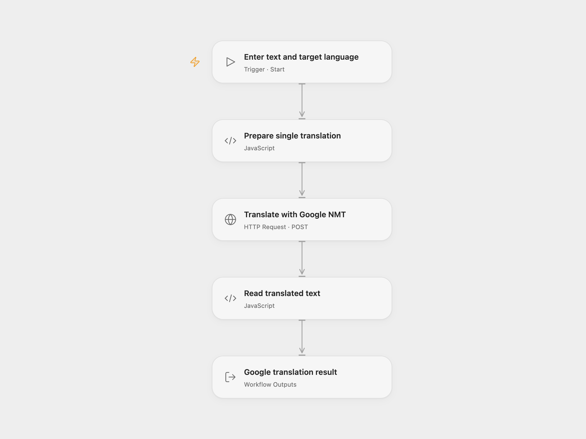

# Google Text Translator

Translate one text or HTML input into a target language with Google Cloud Translation Basic and return the complete translation record.

<picture>
  <source media="(prefers-color-scheme: dark)" srcset="preview-dark.png">
  
</picture>

[Open Flow JSON](templates/google-text-translator.openflow.json) · [n8n JSON](templates/google-text-translator.n8n.json)

## Setup

Enable Cloud Translation API and billing in your Google Cloud project. Set **x-goog-user-project** in **Translate with Google NMT** to the project used for quota and billing. The authorized principal must have `serviceusage.services.use` on that project.

In Open Flow, store a valid, short-lived OAuth access token in a secret Variable and bind it to **Auth Token** (`auth.token`). The token needs `https://www.googleapis.com/auth/cloud-translation` or `https://www.googleapis.com/auth/cloud-platform`. Renew the Variable when the token expires. This workflow does not acquire or refresh tokens, and it contains no service-account key. Shared JSON contains no token or Variable binding.

Run with **Text** and a supported **Target** language code, such as `de`. In n8n, select **Google Translate OAuth2 API** credentials in **Translate with Google NMT**, set the same quota-project header and edit `q` and `target` in the JSON body. n8n manages OAuth2 and can refresh its stored tokens. The two formats have different token-management requirements.

Each run sends one input to one target language. The source language is detected automatically. Google’s HTML input format and NMT model defaults are retained; HTML tags are preserved and translated text may contain escaped entities. This template does not decode or rewrite the returned text, use a custom model, translate files or split long text into batches. Google’s request-size and language-support limits apply.

The full single-translation record is returned, including detected source language and any extra properties. A failed request or malformed result stops the run. No workflow retry is configured. Open Flow’s HTTP step has a 30-second execution budget.

## Changes to the source

- Replace example text and language with user configuration.
- Make the billing/quota project explicit in both formats.
- Use a manually renewed secret access-token Variable in Open Flow and retain managed OAuth2 in n8n.
- Check that one translated-text record is returned before exposing it.

## Source and license

Adapted from [Google Translate workflow](https://github.com/Zie619/n8n-workflows/blob/ae8cf6dc5b873cbb4f74587aa9180ed3a9f70682/workflows/Manual/1200_Manual_Googletranslate_Automation_Triggered.json) in [Zie619/n8n-workflows](https://github.com/Zie619/n8n-workflows). The source export does not identify a separate template author or license.

The collection’s [MIT notice](https://github.com/Zie619/n8n-workflows/blob/94007c1445d9258a7da116646b79473e7c7c3282/LICENSE) is pinned at a later revision. This is the collection notice at that revision; it does not establish a separate original template author's license. Our changes are listed above; see [repository licensing](../../README.md#licensing).

> MIT License
>
> Copyright (c) 2025 Zie619
>
> Permission is hereby granted, free of charge, to any person obtaining a copy
> of this software and associated documentation files (the "Software"), to deal
> in the Software without restriction, including without limitation the rights
> to use, copy, modify, merge, publish, distribute, sublicense, and/or sell
> copies of the Software, and to permit persons to whom the Software is
> furnished to do so, subject to the following conditions:
>
> The above copyright notice and this permission notice shall be included in all
> copies or substantial portions of the Software.
>
> THE SOFTWARE IS PROVIDED "AS IS", WITHOUT WARRANTY OF ANY KIND, EXPRESS OR
> IMPLIED, INCLUDING BUT NOT LIMITED TO THE WARRANTIES OF MERCHANTABILITY,
> FITNESS FOR A PARTICULAR PURPOSE AND NONINFRINGEMENT. IN NO EVENT SHALL THE
> AUTHORS OR COPYRIGHT HOLDERS BE LIABLE FOR ANY CLAIM, DAMAGES OR OTHER
> LIABILITY, WHETHER IN AN ACTION OF CONTRACT, TORT OR OTHERWISE, ARISING FROM,
> OUT OF OR IN CONNECTION WITH THE SOFTWARE OR THE USE OR OTHER DEALINGS IN THE
> SOFTWARE.
