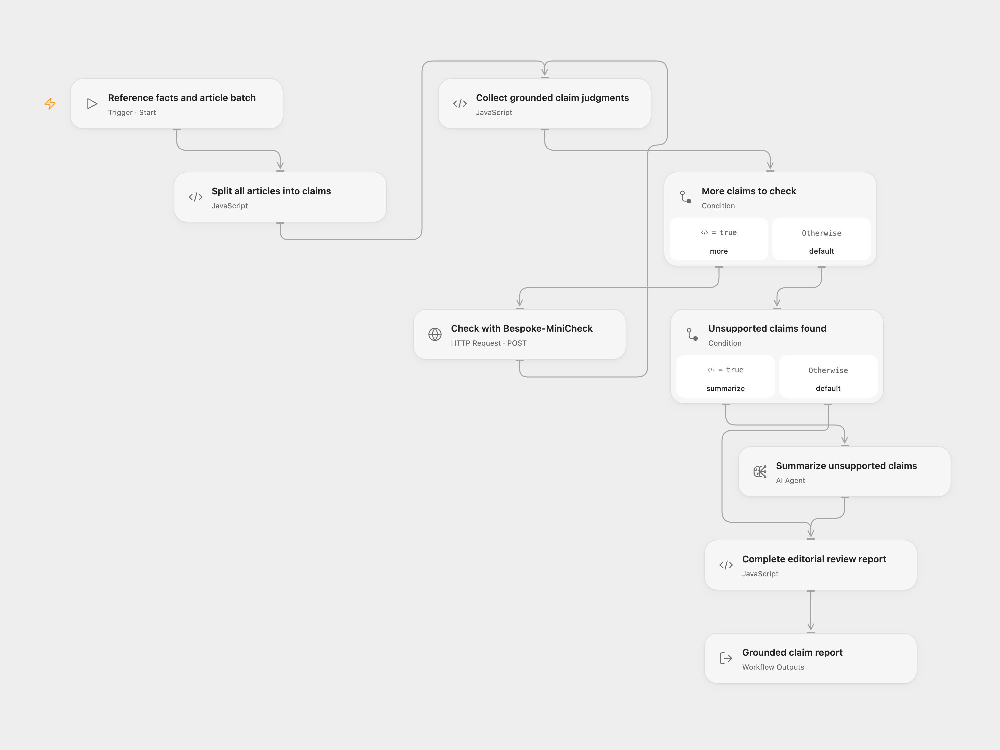

# Grounded Article MiniCheck

Check article sentences against provided facts with the specialized Bespoke-MiniCheck model, then produce an editorial report of unsupported claims.

<picture>
  <source media="(prefers-color-scheme: dark)" srcset="preview-dark.png">
  
</picture>

[Open Flow JSON](templates/grounded-article-minicheck.openflow.json) · [n8n JSON](templates/grounded-article-minicheck.n8n.json)

## Setup

Install the official [`bespoke-minicheck:latest`](https://ollama.com/library/bespoke-minicheck) model on your Ollama server. Configure a reachable HTTPS endpoint on **Check with Bespoke-MiniCheck**, keeping `/api/chat`. Select the `OLLAMA_API_KEY` secret Variable for its Bearer authentication and configure your server or reverse proxy to accept it. The shared file contains no token. Keep the checker model name unchanged; a general chat model does not perform this specialized check.

The inspected deployment allows 30 seconds per HTTP request and 4 MiB per HTTP response. Warm the model and use a server capable of returning each answer within that limit. n8n's adapter streams its answer; Open Flow receives one complete non-streaming answer. Redirects are not followed. Choose a supported model on **Summarize unsupported claims**; the source used `qwen2.5:1.5b` through Ollama. Open Flow's native summary Agent uses your configured model service and one model round without tools. It adds output instructions and uses service generation settings. Summary wording can differ from n8n's Ollama completion chain.

For n8n, configure the Ollama credential on both models. Its base URL and optional Bearer API key must be reachable from n8n. Install both `bespoke-minicheck:latest` and `qwen2.5:1.5b`, or select another summary model. The specialized checker remains Bespoke-MiniCheck.

## Run

Supply `documents`, an array of reference `facts` and article `text` pairs, to the Open Flow Start node. The same entry can be used after publishing the workflow for calls from other workflows.

```json
{"documents":[{"facts":"The workshop starts at 10:00. It is held online.","text":"The workshop starts at 10:00. It is held in Berlin."}]}
```

In n8n, run the manual example or call **When Executed by Another Workflow** with `facts` and `text` fields. Multiple input items are reviewed as one batch.

All articles are split into claims before checking starts. Each claim is sent separately with exactly `Document: ...` and `Claim: ...` in one user message. The checker must return `Yes` or `No`; malformed or incomplete responses stop the run. Every claim is checked before a report is generated. A later failure prevents a partial report or summary. No claims are silently dropped or truncated.

The result includes every check, unsupported claims with their document/claim indices, a count and a summary. Only `No` judgments enter the summary. An empty batch or all-`Yes` batch returns an empty unsupported list and a fixed completion message without calling the summary model. No content is published or sent to another service beyond the configured models.

This checks support in the supplied facts, rather than establishing independent truth. Review the model judgments. The sentence splitter uses a Latin/German uppercase heuristic and protects German dates and numbered-list prefixes; abbreviations and other writing systems may need preprocessing. Keep each reference/claim within the model's context and complete collections within platform byte budgets, including 1 MiB per Code input/result in the inspected Open Flow host.

The specialized checker is attempted once per claim in both formats. n8n's legacy summary adapter can retry startup failures up to six additional times; Open Flow's summary Agent does not retry its model round. A failed or unknown model request stops the run.

## Changes to the source

- Protect date/list boundaries in sentence splitting and preserve multi-document claim association.
- Keep the specialized checker protocol and validate its complete `Yes`/`No` result.
- Serialize all unsupported claims as JSON, include the instructions in the completion-model summary prompt and make the no-findings path explicit.
- Replace the embedded third-party article with a short synthetic manual example.

<details>
<summary>Source and license</summary>

Adapted from [Detect hallucinations using specialised Ollama model bespoke-minicheck](https://github.com/enescingoz/awesome-n8n-templates/blob/827110332c21cbe000ab13f6d292d5adb1f1f8db/OpenAI_and_LLMs/Detect%20hallucinations%20using%20specialised%20Ollama%20model%20bespoke-minicheck.json) in [enescingoz/awesome-n8n-templates](https://github.com/enescingoz/awesome-n8n-templates).

Source collection notice: © 2024–2026 Enes Cingoz, [CC BY 4.0](https://github.com/enescingoz/awesome-n8n-templates/blob/827110332c21cbe000ab13f6d292d5adb1f1f8db/LICENSE). The source export does not identify a separate template author or license. See [repository licensing](../../README.md#licensing) for the scope of OOMOL contributions and third-party material.

</details>
