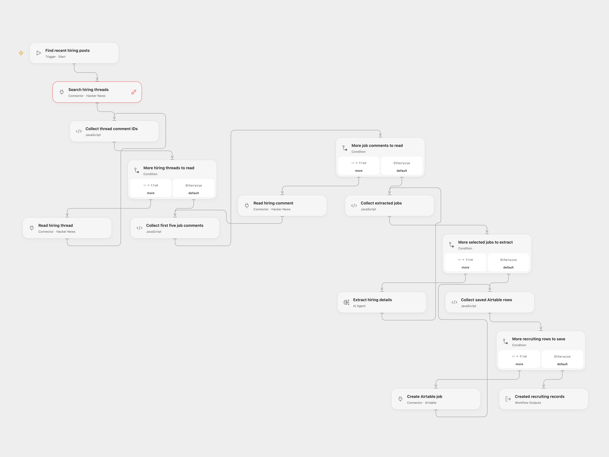

# Hacker News Hiring to Airtable

Find recent Who is hiring threads and save structured recruiting records from the first five job comments.

<picture>
  <source media="(prefers-color-scheme: dark)" srcset="preview-dark.png">
  
</picture>

[Open Flow JSON](templates/hacker-news-hiring-to-airtable.openflow.json) · [n8n JSON](templates/hacker-news-hiring-to-airtable.n8n.json)

## Setup

Choose an available model on **Extract one structured hiring record**. Configure your Airtable connection, base and table on **Create one Airtable job record**. Create text columns `company`, `title`, `location`, `type`, `salary`, `description`, `apply_url` and `company_url`. Hacker News reads need no login; enable its custom API access for the date-sorted phrase search.

For n8n, configure the OpenAI model and Airtable credential, base and table on their respective nodes.

## Run

Start manually. Search the newest 30 story matches for the source phrase, then keep stories created within the last 30 days. Read all their immediate comment IDs and comment texts in returned order. After all reads finish, retain the source's first five comments, extract each into a hiring record and save one Airtable row per selected comment. No replies, emails or job applications are sent.

Both formats preserve the five-comment limit. The Open Flow result returns created record IDs associated with comment IDs. A read or extraction failure prevents every Airtable write; a write failure stops later writes. Inspect Airtable before repeating a run whose write response was lost. Repeated runs can create duplicate rows.

The model extracts company, role, location, employment type, work arrangement, compensation, description and application/company URLs when present. Missing fields can remain absent or null. The source does not save `work_location` to Airtable; the same eight source columns are saved here. Model judgments and extracted links need review. Open Flow uses a tool-free native Agent with one model round and service generation settings; n8n uses its native LLM Chain, structured parser and OpenAI adapter with two additional transient retries. Results can differ.

Complete ID collections and selected comment content must fit execution and Code limits, including 1 MiB per Code input/result in the inspected Open Flow host. Oversized batches fail rather than silently truncate. Search results are a 30-hit window, not an exhaustive historical job archive. Text cleaning follows the source's simple HTML/entity/whitespace substitutions; it is not a complete HTML decoder.

## Changes to the source

- Replace the browser-specific Algolia request and shared-index credential with Hacker News's public date-sorted API.
- Read story IDs from `objectID`, repair nullable JSON Schema types and return proper n8n Code items.
- Preserve collection phase boundaries, validate records and expose confirmed Airtable IDs.

Source and license

Adapted from [Hacker News Job Listing Scraper and Parser](https://github.com/enescingoz/awesome-n8n-templates/blob/827110332c21cbe000ab13f6d292d5adb1f1f8db/AI_Research_RAG_and_Data_Analysis/Hacker%20News%20Job%20Listing%20Scraper%20and%20Parser.json) in [enescingoz/awesome-n8n-templates](https://github.com/enescingoz/awesome-n8n-templates).

Source collection notice: © 2024–2026 Enes Cingoz, [CC BY 4.0](https://github.com/enescingoz/awesome-n8n-templates/blob/827110332c21cbe000ab13f6d292d5adb1f1f8db/LICENSE). The source export does not identify a separate template author or license. See [repository licensing](../../README.md#licensing) for the scope of OOMOL contributions and third-party material.

