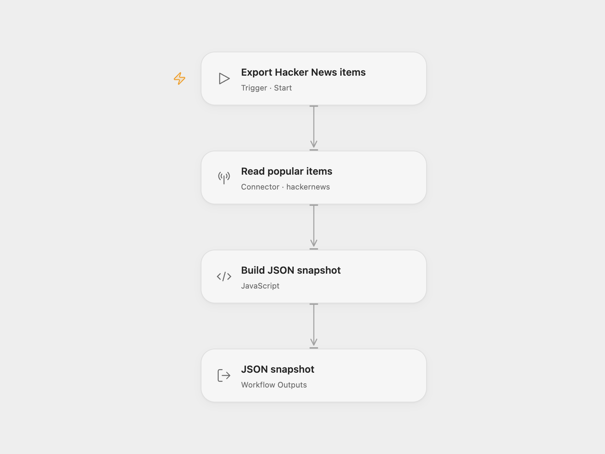

# Hacker News Popular Items

Export up to fifty items from Algolia's popularity-ranked Hacker News search as one JSON string. Each item contains `title`, `points`, `url`, `created_at` and `author`. Use the snapshot as input to another workflow or a content research task.

## Use

Import the Open Flow JSON and run **Export Hacker News items**, or call its Start entry from another workflow. Your Open Flow deployment needs Connector configured and permission to use the Hacker News custom API. Hacker News data itself needs no login or API key.

In n8n, import the JSON and call **Export Hacker News Items** with Execute Sub-workflow. The workflow accepts no required input. It returns one item with `response` and `count`; Open Flow exposes the same two outputs. Parse `response` as JSON to read the array. An empty result returns `"[]"` with count zero.

The read uses Algolia `/api/v1/search`, an empty query, no tag or date filter and a limit of fifty. It preserves the returned order. These are popular items from Algolia's index, which can include different item types. This is not the current Hacker News front page or a guarantee of complete all-time coverage. Fields unavailable for an item remain JSON `null`, and zero points remain zero.

There is one read and no pagination, automatic retry or stored history. A non-200, malformed response or invalid selected field stops without a snapshot. Open Flow's Provider Proxy limits the response to 4 MiB and the request to 30 seconds. The n8n HTTP step also uses a 30-second timeout and the HTTPS endpoint without redirects.

## Changes to the source

- Extract the independent Execute Workflow Trigger → Hacker News → field selection → JSON branch from the source. The parent chat interface and its tool are outside this template.
- Use the Hacker News Provider's custom API for the original empty-query, fifty-item read. Its search Action requires a nonempty query and caps a page at twenty; the latest-post and Firebase feeds have different ordering.
- Use the canonical HTTPS endpoint in n8n's native HTTP step. The original Hacker News node used HTTP.
- Read the plain `title` field instead of highlight markup, preserve missing text/points as `null`, and return a defined empty snapshot. Check the response before returning data. Add the item count alongside the JSON string.

<picture>
  <source media="(prefers-color-scheme: dark)" srcset="preview-dark.png">
  
</picture>

[Open Flow JSON](templates/hacker-news-popular-items.openflow.json) · [n8n JSON](templates/hacker-news-popular-items.n8n.json)

## Source and license

Adapted from the independent Hacker News data branch of [AI chat with any data source (using the n8n workflow tool)](https://github.com/enescingoz/awesome-n8n-templates/blob/827110332c21cbe000ab13f6d292d5adb1f1f8db/OpenAI_and_LLMs/AI%20chat%20with%20any%20data%20source%20(using%20the%20n8n%20workflow%20tool).json) in [Enes Cingoz's awesome-n8n-templates](https://github.com/enescingoz/awesome-n8n-templates), pinned to `827110332c21cbe000ab13f6d292d5adb1f1f8db`. Source collection notice: © 2024–2026 Enes Cingoz, [CC BY 4.0](https://github.com/enescingoz/awesome-n8n-templates/blob/827110332c21cbe000ab13f6d292d5adb1f1f8db/LICENSE). The export does not identify a separate template author or license. See [repository licensing](../../README.md#licensing).

API references: [Hacker News Search](https://hn.algolia.com/api) and its [indexing/ranking configuration](https://github.com/algolia/hn-search#indexing-configuration).
