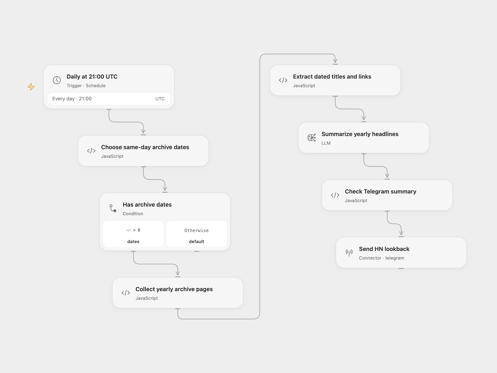

# Hacker News Yearly Lookback

Read the Hacker News front page for the same UTC calendar day across years, choose 10–15 interesting headlines with Gemini, and send one themed Markdown summary to Telegram.

<picture>
  <source media="(prefers-color-scheme: dark)" srcset="preview-dark.png">
  
</picture>

[Open Flow JSON](templates/hacker-news-yearly-lookback.openflow.json) · [n8n JSON](templates/hacker-news-yearly-lookback.n8n.json)

## Setup

In Open Flow, select a configured `gemini-3.8-flash` model in **Summarize yearly headlines**, connect your Telegram bot in **Send HN lookback**, and replace the chat ID. In n8n, select a Google Gemini credential on **Google Gemini Chat Model** and your bot credential/chat ID on **Telegram**.

Review the schedule, then publish and enable the workflow. Both formats run daily at 21:00 UTC. Dates are calculated in UTC; changing the trigger timezone does not change this calendar basis.

Gemini 3.8 Flash is listed in the [current Gemini model catalog](https://ai.google.dev/gemini-api/docs/models). This adaptation updates the source's Gemini 1.5 Pro model. A different configured text model can change the selected stories and wording; review its results for your audience.

## Behavior

The workflow requests this month and day for every year from the run's year down to 2007, newest year first. It retains the source's 2007-02-19 cutoff. February 29 skips years without that date. If no dates are eligible, no requests, model call, or message are made.

Each date reads one public `/front?day=YYYY-MM-DD` page, without paging through additional archive pages. Both formats use a 30-second per-page timeout and reject redirects. Open Flow waits for each page to finish, then waits three seconds before requesting the next; it limits the collection task to 30 minutes and each response to its HTTP runtime's 1 MiB limit. n8n retains the source's three-second request-start spacing, so slow requests can overlap. Both formats wait for all requested pages before extraction and summarization.

The archive's title links are kept with their requested date. Absolute HTTP(S) links are preserved; archive-relative links use the Hacker News origin. One model generation step receives the complete dated headline set and the source's summary prompt. The requested 10–15 headlines and themes are model guidance, not a guaranteed count or factual verification.

An HTTP or extraction failure prevents the model and notification. Empty or oversized model output stops before Telegram. The summary is sent using Telegram's Markdown mode and must fit its 4,096-character limit; invalid model-generated Markdown can also fail delivery. No workflow-level retry, persistent checkpoint, or cross-run deduplication is configured. Model adapters and providers can retry transient requests internally. Repeating a run can send another summary.

Inspiration &amp; credits

## Changes to the source

- Use consistent UTC dates, preserve the requested month/day for 2007, and skip invalid leap-day dates instead of shifting them into March.
- Extract headline URLs alongside their titles and preserve each requested date directly.
- Replace the historical Gemini model configuration with Gemini 3.8 Flash while retaining the complete summary prompt.
- Make response format, timeout, redirect behavior, and Telegram message validation explicit.
- Keep headline link handling compatible with n8n's Code runtime.

Adapted from [Hacker News Throwback Machine - See What Was Hot on This Day, Every Year!](https://github.com/enescingoz/awesome-n8n-templates/blob/827110332c21cbe000ab13f6d292d5adb1f1f8db/Other_Integrations_and_Use_Cases/Hacker%20News%20Throwback%20Machine%20-%20See%20What%20Was%20Hot%20on%20This%20Day%2C%20Every%20Year!.json) in [enescingoz/awesome-n8n-templates](https://github.com/enescingoz/awesome-n8n-templates).

Source collection notice: © 2024–2026 Enes Cingoz, [CC BY 4.0](https://github.com/enescingoz/awesome-n8n-templates/blob/827110332c21cbe000ab13f6d292d5adb1f1f8db/LICENSE). The source export does not identify a separate template author or license. This adaptation includes the changes listed above; see [repository licensing](../../README.md#licensing) for the scope of OOMOL contributions and third-party material.

