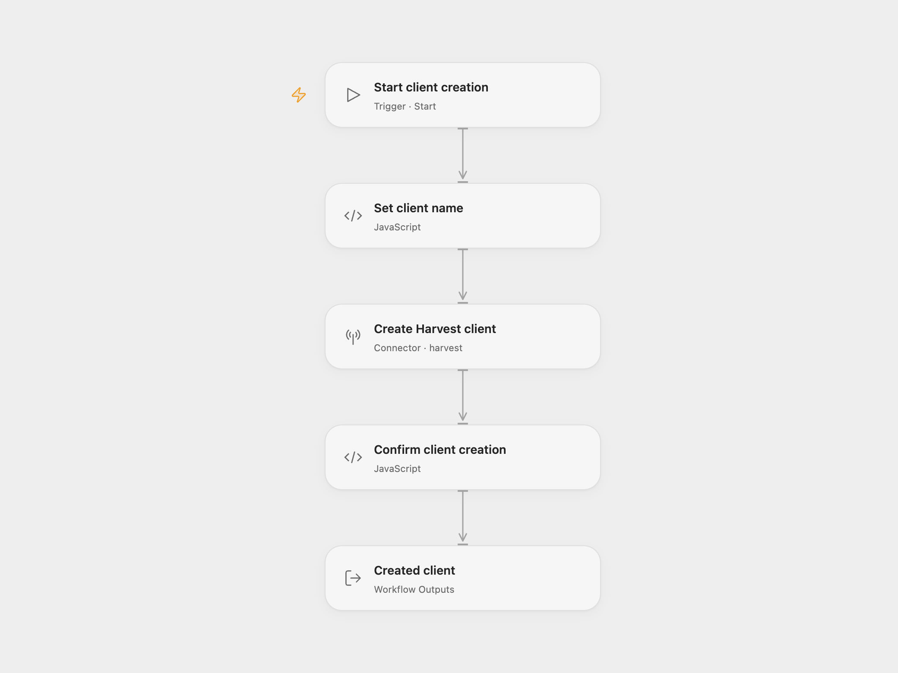

# Harvest Client Creator

Create a Harvest client with a configured name and return its complete record.

<picture>
  <source media="(prefers-color-scheme: dark)" srcset="preview-dark.png">
  
</picture>

[Open Flow JSON](templates/harvest-client-creator.openflow.json) · [n8n JSON](templates/harvest-client-creator.n8n.json)

## Setup

Set the name in **Set client name**. In **Create Harvest client**, select a Harvest administrator account and allow **Provider API** access. The connection manages its token and Harvest account ID. Provider API permission is separate from individual Action permissions. Run manually after setup.

In n8n, select Harvest credentials in **Harvest**, choose the destination account ID and replace the client name. Use an administrator account that can create clients.

The workflow sends one client creation request. It accepts the completed HTTP 201 response and returns the complete client record. The client’s other properties use Harvest defaults.

Each manual run creates another client. There is no lookup, upsert or duplicate detection. Errors and unexpected responses stop the workflow without a retry or rollback. If a write times out, check Harvest before running it again.

## Changes to the source

- Replace the empty client name and account selection with setup placeholders.
- In Open Flow, use the Harvest Provider API for client creation, which has no equivalent Action in the current catalog.
- Validate the completed response and expose the created client.

## Source and license

Adapted from [Create a client in Harvest](https://github.com/Zie619/n8n-workflows/blob/ae8cf6dc5b873cbb4f74587aa9180ed3a9f70682/workflows/Manual/0088_Manual_Harvest_Create_Triggered.json) in [Zie619/n8n-workflows](https://github.com/Zie619/n8n-workflows). The source export does not identify a separate template author or license.

The collection’s [MIT notice](https://github.com/Zie619/n8n-workflows/blob/94007c1445d9258a7da116646b79473e7c7c3282/LICENSE) is pinned at a later revision. This is the collection notice at that revision; it does not establish a separate original template author's license. Our changes are listed above; see [repository licensing](../../README.md#licensing).

> MIT License
>
> Copyright (c) 2025 Zie619
>
> Permission is hereby granted, free of charge, to any person obtaining a copy
> of this software and associated documentation files (the "Software"), to deal
> in the Software without restriction, including without limitation the rights
> to use, copy, modify, merge, publish, distribute, sublicense, and/or sell
> copies of the Software, and to permit persons to whom the Software is
> furnished to do so, subject to the following conditions:
>
> The above copyright notice and this permission notice shall be included in all
> copies or substantial portions of the Software.
>
> THE SOFTWARE IS PROVIDED "AS IS", WITHOUT WARRANTY OF ANY KIND, EXPRESS OR
> IMPLIED, INCLUDING BUT NOT LIMITED TO THE WARRANTIES OF MERCHANTABILITY,
> FITNESS FOR A PARTICULAR PURPOSE AND NONINFRINGEMENT. IN NO EVENT SHALL THE
> AUTHORS OR COPYRIGHT HOLDERS BE LIABLE FOR ANY CLAIM, DAMAGES OR OTHER
> LIABILITY, WHETHER IN AN ACTION OF CONTRACT, TORT OR OTHERWISE, ARISING FROM,
> OUT OF OR IN CONNECTION WITH THE SOFTWARE OR THE USE OR OTHER DEALINGS IN THE
> SOFTWARE.
