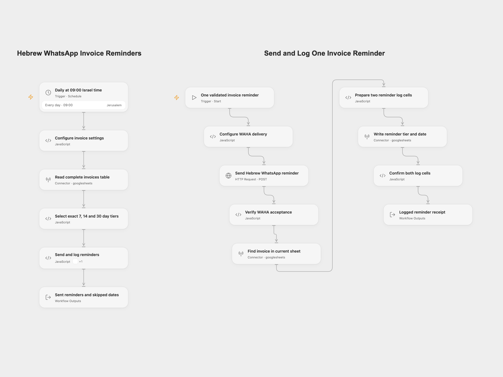

# Hebrew WhatsApp Invoice Reminders

Every morning at 09:00 in `Asia/Jerusalem`, find open invoices exactly 7, 14 or 30 calendar days overdue. Send the corresponding Hebrew message through your WAHA WhatsApp session, then record that reminder in Google Sheets.

<picture>
  <source media="(prefers-color-scheme: dark)" srcset="preview-dark.png">
  
</picture>

## Prepare the invoice table

Use a Google Sheets tab with unique, nonempty headers:

| InvoiceID | CustomerName | Amount | DueDate | Phone | Status | LastReminder | LastReminderDate |
| --- | --- | --- | --- | --- | --- | --- | --- |
| INV-001 | Example customer | 150 | 2026-01-01 | +972501234567 | open | | |

Each selected `InvoiceID` must identify exactly one row in the tab. Keep identifiers as text if leading zeros matter. `Status` must equal `open`. Amount is inserted into the Hebrew message as the sheet supplies it, followed by `₪`; the workflow does not calculate tax, balances or currency conversion.

Due dates can be `YYYY-MM-DD`, day/month/year with one or two digits, or month/day/year when the day-first interpretation is invalid. For example, `03/04/2026` means 3 April. ISO timestamps must include `Z` or a numeric offset and are evaluated in the configured timezone. Prefer unambiguous date-only values. Invalid or empty due dates are skipped and counted in Open Flow.

Phone numbers must be Israeli national numbers or contain country code `972`. Spaces, dashes and parentheses are accepted. A leading national `0` is replaced with `972`; an unprefixed number receives `972`. A selected invoice with an invalid phone, missing ID or duplicate ID stops before any reminder is sent.

## Configure Open Flow

Import `templates/hebrew-whatsapp-invoice-reminders.openflow.json`. The bundle includes **Hebrew WhatsApp Invoice Reminders** and **Send and Log One Invoice Reminder**.

1. In the main workflow’s **Configure invoice settings**, set your spreadsheet ID, tab name and processing timezone. Select your Google Sheets account on **Read complete invoices table**.
2. In the worker’s **Configure WAHA delivery**, replace the endpoint with your HTTPS `/api/sendText` URL and set the working session name. The WAHA endpoint must be reachable from the Open Flow server within its outbound network rules. The default session is `default`.
3. Create a secret Variable containing the WAHA API key. In **Send Hebrew WhatsApp reminder**, bind **Authentication Token** (`auth.token`) to that Variable. The request sends it in `X-Api-Key`. The shared file contains no key or Variable binding.
4. Select the Google Sheets account on the worker’s read and write steps, with permission to edit this spreadsheet.
5. Publish **Send and Log One Invoice Reminder**, then refresh **Send and log reminders** in the main workflow to select the worker’s published interface. Publish and enable the main schedule.

If changing timezone, update both the main schedule and the processing-timezone setting. Review the template using a test sheet and a WAHA session you control before enabling the daily schedule.

## Configure n8n

Import `templates/hebrew-whatsapp-invoice-reminders.n8n.json`. Edit the settings object in **Configure Invoice Sheet and Timezone** and the endpoint/session object in **Configure WAHA Delivery**. Select Google Sheets OAuth2 credentials on the three Sheets HTTP steps. On **Post WhatsApp Reminder**, select Header Auth credentials with name `X-Api-Key` and your WAHA API key as the value. Confirm the workflow timezone and activate the schedule.

The two formats use the same Hebrew messages and selection rules. n8n uses its native loop and Wait node; Open Flow calls the bundled worker in sequence.

## Sending and logging

An invoice is selected only on its exact 7th, 14th or 30th overdue calendar day. There is no catch-up when a run misses that day. `LastReminder` and `LastReminderDate` are logs; they do not suppress another run on the same day. Repeating a run can send the same reminder again.

Each invoice is sent once, then logged before the next invoice starts. WAHA must return HTTP 201, a message ID and an outgoing-message result without a failure acknowledgement. This confirms API acceptance, not delivery or reading by the customer. The workflow then reads the current tab, matches the invoice ID again, and writes only `LastReminder` and `LastReminderDate`. It verifies both returned cell values. Other invoice fields remain intact. Keep the sheet stable during a run; the read and write are separate operations without a row lock.

There is a three-second wait between completed invoices. Open Flow allows up to 30 seconds per HTTP step and two hours for the collection step. No automatic workflow retry is configured. A request error, uncertain send, missing/duplicate current invoice or unconfirmed log stops later invoices. Earlier completed invoices stay logged. A message may already have been sent when logging fails; check WAHA and the sheet before repeating an uncertain run.

## Changes to the source

- Make Israel time explicit for the daily schedule, date comparison and log date. Capture the processing date once per run and use calendar-day arithmetic across daylight-saving changes.
- Validate selected Israeli phone numbers and unique invoice IDs before sending.
- Keep the source’s exact overdue tiers and Hebrew message text. Preserve its day-first date priority and same-day repeat behavior.
- Send and verify each reminder, then log it before continuing. The source sent the whole batch before starting its sheet-update node.
- Read and update the sheet through the existing Google Sheets Actions in Open Flow and equivalent Google Sheets OAuth2 HTTP requests in n8n. This keeps complete header/row handling and verifies the two updated log cells.
- Use WAHA’s documented `X-Api-Key` authentication and check acceptance instead of marking every successful HTTP response as sent.
- Remove account identifiers and leave all credentials and endpoints for your configuration.

## Source and license

Adapted from [Send Escalating WhatsApp Invoice Reminders from Google Sheets (Hebrew)](https://github.com/enescingoz/awesome-n8n-templates/blob/827110332c21cbe000ab13f6d292d5adb1f1f8db/WhatsApp/Send%20Escalating%20WhatsApp%20Invoice%20Reminders%20from%20Google%20Sheets%20(Hebrew).json) in [Enes Cingoz’s awesome-n8n-templates](https://github.com/enescingoz/awesome-n8n-templates), pinned to `827110332c21cbe000ab13f6d292d5adb1f1f8db`, under [CC BY 4.0](https://github.com/enescingoz/awesome-n8n-templates/blob/827110332c21cbe000ab13f6d292d5adb1f1f8db/LICENSE).

API references: [WAHA text messages](https://waha.devlike.pro/docs/how-to/send-messages/#send-text), [WAHA OpenAPI](https://waha.devlike.pro/swagger/openapi.json), [Google Sheets values](https://developers.google.com/workspace/sheets/api/reference/rest/v4/spreadsheets.values/get) and [batch value updates](https://developers.google.com/workspace/sheets/api/reference/rest/v4/spreadsheets.values/batchUpdate). The WAHA contract was checked against the published `2026.10.1` specification. No live invoice or WhatsApp account was used in verification.
