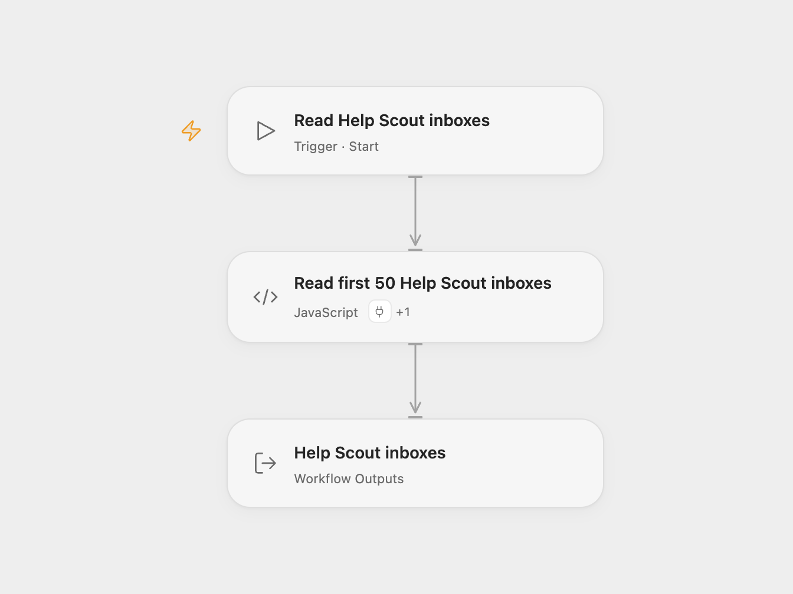

# Help Scout Inbox Reader

Read up to 50 Help Scout inboxes, including their IDs, names, email addresses and other returned properties.

<picture>
  <source media="(prefers-color-scheme: dark)" srcset="preview-dark.png">
  
</picture>

[Open Flow JSON](templates/helpscout-inbox-reader.openflow.json) · [n8n JSON](templates/helpscout-inbox-reader.n8n.json)

## Setup

In Open Flow, open **Read first 50 Help Scout inboxes**, choose your Help Scout account under **Actions**, and allow `helpscout.list_inboxes`. In n8n, choose Help Scout OAuth2 credentials in **HelpScout**. Run the workflow manually. The connected account needs access to the inboxes you want to read.

The workflow reads inboxes, called mailboxes in the API. It retains complete inbox objects and stops at 50 records or the end of the list. Help Scout normally returns 50 inboxes per page. If a shorter page has more pages, Open Flow reads them in order using Help Scout’s page metadata. Missing or inconsistent pagination information stops the run rather than returning an unverified partial list. An empty account returns an empty array.

This workflow does not read conversations or customers, create inboxes or change their settings. A failed request stops the run without an automatic retry.

## Changes to the source

- Make the source’s 50-inbox limit explicit.
- Expose complete inbox records as an Open Flow output.

Source and license

Adapted from [Help Scout mailbox list workflow](https://github.com/Zie619/n8n-workflows/blob/ae8cf6dc5b873cbb4f74587aa9180ed3a9f70682/workflows/Manual/1034_Manual_Helpscout_Automate_Triggered.json) in [Zie619/n8n-workflows](https://github.com/Zie619/n8n-workflows). The source export does not identify a separate template author or license.

The collection’s [MIT notice](https://github.com/Zie619/n8n-workflows/blob/94007c1445d9258a7da116646b79473e7c7c3282/LICENSE) is pinned at a later revision. This is the collection notice at that revision; it does not establish a separate original template author's license. Our changes are listed above; see [repository licensing](../../README.md#licensing).

> MIT License
>
> Copyright (c) 2025 Zie619
>
> Permission is hereby granted, free of charge, to any person obtaining a copy
> of this software and associated documentation files (the "Software"), to deal
> in the Software without restriction, including without limitation the rights
> to use, copy, modify, merge, publish, distribute, sublicense, and/or sell
> copies of the Software, and to permit persons to whom the Software is
> furnished to do so, subject to the following conditions:
>
> The above copyright notice and this permission notice shall be included in all
> copies or substantial portions of the Software.
>
> THE SOFTWARE IS PROVIDED "AS IS", WITHOUT WARRANTY OF ANY KIND, EXPRESS OR
> IMPLIED, INCLUDING BUT NOT LIMITED TO THE WARRANTIES OF MERCHANTABILITY,
> FITNESS FOR A PARTICULAR PURPOSE AND NONINFRINGEMENT. IN NO EVENT SHALL THE
> AUTHORS OR COPYRIGHT HOLDERS BE LIABLE FOR ANY CLAIM, DAMAGES OR OTHER
> LIABILITY, WHETHER IN AN ACTION OF CONTRACT, TORT OR OTHERWISE, ARISING FROM,
> OUT OF OR IN CONNECTION WITH THE SOFTWARE OR THE USE OR OTHER DEALINGS IN THE
> SOFTWARE.

