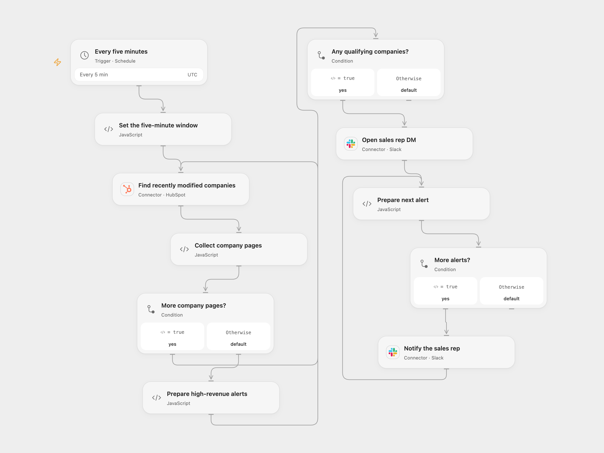

# High-Revenue HubSpot Companies to Slack

Notify a Slack user about recently modified HubSpot companies with annual revenue whose integer value exceeds 5 million.

<picture>
  <source media="(prefers-color-scheme: dark)" srcset="preview-dark.png">
  
</picture>

[Open Flow JSON](templates/high-revenue-hubspot-companies-to-slack.openflow.json) · [n8n JSON](templates/high-revenue-hubspot-companies-to-slack.n8n.json)

## Setup

Connect HubSpot in **Find recently modified companies** with company search access. Connect the same Slack account in **Open sales rep DM** and **Notify the sales rep**, and set the recipient Slack user ID in **Open sales rep DM**. Grant the account permission to open and send direct messages. In n8n connect HubSpot and Slack credentials and choose the recipient user in **Notify sales rep**. Enable one format only.

## Behavior

Every five minutes, the workflow finds companies modified in the preceding five minutes, then sends one Slack direct message per company whose annual revenue, converted to an integer by truncating its fractional part, is strictly greater than 5,000,000. For example, 5,000,000.9 does not qualify. It includes company name, website, revenue and employee count. The original node uses HubSpot’s recently modified companies endpoint, so updates can trigger alerts as well as new companies. The source label says leads created, but the endpoint includes modifications.

Open Flow searches HubSpot using last modification time and follows pages before opening a DM. It stops before Slack if the search fails, a cursor repeats, the search reaches 10,000 results, or a required company value is invalid. HubSpot search is indexed and can lag behind updates; the moving five-minute window can miss late-indexed changes. Overlapping runs or multiple changes can also produce duplicate messages. There is no persistent checkpoint or deduplication. n8n includes its default link to the workflow in each message; Open Flow does not add that link.

The source schedule used the n8n instance timezone. Open Flow starts at five-minute UTC boundaries; n8n retains its Schedule Trigger with a stable second within each minute. If a Slack call fails or its outcome is uncertain, earlier messages may already have been sent; check Slack before rerunning. No automatic retry or rollback is configured.

## Changes to the source

- Replace the private recipient and credentials; request the company properties needed for the filter and message.
- Use the current HubSpot search Action with explicit last-modified filtering, pagination and a safety stop at the search limit in Open Flow.
- Escape Slack control characters, validate message data before sending, while n8n retains its default workflow link in each message.

Source and license

Adapted from [Send a notification to Slack when a new high-quality lead is added to Hubspot](https://github.com/Zie619/n8n-workflows/blob/ae8cf6dc5b873cbb4f74587aa9180ed3a9f70682/workflows/Schedule/0432_Schedule_Filter_Create_Scheduled.json) in [Zie619/n8n-workflows](https://github.com/Zie619/n8n-workflows). The matching [n8n community listing](https://n8n.io/workflows/2131-send-a-notification-to-slack-when-a-new-high-quality-lead-is-added-to-hubspot/) credits Ricardo Espinozaas. The original template does not state a separate license.

The collection’s [MIT notice](https://github.com/Zie619/n8n-workflows/blob/94007c1445d9258a7da116646b79473e7c7c3282/LICENSE) is pinned at a later revision. This is the collection notice at that revision; it does not establish a separate original template author's license. Our changes are listed above; see [repository licensing](../../README.md#licensing).

> MIT License
>
> Copyright (c) 2025 Zie619
>
> Permission is hereby granted, free of charge, to any person obtaining a copy
> of this software and associated documentation files (the "Software"), to deal
> in the Software without restriction, including without limitation the rights
> to use, copy, modify, merge, publish, distribute, sublicense, and/or sell
> copies of the Software, and to permit persons to whom the Software is
> furnished to do so, subject to the following conditions:
>
> The above copyright notice and this permission notice shall be included in all
> copies or substantial portions of the Software.
>
> THE SOFTWARE IS PROVIDED "AS IS", WITHOUT WARRANTY OF ANY KIND, EXPRESS OR
> IMPLIED, INCLUDING BUT NOT LIMITED TO THE WARRANTIES OF MERCHANTABILITY,
> FITNESS FOR A PARTICULAR PURPOSE AND NONINFRINGEMENT. IN NO EVENT SHALL THE
> AUTHORS OR COPYRIGHT HOLDERS BE LIABLE FOR ANY CLAIM, DAMAGES OR OTHER
> LIABILITY, WHETHER IN AN ACTION OF CONTRACT, TORT OR OTHERWISE, ARISING FROM,
> OUT OF OR IN CONNECTION WITH THE SOFTWARE OR THE USE OR OTHER DEALINGS IN THE
> SOFTWARE.

