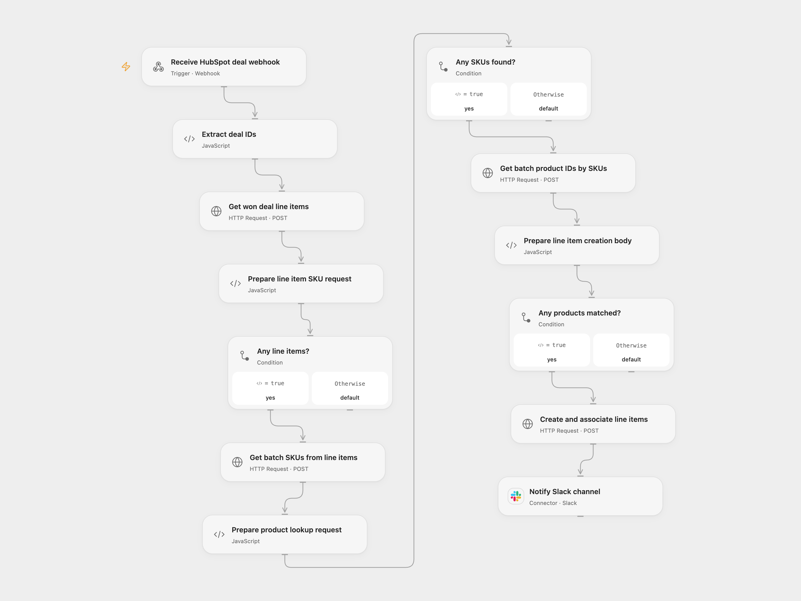

# Replicate HubSpot Deal Line Items

Replicate line items from a won HubSpot deal onto a newly created deal via webhook and notify a Slack channel.

<!-- template-actions:start -->
 
<!-- template-actions:end -->

<picture>
  <source media="(prefers-color-scheme: dark)" srcset="preview-dark.png">
  
</picture>

## Setup

1. Configure a `HUBSPOT_ACCESS_TOKEN` secret variable in Open Flow (from a HubSpot Private App with CRM deals, line items, and products read/write scopes).
2. Connect your Slack account and replace `YOUR_SLACK_CHANNEL_ID` in **Notify Slack channel** with your target channel ID.
3. In your HubSpot Deal workflow (for example, when a deal moves to Closed Won and creates a renewal deal), add a **Send webhook** GET action pointing to this workflow's webhook URL with query parameters `deal_id_won` and `deal_id_created`.
4. For the n8n template, configure your HubSpot App Token and Slack credentials, and update the Slack channel ID.

## Behavior

- Receives `deal_id_won` and `deal_id_created` from the webhook query string (supporting both plain numeric IDs and `0-3-<id>` HubSpot object strings).
- Reads associated line item IDs from `deal_id_won`, fetches their `hs_sku` values, looks up matching HubSpot products by SKU, and batch-creates new line items (quantity `1`) associated to `deal_id_created` using association type ID `20`.
- Skips downstream calls cleanly if no line items, SKUs, or products are found; sends a Slack summary only after line items are created.

Inspiration &amp; credits

## Changes to the source

- Sanitized hardcoded HubSpot portal and n8n instance URLs and Slack channel IDs.
- Added guards for empty line items, SKUs, and products, and supported plain numeric `deal_id_created` values alongside `0-3-<id>` format.
- Bound HubSpot authentication to a `HUBSPOT_ACCESS_TOKEN` secret variable in Open Flow.

Adapted from [Replicate Line Items on New Deal in HubSpot Workflow](https://github.com/Zie619/n8n-workflows/blob/ae8cf6dc5b873cbb4f74587aa9180ed3a9f70682/workflows/Http/0550_HTTP_Slack_Create_Webhook.json) in [Zie619/n8n-workflows](https://github.com/Zie619/n8n-workflows). Attribution: Zie619 / n8n-workflows.

The collection’s [MIT notice](https://github.com/Zie619/n8n-workflows/blob/94007c1445d9258a7da116646b79473e7c7c3282/LICENSE) is pinned at a later revision. This is the collection notice at that revision; it does not establish a separate original template author's license. Our changes are listed above; see [repository licensing](../../README.md#licensing).

> MIT License
>
> Copyright (c) 2025 Zie619
>
> Permission is hereby granted, free of charge, to any person obtaining a copy
> of this software and associated documentation files (the "Software"), to deal
> in the Software without restriction, including without limitation the rights
> to use, copy, modify, merge, publish, distribute, sublicense, and/or sell
> copies of the Software, and to permit persons to whom the Software is
> furnished to do so, subject to the following conditions:
>
> The above copyright notice and this permission notice shall be included in all
> copies or substantial portions of the Software.
>
> THE SOFTWARE IS PROVIDED "AS IS", WITHOUT WARRANTY OF ANY KIND, EXPRESS OR
> IMPLIED, INCLUDING BUT NOT LIMITED TO THE WARRANTIES OF MERCHANTABILITY,
> FITNESS FOR A PARTICULAR PURPOSE AND NONINFRINGEMENT. IN NO EVENT SHALL THE
> AUTHORS OR COPYRIGHT HOLDERS BE LIABLE FOR ANY CLAIM, DAMAGES OR OTHER
> LIABILITY, WHETHER IN AN ACTION OF CONTRACT, TORT OR OTHERWISE, ARISING FROM,
> OUT OF OR IN CONNECTION WITH THE SOFTWARE OR THE USE OR OTHER DEALINGS IN THE
> SOFTWARE.

