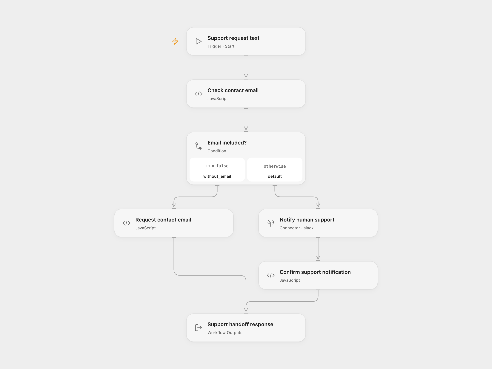

# Human Support Escalation

Check a supplied support request for an email address. Forward the request to a Slack support channel when it includes contact details, or return a prompt asking for an email address.

<picture>
  <source media="(prefers-color-scheme: dark)" srcset="preview-dark.png">
  
</picture>

[Open Flow JSON](templates/human-support-escalation.openflow.json) · [n8n JSON](templates/human-support-escalation.n8n.json)

## Setup and use

Connect Slack in **Notify human support** and replace `YOUR_SLACK_SUPPORT_CHANNEL_ID` with your support channel ID. The app needs `chat:write` and access to the channel. Invite it to private channels you want to use.

In Open Flow, use Run with:

```json
{"chatInput":"I need help with my account. Please contact ada@example.com."}
```

In n8n, select a Slack API credential and your channel in **Notify Human Support**. Edit **Support Request**, then run **Run Support Handoff**. Another workflow can call **Execute Workflow Trigger** with a `chatInput` string.

## Behavior

The workflow retains the source's permissive email-pattern check. It looks for an email-like substring in the supplied text; it does not verify address ownership or deliverability. The source field name `chatInput` is ordinary request text here.

If no email-like substring is present, no Slack request is made. The `response` asks the caller to repeat the question with an email address. The caller can show that text or collect another request.

With an email-like substring, the workflow submits one [Slack message request](https://docs.slack.dev/reference/methods/chat.postMessage/) containing the source support prefix followed by the supplied text. The question and contact address therefore go to the chosen channel. The Open Flow Slack connector trims whitespace at the end of the outgoing message. Slack controls message formatting, link handling and display. The workflow returns the source confirmation text after Slack acknowledges the post. It does not wait for a human reply or send email.

Blank input is rejected. A message destined for Slack must fit the 40,000-character budget including the prefix. Slack failures or missing acknowledgment fields stop the run without a successful confirmation. There are no workflow-level retries, duplicate-request checks or persistent state. Repeating an email-bearing request can post it again.

## Changes to the source

- Extract the independently callable support handoff branch and retain both response texts and the email pattern.
- Add a manual n8n entry while keeping the callable trigger.
- Replace the source Slack destination and credentials with configuration placeholders.
- Validate blank or oversized input and require a Slack acknowledgment before confirming.
- Replace undeclared response assignments with returned objects and disable the n8n instance-link footer.

<details>
<summary>Source and license</summary>

Adapted from the support handoff sub-workflow in [Ask a human for help when the AI doesn't know the answer](https://github.com/enescingoz/awesome-n8n-templates/blob/827110332c21cbe000ab13f6d292d5adb1f1f8db/OpenAI_and_LLMs/Ask%20a%20human%20for%20help%20when%20the%20AI%20doesn_t%20know%20the%20answer.json) in [enescingoz/awesome-n8n-templates](https://github.com/enescingoz/awesome-n8n-templates). This template publishes that callable component; the source's conversational agent is separate.

Source collection notice: © 2024–2026 Enes Cingoz, [CC BY 4.0](https://github.com/enescingoz/awesome-n8n-templates/blob/827110332c21cbe000ab13f6d292d5adb1f1f8db/LICENSE). The source export does not identify a separate template author or license. This adaptation includes the changes above; see [repository licensing](../../README.md#licensing) for OOMOL contributions and third-party material.

</details>
