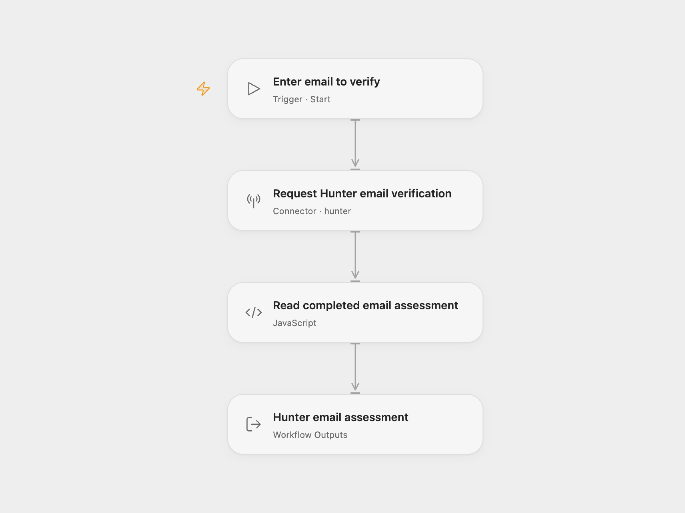

# Hunter Email Verifier

Request a deliverability assessment for one email address and return Hunter’s complete assessment.

<picture>
  <source media="(prefers-color-scheme: dark)" srcset="preview-dark.png">
  
</picture>

[Open Flow JSON](templates/hunter-email-verifier.openflow.json) · [n8n JSON](templates/hunter-email-verifier.n8n.json)

## Setup

Select your Hunter account in **Request Hunter email verification** and allow `hunter.email_verifier`. Run with the **Email** address you want to assess. In n8n, select Hunter credentials and replace the example address in **Hunter**. Your account needs an API key and sufficient verification credits.

Each run makes one verification request. The result includes Hunter’s status, score, SMTP checks, source information and any other returned assessment fields. A result such as `invalid`, `accept_all` or `unknown` is still an assessment; the workflow does not turn these values into a success-or-failure decision. Verification can use account credits and does not send an email message.

Hunter can return a previous verification from up to one month ago. Inspect the returned verification date; it can be `null` when no verification was performed. This assessment does not guarantee delivery to an inbox.

If Hunter is still verifying after its request window, it returns a pending response. This workflow stops without claiming a completed assessment. It has no automatic polling or retry; check the result before running again. A rejected request or malformed response also stops the run.

## Changes to the source

- Replace the example email with user configuration.
- Check that a completed assessment is present and expose it as an Open Flow output.

## Source and license

Adapted from [Hunter email verification workflow](https://github.com/Zie619/n8n-workflows/blob/ae8cf6dc5b873cbb4f74587aa9180ed3a9f70682/workflows/Manual/0991_Manual_Hunter_Automate_Triggered.json) in [Zie619/n8n-workflows](https://github.com/Zie619/n8n-workflows). The source export does not identify a separate template author or license.

The collection’s [MIT notice](https://github.com/Zie619/n8n-workflows/blob/94007c1445d9258a7da116646b79473e7c7c3282/LICENSE) is pinned at a later revision. This is the collection notice at that revision; it does not establish a separate original template author's license. Our changes are listed above; see [repository licensing](../../README.md#licensing).

> MIT License
>
> Copyright (c) 2025 Zie619
>
> Permission is hereby granted, free of charge, to any person obtaining a copy
> of this software and associated documentation files (the "Software"), to deal
> in the Software without restriction, including without limitation the rights
> to use, copy, modify, merge, publish, distribute, sublicense, and/or sell
> copies of the Software, and to permit persons to whom the Software is
> furnished to do so, subject to the following conditions:
>
> The above copyright notice and this permission notice shall be included in all
> copies or substantial portions of the Software.
>
> THE SOFTWARE IS PROVIDED "AS IS", WITHOUT WARRANTY OF ANY KIND, EXPRESS OR
> IMPLIED, INCLUDING BUT NOT LIMITED TO THE WARRANTIES OF MERCHANTABILITY,
> FITNESS FOR A PARTICULAR PURPOSE AND NONINFRINGEMENT. IN NO EVENT SHALL THE
> AUTHORS OR COPYRIGHT HOLDERS BE LIABLE FOR ANY CLAIM, DAMAGES OR OTHER
> LIABILITY, WHETHER IN AN ACTION OF CONTRACT, TORT OR OTHERWISE, ARISING FROM,
> OUT OF OR IN CONNECTION WITH THE SOFTWARE OR THE USE OR OTHER DEALINGS IN THE
> SOFTWARE.
