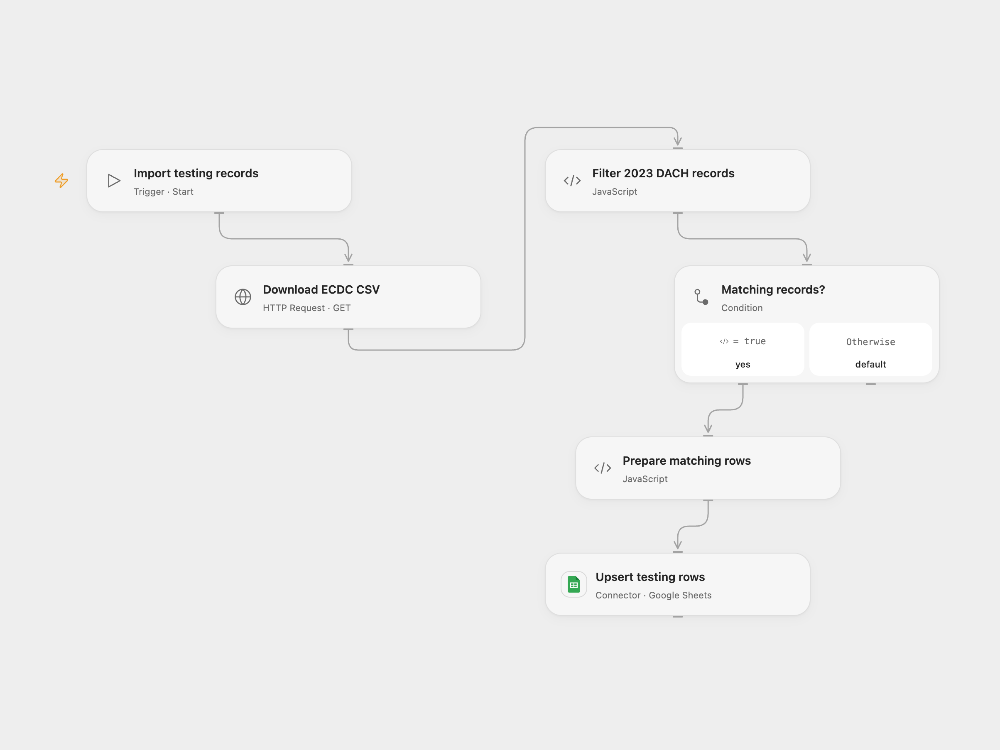

# Import 2023 DACH COVID Testing Data

Import 2023 COVID testing records for Germany, Austria and Switzerland into Google Sheets.

<picture>
  <source media="(prefers-color-scheme: dark)" srcset="preview-dark.png">
  
</picture>

[Open Flow JSON](templates/import-2023-dach-covid-testing-data.openflow.json) · [n8n JSON](templates/import-2023-dach-covid-testing-data.n8n.json)

## Setup and use

Connect Google Sheets and configure the destination spreadsheet ID and sheet name in Upsert testing rows. The destination header should include unique_key and the ECDC columns. In n8n configure its Google Sheets credential and destination. Use one format.

## Behavior

The workflow downloads ECDC testing data, keeps 2023 rows whose country code is DE, AT or CH, and upserts them by country code and year-week. No matching rows causes no write. It updates existing matching keys and adds new ones. Open Flow adds missing destination columns if needed. If an update outcome is unknown, inspect the destination before retrying. Dataset availability and coverage depend on ECDC.

Inspiration &amp; credits

## Changes to the source

- Open Flow batches the source upserts. Both formats normalize the CSV byte-order mark in the country header.

Adapted from [Import 2023 DACH COVID testing data](https://github.com/Zie619/n8n-workflows/blob/ae8cf6dc5b873cbb4f74587aa9180ed3a9f70682/workflows/Filter/1562_Filter_Manual_Import_Webhook.json) in [Zie619/n8n-workflows](https://github.com/Zie619/n8n-workflows). The source export does not identify a separate template author or license.

The collection’s [MIT notice](https://github.com/Zie619/n8n-workflows/blob/94007c1445d9258a7da116646b79473e7c7c3282/LICENSE) is pinned at a later revision. This is the collection notice at that revision; it does not establish a separate original template author's license. Our changes are listed above; see [repository licensing](../../README.md#licensing).

> MIT License
>
> Copyright (c) 2025 Zie619
>
> Permission is hereby granted, free of charge, to any person obtaining a copy
> of this software and associated documentation files (the "Software"), to deal
> in the Software without restriction, including without limitation the rights
> to use, copy, modify, merge, publish, distribute, sublicense, and/or sell
> copies of the Software, and to permit persons to whom the Software is
> furnished to do so, subject to the following conditions:
>
> The above copyright notice and this permission notice shall be included in all
> copies or substantial portions of the Software.
>
> THE SOFTWARE IS PROVIDED "AS IS", WITHOUT WARRANTY OF ANY KIND, EXPRESS OR
> IMPLIED, INCLUDING BUT NOT LIMITED TO THE WARRANTIES OF MERCHANTABILITY,
> FITNESS FOR A PARTICULAR PURPOSE AND NONINFRINGEMENT. IN NO EVENT SHALL THE
> AUTHORS OR COPYRIGHT HOLDERS BE LIABLE FOR ANY CLAIM, DAMAGES OR OTHER
> LIABILITY, WHETHER IN AN ACTION OF CONTRACT, TORT OR OTHERWISE, ARISING FROM,
> OUT OF OR IN CONNECTION WITH THE SOFTWARE OR THE USE OR OTHER DEALINGS IN THE
> SOFTWARE.

SheetJS xlsx 0.20.2 is included under the [Apache License 2.0](https://www.apache.org/licenses/LICENSE-2.0); copyright 2013-present SheetJS. Its full license is included in the workflow module.

