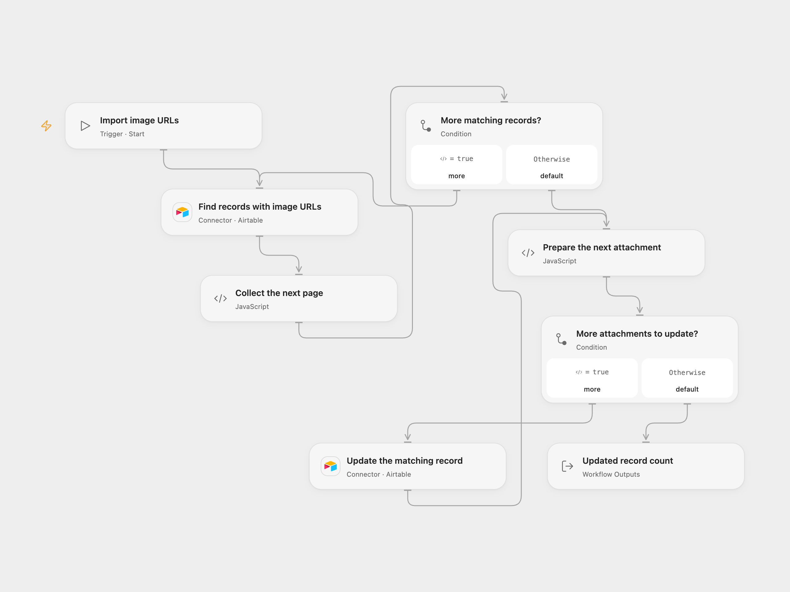

# Import Airtable Image URLs as Attachments

Find Airtable records with image URLs and replace each record’s attachment field with its image.

<picture>
  <source media="(prefers-color-scheme: dark)" srcset="preview-dark.png">
  
</picture>

[Open Flow JSON](templates/import-airtable-image-urls-as-attachments.openflow.json) · [n8n JSON](templates/import-airtable-image-urls-as-attachments.n8n.json)

## Setup

Connect Airtable with read and write permission for the same base and table in both Airtable nodes. Configure the base and table IDs in both nodes. Create a text field named `Image source URL` and an attachment field named `Image attachment`. Each source URL must directly serve the image publicly without credentials so Airtable can fetch it.

In n8n, connect an Airtable Personal Access Token and configure the same base and table in both Airtable nodes. Run one format for each intended operation.

## Behavior

A manual run searches all records whose `Image source URL` is nonempty, then updates each matching record by ID. Each update replaces the entire `Image attachment` field with the image at that record’s URL. Existing attachments in that field are removed; review your table before running. No matching records causes no updates.

Airtable fetches each image after accepting the update. An accepted request does not guarantee that Airtable could download the image. Check the attachment field when URLs may be inaccessible or expired. A failed or uncertain update stops the run; earlier updates remain and an uncertain update may have succeeded. Check the table before retrying. The workflow does not add retries or deduplication. Collected records must fit the host execution limits.

## Changes to the source

- Remove the personal base and table. Replace the source attachment object with Airtable’s array of URL objects so it can populate the attachment field.
- Open Flow explicitly follows all search pages and updates one record per request. n8n keeps its search and update nodes.

Source and license

Adapted from [Upload image URLs as attachments in Airtable](https://github.com/Zie619/n8n-workflows/blob/ae8cf6dc5b873cbb4f74587aa9180ed3a9f70682/workflows/Manual/0377_Manual_Stickynote_Update_Triggered.json) in [Zie619/n8n-workflows](https://github.com/Zie619/n8n-workflows). The source export does not identify a separate template author or license.

The collection’s [MIT notice](https://github.com/Zie619/n8n-workflows/blob/94007c1445d9258a7da116646b79473e7c7c3282/LICENSE) is pinned at a later revision. This is the collection notice at that revision; it does not establish a separate original template author's license. Our changes are listed above; see [repository licensing](../../README.md#licensing).

> MIT License
>
> Copyright (c) 2025 Zie619
>
> Permission is hereby granted, free of charge, to any person obtaining a copy
> of this software and associated documentation files (the "Software"), to deal
> in the Software without restriction, including without limitation the rights
> to use, copy, modify, merge, publish, distribute, sublicense, and/or sell
> copies of the Software, and to permit persons to whom the Software is
> furnished to do so, subject to the following conditions:
>
> The above copyright notice and this permission notice shall be included in all
> copies or substantial portions of the Software.
>
> THE SOFTWARE IS PROVIDED "AS IS", WITHOUT WARRANTY OF ANY KIND, EXPRESS OR
> IMPLIED, INCLUDING BUT NOT LIMITED TO THE WARRANTIES OF MERCHANTABILITY,
> FITNESS FOR A PARTICULAR PURPOSE AND NONINFRINGEMENT. IN NO EVENT SHALL THE
> AUTHORS OR COPYRIGHT HOLDERS BE LIABLE FOR ANY CLAIM, DAMAGES OR OTHER
> LIABILITY, WHETHER IN AN ACTION OF CONTRACT, TORT OR OTHERWISE, ARISING FROM,
> OUT OF OR IN CONNECTION WITH THE SOFTWARE OR THE USE OR OTHER DEALINGS IN THE
> SOFTWARE.

