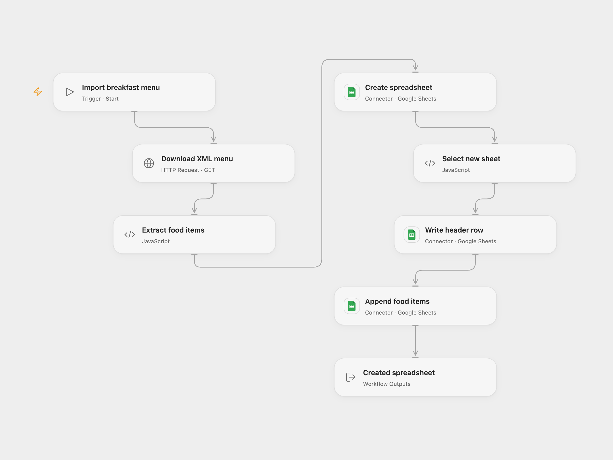

# Import an XML Breakfast Menu to Google Sheets

Download a breakfast menu XML file and create a Google spreadsheet containing its items.

<picture>
  <source media="(prefers-color-scheme: dark)" srcset="preview-dark.png">
  
</picture>

[Open Flow JSON](templates/import-an-xml-breakfast-menu-to-google-sheets.openflow.json) · [n8n JSON](templates/import-an-xml-breakfast-menu-to-google-sheets.n8n.json)

## Setup and use

Connect Google Sheets with permission to create and update spreadsheets, then run manually. In n8n configure its Google Sheets credential. Use one format.

## Behavior

The source URL returned HTTP 403 from the verification environment; successful use depends on the source being accessible from your runtime. The workflow downloads the public W3Schools breakfast menu XML, creates a spreadsheet titled My XML Data, writes food field names as headers and appends one row per food item. It creates a new spreadsheet each run. If a write result is unknown, inspect the new spreadsheet before retrying.

Inspiration &amp; credits

## Changes to the source

- Open Flow uses a bundled XML parser and Google Sheets actions.

Adapted from [Import XML menu data to Google Sheets](https://github.com/Zie619/n8n-workflows/blob/ae8cf6dc5b873cbb4f74587aa9180ed3a9f70682/workflows/Manual/0271_Manual_HTTP_Create_Webhook.json) in [Zie619/n8n-workflows](https://github.com/Zie619/n8n-workflows). The source export does not identify a separate template author or license.

The collection’s [MIT notice](https://github.com/Zie619/n8n-workflows/blob/94007c1445d9258a7da116646b79473e7c7c3282/LICENSE) is pinned at a later revision. This is the collection notice at that revision; it does not establish a separate original template author's license. Our changes are listed above; see [repository licensing](../../README.md#licensing).

> MIT License
>
> Copyright (c) 2025 Zie619
>
> Permission is hereby granted, free of charge, to any person obtaining a copy
> of this software and associated documentation files (the "Software"), to deal
> in the Software without restriction, including without limitation the rights
> to use, copy, modify, merge, publish, distribute, sublicense, and/or sell
> copies of the Software, and to permit persons to whom the Software is
> furnished to do so, subject to the following conditions:
>
> The above copyright notice and this permission notice shall be included in all
> copies or substantial portions of the Software.
>
> THE SOFTWARE IS PROVIDED "AS IS", WITHOUT WARRANTY OF ANY KIND, EXPRESS OR
> IMPLIED, INCLUDING BUT NOT LIMITED TO THE WARRANTIES OF MERCHANTABILITY,
> FITNESS FOR A PARTICULAR PURPOSE AND NONINFRINGEMENT. IN NO EVENT SHALL THE
> AUTHORS OR COPYRIGHT HOLDERS BE LIABLE FOR ANY CLAIM, DAMAGES OR OTHER
> LIABILITY, WHETHER IN AN ACTION OF CONTRACT, TORT OR OTHERWISE, ARISING FROM,
> OUT OF OR IN CONNECTION WITH THE SOFTWARE OR THE USE OR OTHER DEALINGS IN THE
> SOFTWARE.

The bundled fast-xml-parser 4.4.1 is provided under its MIT license, included in the workflow module.

