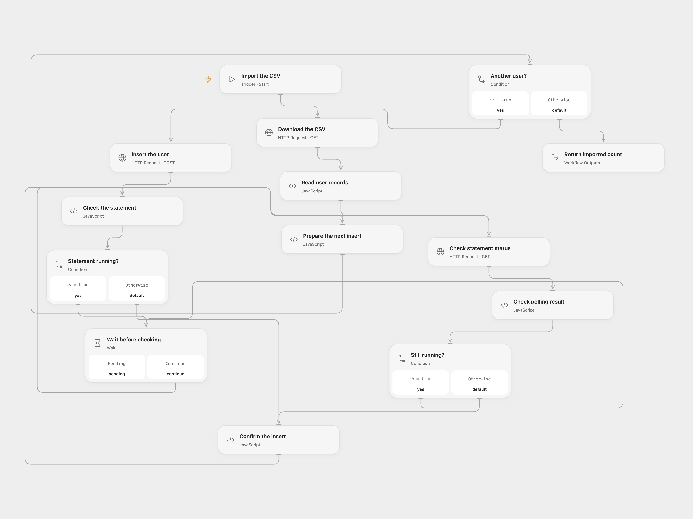

# Import CSV Users to Snowflake

Read user records from a CSV URL and insert them into a Snowflake users table.

<picture>
  <source media="(prefers-color-scheme: dark)" srcset="preview-dark.png">
  
</picture>

[Open Flow JSON](templates/import-csv-users-to-snowflake.openflow.json) · [n8n JSON](templates/import-csv-users-to-snowflake.n8n.json)

## Setup and use

Configure the CSV URL in **Download the CSV**. Its header must contain id, first_name and last_name. In **Prepare the next insert**, set the Snowflake account identifier, warehouse, database and schema. Create a secret Variable named **SNOWFLAKE_TOKEN** with a [Snowflake programmatic access token](https://docs.snowflake.com/en/user-guide/programmatic-access-tokens) authorized to insert into the users table. Its network policy must permit the workflow's requests.

In n8n, connect Snowflake, configure the target table and CSV URL, then run manually.

## Behavior

Insert each CSV row as id, first_name and last_name. Open Flow waits for confirmation of an asynchronous statement before submitting the next row; it stops after 60 status checks. A failed or uncertain insert may have succeeded: inspect the table before retrying. Previously inserted rows are not rolled back when a later insert fails.

Inspiration &amp; credits

## Changes to the source

- Correct first_name to text and use parameterized Snowflake SQL API requests in Open Flow. n8n retains its native Snowflake node.

Adapted from [Import users into Snowflake](https://github.com/Zie619/n8n-workflows/blob/ae8cf6dc5b873cbb4f74587aa9180ed3a9f70682/workflows/Manual/0336_Manual_Snowflake_Automation_Webhook.json) in [Zie619/n8n-workflows](https://github.com/Zie619/n8n-workflows). The source export does not identify a separate template author or license.

The collection’s [MIT notice](https://github.com/Zie619/n8n-workflows/blob/94007c1445d9258a7da116646b79473e7c7c3282/LICENSE) is pinned at a later revision. This is the collection notice at that revision; it does not establish a separate original template author's license. Our changes are listed above; see [repository licensing](../../README.md#licensing).

> MIT License
>
> Copyright (c) 2025 Zie619
>
> Permission is hereby granted, free of charge, to any person obtaining a copy
> of this software and associated documentation files (the "Software"), to deal
> in the Software without restriction, including without limitation the rights
> to use, copy, modify, merge, publish, distribute, sublicense, and/or sell
> copies of the Software, and to permit persons to whom the Software is
> furnished to do so, subject to the following conditions:
>
> The above copyright notice and this permission notice shall be included in all
> copies or substantial portions of the Software.
>
> THE SOFTWARE IS PROVIDED "AS IS", WITHOUT WARRANTY OF ANY KIND, EXPRESS OR
> IMPLIED, INCLUDING BUT NOT LIMITED TO THE WARRANTIES OF MERCHANTABILITY,
> FITNESS FOR A PARTICULAR PURPOSE AND NONINFRINGEMENT. IN NO EVENT SHALL THE
> AUTHORS OR COPYRIGHT HOLDERS BE LIABLE FOR ANY CLAIM, DAMAGES OR OTHER
> LIABILITY, WHETHER IN AN ACTION OF CONTRACT, TORT OR OTHERWISE, ARISING FROM,
> OUT OF OR IN CONNECTION WITH THE SOFTWARE OR THE USE OR OTHER DEALINGS IN THE
> SOFTWARE.

