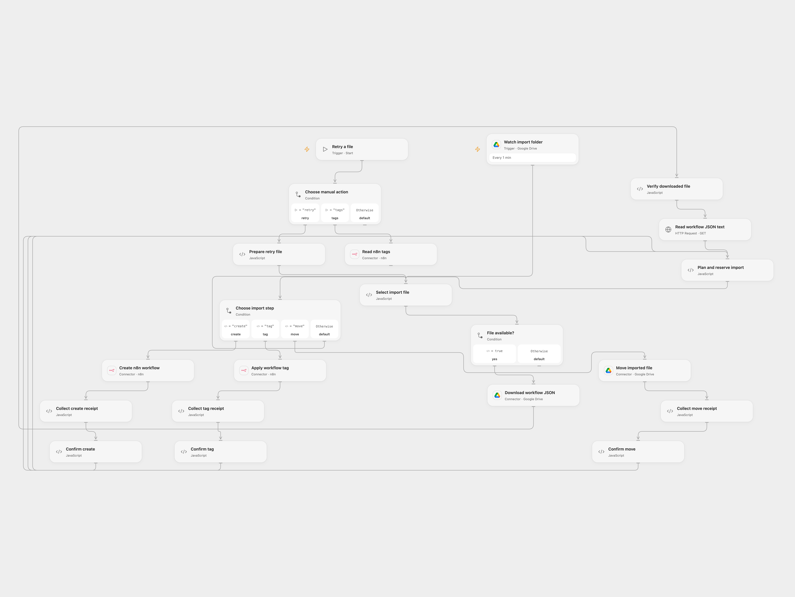

# Import n8n Workflows from Google Drive

Import n8n workflow JSON files from a Drive folder, apply a tag and move them after success.

<!-- template-actions:start -->
 
<!-- template-actions:end -->

<picture>
  <source media="(prefers-color-scheme: dark)" srcset="preview-dark.png">
  
</picture>

## Setup

Connect Google Drive and n8n with permissions to read and move the files and create workflows. Configure the watched source folder, destination folder and the same tag ID in **Plan and reserve import** and confirmation nodes. Enable persistent State. Run **Retry a file** with mode `tags` to inspect the first page of tags, or mode `retry` with file and source folder IDs to retry. Import only trusted workflow exports. Files and execution history can contain sensitive workflow configuration. In n8n configure the source and destination Drive folders, n8n credentials and instance URL, and choose one Data Table with text columns item_key and status for all checkpoint nodes.

## Behavior

Every minute, new files in the source folder are downloaded, checked as JSON and imported to n8n, tagged and moved to the destination. The imported workflow is created with its name, nodes, connections and supported settings. Files larger than 512 KiB stop. Each external write has a pending checkpoint; if a result is uncertain, inspect the destination and enter the key and confirmed or absent in **Plan and reserve import**, then retry with the same file and source folder. For a confirmed create also enter the workflow ID. Clear recovery fields after use and avoid overlapping runs. In n8n a pending Data Table entry stops replay. Inspect the workflow, tags and Drive file; finish or repair any partial operation manually, then delete its checkpoint only when safe.

Inspiration &amp; credits

Retain source file association, verify writes, and stop before retrying an uncertain create, tag or move.

Adapted from [n8n workflow deployer](https://github.com/Zie619/n8n-workflows/blob/ae8cf6dc5b873cbb4f74587aa9180ed3a9f70682/workflows/Code/1814_Code_Extractfromfile_Automate_Webhook.json) in [Zie619/n8n-workflows](https://github.com/Zie619/n8n-workflows). Attribution: Zie619 / n8n-workflows.

The collection’s [MIT notice](https://github.com/Zie619/n8n-workflows/blob/94007c1445d9258a7da116646b79473e7c7c3282/LICENSE) is pinned at a later revision. This is the collection notice at that revision; it does not establish a separate original template author's license. Our changes are listed above; see [repository licensing](../../README.md#licensing).

> MIT License
>
> Copyright (c) 2025 Zie619
>
> Permission is hereby granted, free of charge, to any person obtaining a copy
> of this software and associated documentation files (the "Software"), to deal
> in the Software without restriction, including without limitation the rights
> to use, copy, modify, merge, publish, distribute, sublicense, and/or sell
> copies of the Software, and to permit persons to whom the Software is
> furnished to do so, subject to the following conditions:
>
> The above copyright notice and this permission notice shall be included in all
> copies or substantial portions of the Software.
>
> THE SOFTWARE IS PROVIDED "AS IS", WITHOUT WARRANTY OF ANY KIND, EXPRESS OR
> IMPLIED, INCLUDING BUT NOT LIMITED TO THE WARRANTIES OF MERCHANTABILITY,
> FITNESS FOR A PARTICULAR PURPOSE AND NONINFRINGEMENT. IN NO EVENT SHALL THE
> AUTHORS OR COPYRIGHT HOLDERS BE LIABLE FOR ANY CLAIM, DAMAGES OR OTHER
> LIABILITY, WHETHER IN AN ACTION OF CONTRACT, TORT OR OTHERWISE, ARISING FROM,
> OUT OF OR IN CONNECTION WITH THE SOFTWARE OR THE USE OR OTHER DEALINGS IN THE
> SOFTWARE.

