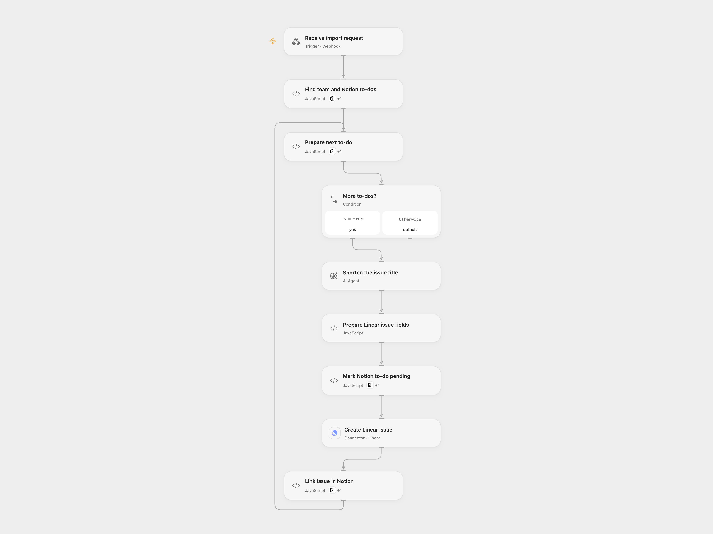

# Import Notion To-Dos into Linear

Create Linear issues from unchecked Notion to-dos, including their nested contents, and add issue links back.

<picture>
  <source media="(prefers-color-scheme: dark)" srcset="preview-dark.png">
  
</picture>

[Open Flow JSON](templates/import-notion-todos-into-linear.openflow.json) · [n8n JSON](templates/import-notion-todos-into-linear.n8n.json)

## Setup

Connect Notion and Linear. Set the secret Variable LINEAR_API_KEY to a Linear API key for reading teams and members, and use the same Linear account for issue creation. Configure the AI model. Import the n8n workflow to use its form; in relay mode set the Open Flow webhook URL, and in direct mode connect its Notion, Linear and model credentials. For both Linear HTTP nodes configure HTTP Header Auth with name `Authorization` and your Linear API key as its value. Enable one mode. The Open Flow webhook is public; restrict access to its URL.

## Behavior

Enter a Notion page URL and an exact Linear team name. Unchecked to-do blocks without an existing Linear marker become issues. Nested block contents are included as Markdown. A leading [name] is matched to a unique team member; unmatched or ambiguous names are noted in the description. Titles longer than 70 characters use a concise model result. The original rich text is retained when the resulting issue link is added to the Notion block.

Before each Linear write the to-do is marked [In Linear pending]. An interrupted or uncertain write may have created the issue. Inspect Linear and the Notion block, then manually add the issue link if it exists or remove the pending marker if it does not. Do not overlap imports or edit those blocks during an import.

Inspiration &amp; credits

## Changes to the source

- Match team names exactly and assign only unique member matches. Paginate Notion reads, match team names exactly and mark pending before issue creation. Open Flow paginates Linear members; n8n considers the first 100 team members. The two Linear lookups use HTTP POST requests with Header Auth.

Adapted from [Import Notion design reviews into Linear](https://github.com/Zie619/n8n-workflows/blob/ae8cf6dc5b873cbb4f74587aa9180ed3a9f70682/workflows/Code/0438_Code_Filter_Create_Webhook.json) in [Zie619/n8n-workflows](https://github.com/Zie619/n8n-workflows). The source export does not identify a separate template author or license.

The collection’s [MIT notice](https://github.com/Zie619/n8n-workflows/blob/94007c1445d9258a7da116646b79473e7c7c3282/LICENSE) is pinned at a later revision. This is the collection notice at that revision; it does not establish a separate original template author's license. Our changes are listed above; see [repository licensing](../../README.md#licensing).

> MIT License
>
> Copyright (c) 2025 Zie619
>
> Permission is hereby granted, free of charge, to any person obtaining a copy
> of this software and associated documentation files (the "Software"), to deal
> in the Software without restriction, including without limitation the rights
> to use, copy, modify, merge, publish, distribute, sublicense, and/or sell
> copies of the Software, and to permit persons to whom the Software is
> furnished to do so, subject to the following conditions:
>
> The above copyright notice and this permission notice shall be included in all
> copies or substantial portions of the Software.
>
> THE SOFTWARE IS PROVIDED "AS IS", WITHOUT WARRANTY OF ANY KIND, EXPRESS OR
> IMPLIED, INCLUDING BUT NOT LIMITED TO THE WARRANTIES OF MERCHANTABILITY,
> FITNESS FOR A PARTICULAR PURPOSE AND NONINFRINGEMENT. IN NO EVENT SHALL THE
> AUTHORS OR COPYRIGHT HOLDERS BE LIABLE FOR ANY CLAIM, DAMAGES OR OTHER
> LIABILITY, WHETHER IN AN ACTION OF CONTRACT, TORT OR OTHERWISE, ARISING FROM,
> OUT OF OR IN CONNECTION WITH THE SOFTWARE OR THE USE OR OTHER DEALINGS IN THE
> SOFTWARE.

