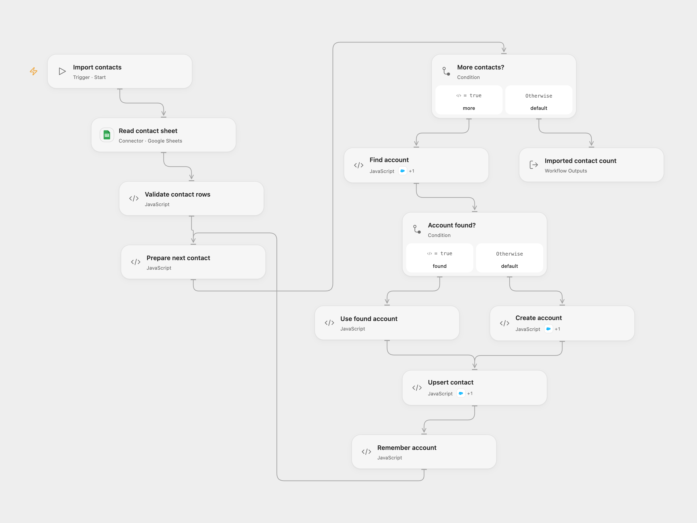

# Import Sheet Contacts to Salesforce

Find or create Salesforce accounts and upsert sheet contacts by email.

<picture>
  <source media="(prefers-color-scheme: dark)" srcset="preview-dark.png">
  
</picture>

[Open Flow JSON](templates/import-sheet-contacts-to-salesforce.openflow.json) · [n8n JSON](templates/import-sheet-contacts-to-salesforce.n8n.json)

## Setup

Use a sheet with unique headers `Company Name`, `First Name`, `Last Name`, and `Email`. Connect Google Sheets and Salesforce with permission to query and create Accounts and upsert Contacts by Email. Contact Email must be available as an idLookup field in your Salesforce organization. Salesforce rejects an upsert when multiple Contacts match an email.

In Open Flow, set the spreadsheet ID and A1 range in **Read contact sheet** (default `'Sheet1'!A:Z`), and select Salesforce connections for **Find account**, **Create account**, and **Upsert contact**. Allow each node's declared Action. In n8n, configure the sheet ID and range and Salesforce credentials on each Salesforce node.

## Behavior

Each run validates the rows, resolves each company to one Salesforce Account with an exactly matching name, creates it if absent, and upserts each Contact by email with first name, last name and AccountId. The workflow reuses an account ID for later rows of the same company in that run. Repeated emails update the same Contact again, so a later row can change its account and name. It stops if a query returns multiple account matches, on invalid account responses, invalid rows or an error. An empty sheet does nothing.

The workflow processes contacts in order. Earlier writes remain if a later request fails; there is no rollback or automatic retry. A lost response may mean a write succeeded, so check Salesforce before retrying. Concurrent account creation or duplicate names can change the outcome.

Inspiration &amp; credits

## Changes to the source

- Replace the private spreadsheet with configuration. The source uses the default A:F range; the templates start with Sheet1 A:Z. Validate rows and account matches. Both formats process rows sequentially and reuse resolved accounts, fixing the source's no-results branch and keeping each contact associated with its company.
- Upsert by Contact Email as in the source. The source Salesforce field spelling `acconuntId` maps to `AccountId` in its native node.

Adapted from [Import sheet contacts to Salesforce](https://github.com/Zie619/n8n-workflows/blob/ae8cf6dc5b873cbb4f74587aa9180ed3a9f70682/workflows/Manual/0257_Manual_GoogleSheets_Create_Triggered.json) in [Zie619/n8n-workflows](https://github.com/Zie619/n8n-workflows). The matching [n8n community listing](https://n8n.io/workflows/1792-create-salesforce-accounts-based-on-google-sheets-data/) credits Tom. The original template does not state a separate license.

The collection’s [MIT notice](https://github.com/Zie619/n8n-workflows/blob/94007c1445d9258a7da116646b79473e7c7c3282/LICENSE) is pinned at a later revision. This is the collection notice at that revision; it does not establish a separate original template author's license. Our changes are listed above; see [repository licensing](../../README.md#licensing).

> MIT License
>
> Copyright (c) 2025 Zie619
>
> Permission is hereby granted, free of charge, to any person obtaining a copy
> of this software and associated documentation files (the "Software"), to deal
> in the Software without restriction, including without limitation the rights
> to use, copy, modify, merge, publish, distribute, sublicense, and/or sell
> copies of the Software, and to permit persons to whom the Software is
> furnished to do so, subject to the following conditions:
>
> The above copyright notice and this permission notice shall be included in all
> copies or substantial portions of the Software.
>
> THE SOFTWARE IS PROVIDED "AS IS", WITHOUT WARRANTY OF ANY KIND, EXPRESS OR
> IMPLIED, INCLUDING BUT NOT LIMITED TO THE WARRANTIES OF MERCHANTABILITY,
> FITNESS FOR A PARTICULAR PURPOSE AND NONINFRINGEMENT. IN NO EVENT SHALL THE
> AUTHORS OR COPYRIGHT HOLDERS BE LIABLE FOR ANY CLAIM, DAMAGES OR OTHER
> LIABILITY, WHETHER IN AN ACTION OF CONTRACT, TORT OR OTHERWISE, ARISING FROM,
> OUT OF OR IN CONNECTION WITH THE SOFTWARE OR THE USE OR OTHER DEALINGS IN THE
> SOFTWARE.

