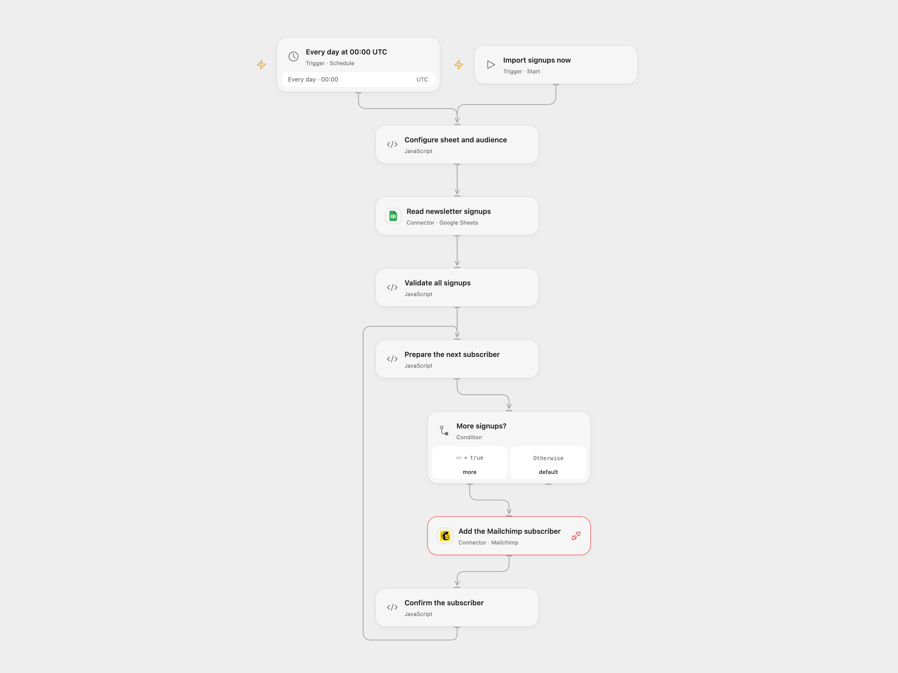

# Import Squarespace Signups to Mailchimp

Add newsletter signups from a Google Sheet to a Mailchimp audience with their signup times.

<picture>
  <source media="(prefers-color-scheme: dark)" srcset="preview-dark.png">
  
</picture>

[Open Flow JSON](templates/import-squarespace-signups-to-mailchimp.openflow.json) · [n8n JSON](templates/import-squarespace-signups-to-mailchimp.n8n.json)

## Setup

Connect Google Sheets and Mailchimp. In **Configure sheet and audience**, set the spreadsheet ID, sheet name and Mailchimp audience ID. The sheet needs unique headers **Email Address**, **Name** and **Submitted On**. Format each signup time as ISO 8601 text with an explicit time zone, such as `2025-01-20T13:45:30Z`. The Mailchimp audience needs an `FNAME` merge field. Open Flow requires Mailchimp Provider API Request permission.

In n8n, set the same sheet, audience and Mailchimp server prefix (for example, `us1`) in **Configure sheet and audience**. Connect a Google Sheets OAuth2 credential to **Read newsletter signups** and a Header Auth credential containing `Authorization: Bearer <Mailchimp API key>` to the Mailchimp HTTP node. Run one format. Only import contacts who agreed to receive marketing: this workflow directly sets `subscribed` and does not send a confirmation request.

## Behavior

Run manually or daily at 00:00 UTC. The workflow validates the entire sheet before writing, then creates each subscriber in order with email, name as `FNAME`, and the original signup timestamp. An empty sheet sends nothing. Invalid rows or duplicate emails stop before any writes. n8n runs at a fixed second within the scheduled minute; Open Flow runs on the minute boundary. Review the time zone and schedule.

The operation creates members only; an existing member causes an error and is not updated or resubscribed. Since rows remain in the sheet, later runs can stop at an existing member before reaching later rows. Select or maintain a sheet containing only new signups. Earlier creates remain after a later failure, and a lost response may still mean a member was created. Inspect Mailchimp before rerunning. No automatic write retry is added.

## Changes to the source

- Remove private sheet and audience values and repair the email expression that appended the row number. Validate signup times and preserve their time zone. Set 00:00 UTC as the starting schedule; the source inherited its instance time zone.
- n8n reads raw sheet values using Google Sheets OAuth2 so duplicate headers can be detected, and uses an authenticated Mailchimp HTTP request because the original node formats the signup timestamp with incorrect minute/second tokens. Open Flow uses the Mailchimp Provider API Request for add-only creation.

Source and license

Adapted from [Create Mailchimp contact based on Squarespace newsletter](https://github.com/Zie619/n8n-workflows/blob/ae8cf6dc5b873cbb4f74587aa9180ed3a9f70682/workflows/Schedule/0795_Schedule_Mailchimp_Create_Scheduled.json) in [Zie619/n8n-workflows](https://github.com/Zie619/n8n-workflows). The matching [n8n community listing](https://n8n.io/workflows/3251-sync-squarespace-newsletter-signups-to-mailchimp-via-google-sheets/) credits bangank36. The original template does not state a separate license.

The collection’s [MIT notice](https://github.com/Zie619/n8n-workflows/blob/94007c1445d9258a7da116646b79473e7c7c3282/LICENSE) is pinned at a later revision. This is the collection notice at that revision; it does not establish a separate original template author's license. Our changes are listed above; see [repository licensing](../../README.md#licensing).

> MIT License
>
> Copyright (c) 2025 Zie619
>
> Permission is hereby granted, free of charge, to any person obtaining a copy
> of this software and associated documentation files (the "Software"), to deal
> in the Software without restriction, including without limitation the rights
> to use, copy, modify, merge, publish, distribute, sublicense, and/or sell
> copies of the Software, and to permit persons to whom the Software is
> furnished to do so, subject to the following conditions:
>
> The above copyright notice and this permission notice shall be included in all
> copies or substantial portions of the Software.
>
> THE SOFTWARE IS PROVIDED "AS IS", WITHOUT WARRANTY OF ANY KIND, EXPRESS OR
> IMPLIED, INCLUDING BUT NOT LIMITED TO THE WARRANTIES OF MERCHANTABILITY,
> FITNESS FOR A PARTICULAR PURPOSE AND NONINFRINGEMENT. IN NO EVENT SHALL THE
> AUTHORS OR COPYRIGHT HOLDERS BE LIABLE FOR ANY CLAIM, DAMAGES OR OTHER
> LIABILITY, WHETHER IN AN ACTION OF CONTRACT, TORT OR OTHERWISE, ARISING FROM,
> OUT OF OR IN CONNECTION WITH THE SOFTWARE OR THE USE OR OTHER DEALINGS IN THE
> SOFTWARE.

