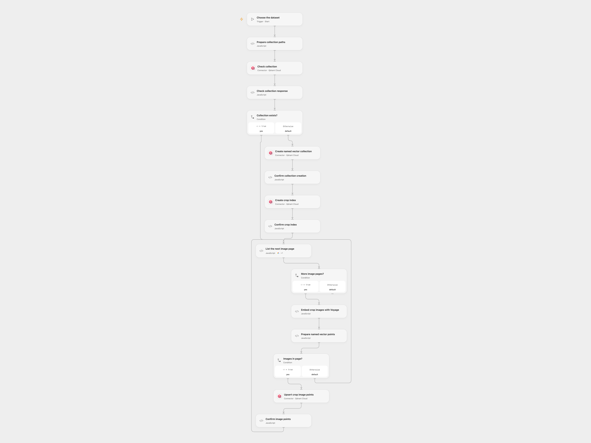

# Index Crop Images in Qdrant

Embed a Cloud Storage image dataset and index the results in Qdrant.

<!-- template-actions:start -->
 
<!-- template-actions:end -->

<picture>
  <source media="(prefers-color-scheme: dark)" srcset="preview-dark.png">
  
</picture>

## Setup

Connect Qdrant Cloud and select a Google Cloud STS Workload Identity Connection in **List the next image page** with permission to list objects. Bind the **Embed crop images with Voyage** key input to the secret Variable `VOYAGE_API_KEY`. Enter a bucket, prefix and Qdrant collection. Image objects must be publicly readable by Voyage. Images are grouped by their parent folder; tomato is excluded for the source anomaly-detection example.

In n8n, configure the Google Cloud Storage, Voyage and Qdrant credentials and the bucket, prefix and collection nodes. Use one format at a time.

## Behavior

Cloud Storage pages of four are embedded with Voyage multimodal-3 and written as named `voyage` vectors with crop and image URL payloads. A new collection receives a cosine 1024-dimensional named vector and a crop index. Existing collections must already have that vector and index. Point IDs are derived from image URLs so retrying replaces the same points. A changed image at the same URL replaces its old vector. A run that stops can be restarted; check the collection after an uncertain create or write. Token and API access require appropriate permissions, and images are sent to Voyage.

Inspiration &amp; credits

The import follows the source crop dataset example. It pages Cloud Storage, checks vector counts, and uses stable point IDs for safe retries.

Adapted from [Batch Uploading Dataset to Qdrant](https://github.com/Zie619/n8n-workflows/blob/ae8cf6dc5b873cbb4f74587aa9180ed3a9f70682/workflows/Code/1728_Code_Filter_Import_Webhook.json) in [Zie619/n8n-workflows](https://github.com/Zie619/n8n-workflows). Attribution: Zie619 / n8n-workflows.

The collection’s [MIT notice](https://github.com/Zie619/n8n-workflows/blob/94007c1445d9258a7da116646b79473e7c7c3282/LICENSE) is pinned at a later revision. This is the collection notice at that revision; it does not establish a separate original template author's license. Our changes are listed above; see [repository licensing](../../README.md#licensing).

> MIT License
>
> Copyright (c) 2025 Zie619
>
> Permission is hereby granted, free of charge, to any person obtaining a copy
> of this software and associated documentation files (the "Software"), to deal
> in the Software without restriction, including without limitation the rights
> to use, copy, modify, merge, publish, distribute, sublicense, and/or sell
> copies of the Software, and to permit persons to whom the Software is
> furnished to do so, subject to the following conditions:
>
> The above copyright notice and this permission notice shall be included in all
> copies or substantial portions of the Software.
>
> THE SOFTWARE IS PROVIDED "AS IS", WITHOUT WARRANTY OF ANY KIND, EXPRESS OR
> IMPLIED, INCLUDING BUT NOT LIMITED TO THE WARRANTIES OF MERCHANTABILITY,
> FITNESS FOR A PARTICULAR PURPOSE AND NONINFRINGEMENT. IN NO EVENT SHALL THE
> AUTHORS OR COPYRIGHT HOLDERS BE LIABLE FOR ANY CLAIM, DAMAGES OR OTHER
> LIABILITY, WHETHER IN AN ACTION OF CONTRACT, TORT OR OTHERWISE, ARISING FROM,
> OUT OF OR IN CONNECTION WITH THE SOFTWARE OR THE USE OR OTHER DEALINGS IN THE
> SOFTWARE.

