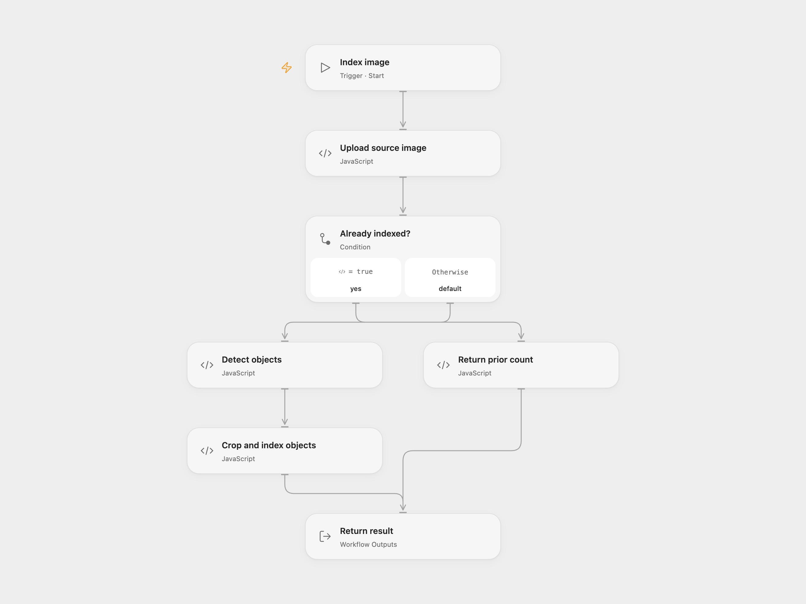

# Index Detected Image Objects

Detect and crop objects in an image, then index their URLs and labels.

<!-- template-actions:start -->
[](https://openflow.run/templates/index-detected-image-objects/) [](templates/index-detected-image-objects.n8n.json)
<!-- template-actions:end -->

<picture>
  <source media="(prefers-color-scheme: dark)" srcset="preview-dark.png">
  
</picture>

## Setup

In Open Flow configure AWS_ACCESS_KEY_ID, AWS_SECRET_ACCESS_KEY and ELASTICSEARCH_API_KEY as secret variables, set the Cloudinary cloud name and unsigned upload preset and Elasticsearch index URL. Configure each Code node HTTP host allowlist for your Cloudinary delivery host, AWS region and Elasticsearch host. Enable persistent State. Supply an HTTPS JPEG or PNG image URL.

## Behavior

The workflow uploads the source once to Cloudinary, then sends that fixed asset to Rekognition. Rekognition returns object boxes with confidence at least 90%. Cloudinary hosts the source and produces cropped URLs, and Elasticsearch stores each crop URL, source URL, label and box metadata. Inspect external services before clearing a pending checkpoint after an uncertain write. Avoid overlapping runs. A pending record covers the whole image, so reconcile all uploaded and indexed objects before clearing it. The original image is sent to Cloudinary and AWS. Rekognition accepts JPEG or PNG up to 5 MiB.

<details>
<summary>In n8n</summary>

In n8n configure AWS and Elasticsearch credentials, the image URL and Cloudinary preset, and a Data Table with item_key and status text columns.

</details>

<details>
<summary>Inspiration &amp; credits</summary>

Adapted from [Build Your Own Image Search Using AI Object Detection, CDN and ElasticSearch](https://github.com/enescingoz/awesome-n8n-templates/blob/827110332c21cbe000ab13f6d292d5adb1f1f8db/AI_Research_RAG_and_Data_Analysis/Build%20Your%20Own%20Image%20Search%20Using%20AI%20Object%20Detection%2C%20CDN%20and%20ElasticSearch.json) in [enescingoz/awesome-n8n-templates](https://github.com/enescingoz/awesome-n8n-templates).

Source collection notice: © 2024–2026 Enes Cingoz, [CC BY 4.0](https://github.com/enescingoz/awesome-n8n-templates/blob/827110332c21cbe000ab13f6d292d5adb1f1f8db/LICENSE). The source export does not identify a separate template author or license. See [repository licensing](../../README.md#licensing) for the scope of OOMOL contributions and third-party material.

Changes from source: Replace the unavailable Cloudflare detection model with AWS Rekognition, use Cloudinary crop delivery URLs, and add checkpoints for external writes.

Collection license notice:

```text
Creative Commons Attribution 4.0 International License

Copyright (c) 2024-2026 Enes Cingoz

You are free to:

  Share - copy and redistribute the material in any medium or format
  Adapt - remix, transform, and build upon the material for any purpose,
  even commercially.

Under the following terms:

  Attribution - You must give appropriate credit, provide a link to the
  license, and indicate if changes were made. You may do so in any
  reasonable manner, but not in any way that suggests the licensor
  endorses you or your use.

  No additional restrictions - You may not apply legal terms or
  technological measures that legally restrict others from doing
  anything the license permits.

Notices:

  You do not have to comply with the license for elements of the
  material in the public domain or where your use is permitted by an
  applicable exception or limitation.

  No warranties are given. The license may not give you all of the
  permissions necessary for your intended use. For example, other rights
  such as publicity, privacy, or moral rights may limit how you use the
  material.

For the full license text, see:
https://creativecommons.org/licenses/by/4.0/legalcode
```

</details>
