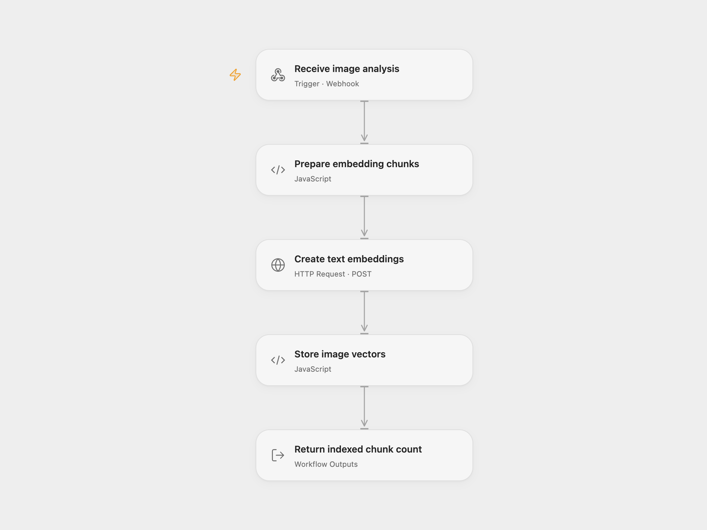

# Index Drive Image Analysis

Analyze a Drive image and store embeddings of its keywords and color information.

<!-- template-actions:start -->
 
<!-- template-actions:end -->

<picture>
  <source media="(prefers-color-scheme: dark)" srcset="preview-dark.png">
  
</picture>

## Setup and use

For Open Flow enable **Forward image analysis**, set its webhook URL, and disconnect **Document for Embedding** from **In-Memory Vector Store**. In Open Flow bind secret Variable OPENAI_API_KEY and enable persistent State. Restrict access to the Open Flow webhook.

## Behavior

The source's unconnected search node is not part of the executed workflow. Model and embedding calls may incur charges; image analysis can be inaccurate. The relay acknowledges receipt before embedding finishes; inspect Open Flow execution history for failures. Avoid overlapping Open Flow imports. The persistent vector list must fit the State read size limit; this example does not provide a search interface.

In n8n

In n8n select the Drive image, connect Google Drive and OpenAI, and choose one mode. For n8n alone leave the relay disabled and retain the original connection. Run the n8n workflow manually. n8n downloads the image, derives color statistics and visual keywords, and constructs a document with source, format and background color. In relay mode Open Flow chunks the document, requests text embeddings and appends vectors and metadata to its persistent State. n8n direct mode stores vectors in its in-memory store.

Inspiration &amp; credits

## Changes to the source

- Add an optional n8n relay and make image metadata expressions explicit. Open Flow stores vectors in persistent State and uses overlapping character windows rather than the source's recursive splitter.

Adapted from [Image embeddings with color and keywords](https://github.com/Zie619/n8n-workflows/blob/ae8cf6dc5b873cbb4f74587aa9180ed3a9f70682/workflows/Manual/1475_Manual_Stickynote_Automation_Triggered.json) in [Zie619/n8n-workflows](https://github.com/Zie619/n8n-workflows). The source notes cite [Pinecone on color histograms](https://www.pinecone.io/learn/series/image-search/color-histograms/) and [visual words](https://www.pinecone.io/learn/series/image-search/bag-of-visual-words/). The source export does not identify a separate template author or license.

The collection’s [MIT notice](https://github.com/Zie619/n8n-workflows/blob/94007c1445d9258a7da116646b79473e7c7c3282/LICENSE) is pinned at a later revision. This is the collection notice at that revision; it does not establish a separate original template author's license. Our changes are listed above; see [repository licensing](../../README.md#licensing).

> MIT License
>
> Copyright (c) 2025 Zie619
>
> Permission is hereby granted, free of charge, to any person obtaining a copy
> of this software and associated documentation files (the "Software"), to deal
> in the Software without restriction, including without limitation the rights
> to use, copy, modify, merge, publish, distribute, sublicense, and/or sell
> copies of the Software, and to permit persons to whom the Software is
> furnished to do so, subject to the following conditions:
>
> The above copyright notice and this permission notice shall be included in all
> copies or substantial portions of the Software.
>
> THE SOFTWARE IS PROVIDED "AS IS", WITHOUT WARRANTY OF ANY KIND, EXPRESS OR
> IMPLIED, INCLUDING BUT NOT LIMITED TO THE WARRANTIES OF MERCHANTABILITY,
> FITNESS FOR A PARTICULAR PURPOSE AND NONINFRINGEMENT. IN NO EVENT SHALL THE
> AUTHORS OR COPYRIGHT HOLDERS BE LIABLE FOR ANY CLAIM, DAMAGES OR OTHER
> LIABILITY, WHETHER IN AN ACTION OF CONTRACT, TORT OR OTHERWISE, ARISING FROM,
> OUT OF OR IN CONNECTION WITH THE SOFTWARE OR THE USE OR OTHER DEALINGS IN THE
> SOFTWARE.

