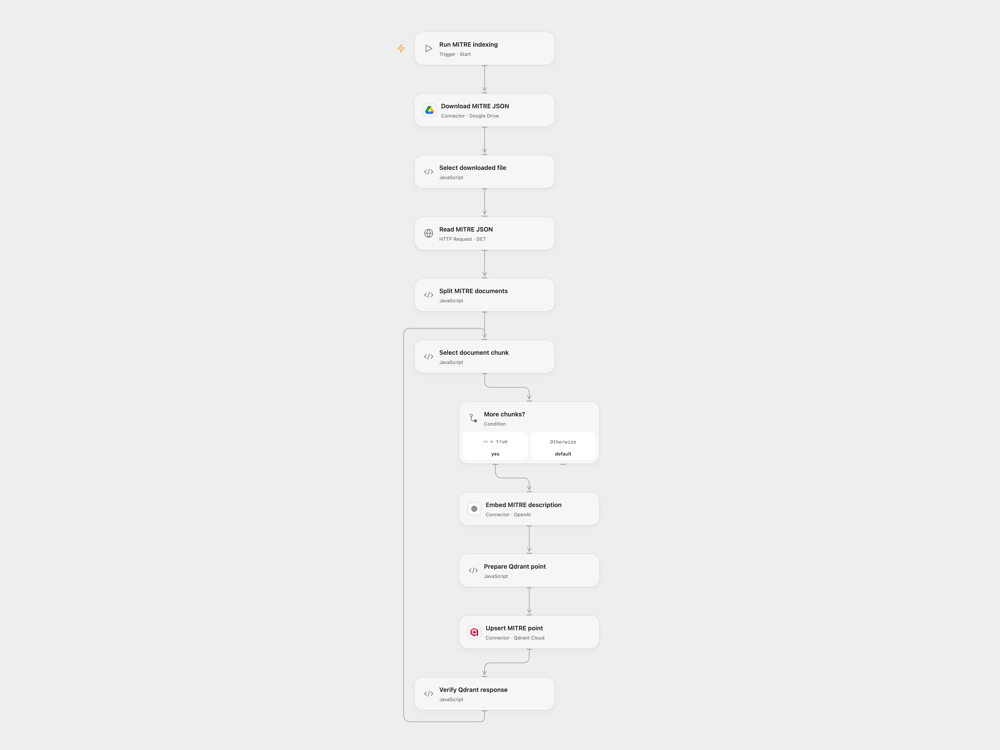

# Index MITRE ATT&CK in Qdrant

Load MITRE ATT&CK descriptions from a Drive JSON file into a Qdrant collection.

<!-- template-actions:start -->
[](https://openflow.run/templates/index-mitre-attack-in-qdrant/) [](templates/index-mitre-attack-in-qdrant.n8n.json)
<!-- template-actions:end -->

<picture>
  <source media="(prefers-color-scheme: dark)" srcset="preview-dark.png">
  
</picture>

## Setup and use

Configure Google Drive, OpenAI and Qdrant connections and select a JSON file containing a data array of records with id, name, description, kill_chain_phases and external_references. Configure an existing 1536-dimensional Qdrant collection named mitre. Both the index and any retrieval workflow must use text-embedding-3-large at 1536 dimensions. Run manually to embed descriptions and upsert their content and metadata. Open Flow uses stable IDs per document chunk; repeated runs update those IDs but do not remove chunks deleted from the source. Completed versions are skipped; inspect the collection before clearing a pending checkpoint after an uncertain write. Avoid overlapping runs. Choose a new version deliberately when the file changes; existing vectors are not deleted.

<details>
<summary>In n8n</summary>

For n8n, configure a Data Table with item_key and status columns and set the same unique file version in the checkpoint key of the Check file version, Reserve file version and Confirm file version nodes.

</details>

<details>
<summary>Inspiration &amp; credits</summary>

Adapted from [Automate SIEM Alert Enrichment with MITRE ATT&CK, Qdrant & Zendesk in n8n](https://github.com/enescingoz/awesome-n8n-templates/blob/827110332c21cbe000ab13f6d292d5adb1f1f8db/Other_Integrations_and_Use_Cases/Automate%20SIEM%20Alert%20Enrichment%20with%20MITRE%20ATT%26CK%2C%20Qdrant%20%26%20Zendesk%20in%20n8n.json) in [enescingoz/awesome-n8n-templates](https://github.com/enescingoz/awesome-n8n-templates).

Source collection notice: © 2024–2026 Enes Cingoz, [CC BY 4.0](https://github.com/enescingoz/awesome-n8n-templates/blob/827110332c21cbe000ab13f6d292d5adb1f1f8db/LICENSE). The source export does not identify a separate template author or license. See [repository licensing](../../README.md#licensing) for the scope of OOMOL contributions and third-party material.


Changes: isolate the Drive indexing path, configure the input and collection, align the embedding model and dimensions with retrieval, and use deterministic Open Flow point IDs.

Collection license notice:

```text
Creative Commons Attribution 4.0 International License

Copyright (c) 2024-2026 Enes Cingoz

You are free to:

  Share - copy and redistribute the material in any medium or format
  Adapt - remix, transform, and build upon the material for any purpose,
  even commercially.

Under the following terms:

  Attribution - You must give appropriate credit, provide a link to the
  license, and indicate if changes were made. You may do so in any
  reasonable manner, but not in any way that suggests the licensor
  endorses you or your use.

  No additional restrictions - You may not apply legal terms or
  technological measures that legally restrict others from doing
  anything the license permits.

Notices:

  You do not have to comply with the license for elements of the
  material in the public domain or where your use is permitted by an
  applicable exception or limitation.

  No warranties are given. The license may not give you all of the
  permissions necessary for your intended use. For example, other rights
  such as publicity, privacy, or moral rights may limit how you use the
  material.

For the full license text, see:
https://creativecommons.org/licenses/by/4.0/legalcode
```

</details>
