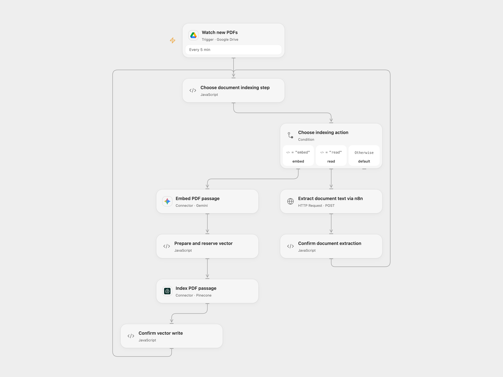

# Index New Drive PDFs in Pinecone

Extract and index new PDF documents from a Drive folder.

<!-- template-actions:start -->
 
<!-- template-actions:end -->

<picture>
  <source media="(prefers-color-scheme: dark)" srcset="preview-dark.png">
  
</picture>

## Setup and use

Configure a Drive folder in both formats, connect Gemini and a 3072-dimensional Pinecone index, and enable persistent State. Enable the PDF extraction webhook in n8n. In Open Flow configure its URL and bind RADAR_RELAY_TOKEN. In n8n connect Drive and Pinecone, select the index and a Data Table with item_key and status text columns, and configure Header Auth for the extraction webhook.

New PDFs are extracted, normalized by removing punctuation and non-ASCII characters as in the source, split into passages of up to 3,000 characters with overlap, and indexed. A vector write with an unknown result stays pending. Inspect the index and reconcile the key with confirmed or absent before retrying. The n8n Data Table checks are not atomic; avoid overlapping runs. Existing vectors from earlier versions remain in the index. Text leaves Drive for Gemini and Pinecone. The separate chat workflow in the source is not included.

Inspiration &amp; credits

Use current Gemini embeddings, stable document IDs and checkpoints; expose PDF extraction through an authenticated relay.

Adapted from [Google Drive Automation](https://github.com/Zie619/n8n-workflows/blob/ae8cf6dc5b873cbb4f74587aa9180ed3a9f70682/workflows/Code/1906_Code_Extractfromfile_Automate_Triggered.json) in [Zie619/n8n-workflows](https://github.com/Zie619/n8n-workflows). Attribution: Zie619 / n8n-workflows.

The collection’s [MIT notice](https://github.com/Zie619/n8n-workflows/blob/94007c1445d9258a7da116646b79473e7c7c3282/LICENSE) is pinned at a later revision. This is the collection notice at that revision; it does not establish a separate original template author's license. Our changes are listed above; see [repository licensing](../../README.md#licensing).

> MIT License
>
> Copyright (c) 2025 Zie619
>
> Permission is hereby granted, free of charge, to any person obtaining a copy
> of this software and associated documentation files (the "Software"), to deal
> in the Software without restriction, including without limitation the rights
> to use, copy, modify, merge, publish, distribute, sublicense, and/or sell
> copies of the Software, and to permit persons to whom the Software is
> furnished to do so, subject to the following conditions:
>
> The above copyright notice and this permission notice shall be included in all
> copies or substantial portions of the Software.
>
> THE SOFTWARE IS PROVIDED "AS IS", WITHOUT WARRANTY OF ANY KIND, EXPRESS OR
> IMPLIED, INCLUDING BUT NOT LIMITED TO THE WARRANTIES OF MERCHANTABILITY,
> FITNESS FOR A PARTICULAR PURPOSE AND NONINFRINGEMENT. IN NO EVENT SHALL THE
> AUTHORS OR COPYRIGHT HOLDERS BE LIABLE FOR ANY CLAIM, DAMAGES OR OTHER
> LIABILITY, WHETHER IN AN ACTION OF CONTRACT, TORT OR OTHERWISE, ARISING FROM,
> OUT OF OR IN CONNECTION WITH THE SOFTWARE OR THE USE OR OTHER DEALINGS IN THE
> SOFTWARE.

