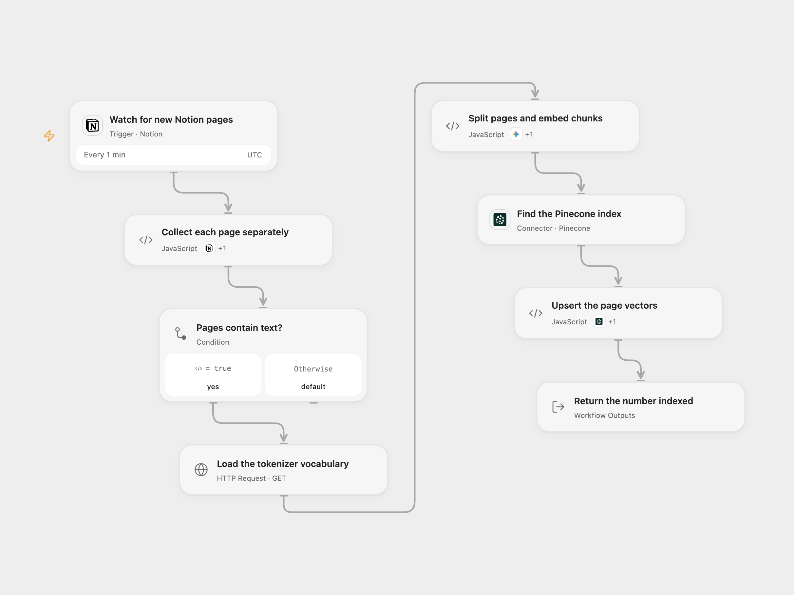

# Index Notion Pages in Pinecone

Turn new Notion pages into searchable text vectors in Pinecone with Gemini embeddings.

<!-- template-actions:start -->
 
<!-- template-actions:end -->

<picture>
  <source media="(prefers-color-scheme: dark)" srcset="preview-dark.png">
  
</picture>

## Setup

1. Connect Notion in **Watch for new Notion pages** and **Collect each page separately**. Share the source database with the connection. Select its database and, if it has multiple data sources, its data source in the trigger.
2. Connect Gemini in **Split pages and embed chunks**. Connect the same Pinecone account in **Find the Pinecone index** and **Upsert the page vectors**.
3. Create a dense cosine Pinecone index with dimension 768. Set its name in **Find the Pinecone index** and its namespace in **Upsert the page vectors**. Use a namespace reserved for vectors made with Gemini Embedding 2.
4. Publish the workflow. The trigger checks for new pages each minute and establishes its starting point on the first poll.

## Behavior

The workflow reads every page's blocks, including nested text, and skips images and videos. It uses 256-token chunks with 30-token overlap. Each vector carries the page ID, title, creation time, chunk order, and text. Reprocessing the same page and chunk position upserts the same ID. Empty pages produce no vectors.

The workflow downloads the public cl100k_base vocabulary and verifies its checksum. The vocabulary host receives only the GET request for that file. Gemini receives each chunk and its title. Pinecone stores the vectors and the associated text and page metadata. Use an index and namespace whose access suits that content.

Each Open Flow poll accepts up to five new pages. One run can index up to 64 chunks across all pages and checks every embedding before writing. Lower the number of pages per poll for larger imports. A single page over 64 chunks exceeds the workflow limit. A failed page read, invalid embedding, or oversized run stops before the Pinecone upsert. The workflow watches new pages. Editing or deleting an indexed page does not remove existing vectors.

In n8n

Select the same Notion credential for **Watch for new Notion pages** and **Read all Notion page blocks** and choose a Notion database with a single data source. Connect Google Gemini (PaLM) in **Split pages and embed chunks**, and select the same Pinecone credential for **Find the Pinecone index** and **Upsert the page vectors**. Edit the index name and namespace in **Collect each page separately**. Activate the workflow to poll each minute. The n8n manual trigger test may index the latest existing page.

Inspiration &amp; credits

Adapted from [Notion to Pinecone Vector Store Integration](https://github.com/enescingoz/awesome-n8n-templates/blob/827110332c21cbe000ab13f6d292d5adb1f1f8db/Notion/Notion%20to%20Pinecone%20Vector%20Store%20Integration.json) in [enescingoz/awesome-n8n-templates](https://github.com/enescingoz/awesome-n8n-templates).

Source collection notice: © 2024–2026 Enes Cingoz, [CC BY 4.0](https://github.com/enescingoz/awesome-n8n-templates/blob/827110332c21cbe000ab13f6d292d5adb1f1f8db/LICENSE). The [original n8n template](https://n8n.io/workflows/2797-notion-to-pinecone-vector-store-integration/) credits Udit Rawat (ailistmaster). See [repository licensing](../../README.md#licensing) for the scope of OOMOL contributions and third-party material.

## Changes to the source

Gemini Embedding 2 replaces the retired text-embedding-004 model. New vectors use 768 dimensions and a dedicated namespace. Nested block reads preserve page ownership. Stable chunk IDs make a repeated upsert replace the matching vector. [Gemini embedding guide](https://ai.google.dev/gemini-api/docs/embeddings)

