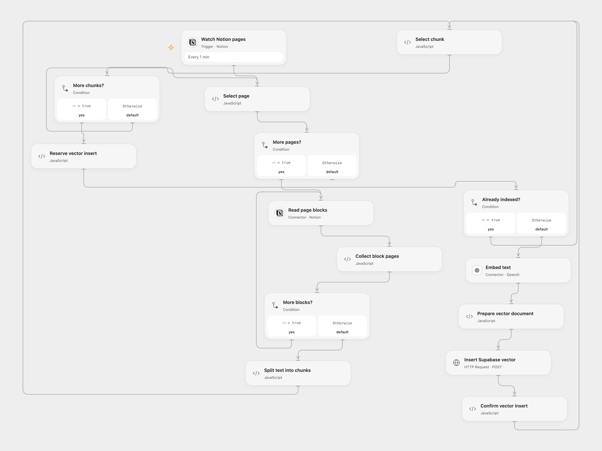

# Index Notion Pages in Supabase

Embed new Notion pages and store their text chunks in Supabase.

<!-- template-actions:start -->
[](https://openflow.run/templates/index-notion-pages-in-supabase/) [](templates/index-notion-pages-in-supabase.n8n.json)
<!-- template-actions:end -->

<picture>
  <source media="(prefers-color-scheme: dark)" srcset="preview-dark.png">
  
</picture>

## Setup and use

Connect Notion and OpenAI and configure the database trigger. Create a Supabase documents table with an auto-generated id, content text, metadata jsonb and embedding vector(1536), enable pgvector, and authorize inserts. In Open Flow configure the project URL, bind SUPABASE_KEY and SUPABASE_AUTHORIZATION (the latter is the same key prefixed by Bearer followed by a space), and use persistent State.

## Behavior

The workflow processes newly added pages and reads direct blocks with pagination. Image and video blocks are excluded; child-page titles are included but nested blocks are not fetched. Open Flow splits text into overlapping chunks of up to 920 Unicode characters with 120 characters overlap. Both use text-embedding-3-small and store page ID, title and creation time with each chunk. Avoid overlapping runs. Inspect Supabase before clearing a pending checkpoint after an uncertain insert. Reset completed checkpoints only when deliberate reindexing is needed.

<details>
<summary>In n8n</summary>

In n8n set the database ID, Supabase credentials and table, and select a Data Table with item_key and status text columns. N8n uses the source token splitter (256 tokens, 30 overlap).

</details>

<details>
<summary>Inspiration &amp; credits</summary>

Adapted from [Store Notion's Pages as Vector Documents into Supabase with OpenAI](https://github.com/enescingoz/awesome-n8n-templates/blob/827110332c21cbe000ab13f6d292d5adb1f1f8db/Notion/Store%20Notion_s%20Pages%20as%20Vector%20Documents%20into%20Supabase%20with%20OpenAI.json) in [enescingoz/awesome-n8n-templates](https://github.com/enescingoz/awesome-n8n-templates).

Source collection notice: © 2024–2026 Enes Cingoz, [CC BY 4.0](https://github.com/enescingoz/awesome-n8n-templates/blob/827110332c21cbe000ab13f6d292d5adb1f1f8db/LICENSE). The source export does not identify a separate template author or license. See [repository licensing](../../README.md#licensing) for the scope of OOMOL contributions and third-party material.

Changes from source: Use current Notion rich text, paginate block reads, process each page separately, select text-embedding-3-small and add insert checkpoints.

Collection license notice:

```text
Creative Commons Attribution 4.0 International License

Copyright (c) 2024-2026 Enes Cingoz

You are free to:

  Share - copy and redistribute the material in any medium or format
  Adapt - remix, transform, and build upon the material for any purpose,
  even commercially.

Under the following terms:

  Attribution - You must give appropriate credit, provide a link to the
  license, and indicate if changes were made. You may do so in any
  reasonable manner, but not in any way that suggests the licensor
  endorses you or your use.

  No additional restrictions - You may not apply legal terms or
  technological measures that legally restrict others from doing
  anything the license permits.

Notices:

  You do not have to comply with the license for elements of the
  material in the public domain or where your use is permitted by an
  applicable exception or limitation.

  No warranties are given. The license may not give you all of the
  permissions necessary for your intended use. For example, other rights
  such as publicity, privacy, or moral rights may limit how you use the
  material.

For the full license text, see:
https://creativecommons.org/licenses/by/4.0/legalcode
```

</details>
