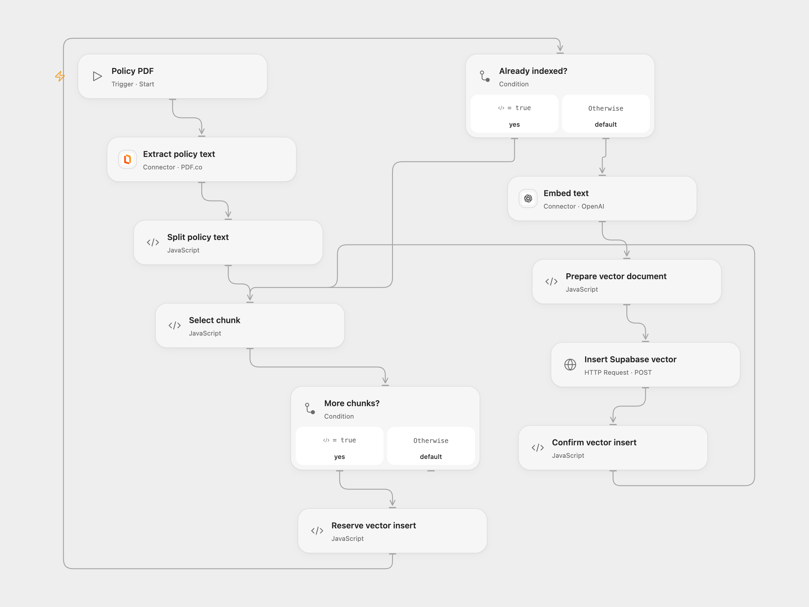

# Index Policy PDF Vectors

Extract a policy PDF and index its text chunks in a vector table.

<!-- template-actions:start -->
[](https://openflow.run/templates/index-policy-pdf-vectors/) [](templates/index-policy-pdf-vectors.n8n.json)
<!-- template-actions:end -->

<picture>
  <source media="(prefers-color-scheme: dark)" srcset="preview-dark.png">
  
</picture>

## Setup and use

In Open Flow connect PDF.co and OpenAI, configure Supabase REST project URL, SUPABASE_KEY and SUPABASE_AUTHORIZATION and persistent State. Create a documents table with auto-generated id, content text, metadata jsonb, and embedding vector(1536); enable pgvector and grant insert permissions. Run with a direct HTTPS PDF URL and a document version. In n8n set the PDF URL and version in Policy settings, configure OpenAI and PostgreSQL credentials and PGVector table, and select a Data Table with item_key and status text columns.

## Behavior

The PDF is extracted, split into overlapping chunks, embedded and inserted into the vector table. A new version is a new index; remove obsolete vectors separately if needed. Inspect the database before clearing any pending checkpoint after an uncertain write. Avoid overlapping runs. Open Flow sends the PDF URL to PDF.co and document text to OpenAI. The excluded Telegram chat is not part of this component.

<details>
<summary>Inspiration &amp; credits</summary>

Adapted from [HR & IT Helpdesk Chatbot with Audio Transcription](https://github.com/enescingoz/awesome-n8n-templates/blob/827110332c21cbe000ab13f6d292d5adb1f1f8db/HR_and_Recruitment/HR%20%26%20IT%20Helpdesk%20Chatbot%20with%20Audio%20Transcription.json) in [enescingoz/awesome-n8n-templates](https://github.com/enescingoz/awesome-n8n-templates).

Source collection notice: © 2024–2026 Enes Cingoz, [CC BY 4.0](https://github.com/enescingoz/awesome-n8n-templates/blob/827110332c21cbe000ab13f6d292d5adb1f1f8db/LICENSE). The source export does not identify a separate template author or license. See [repository licensing](../../README.md#licensing) for the scope of OOMOL contributions and third-party material.


Changes from source: Isolate PDF indexing, use PDF.co for Open Flow extraction, use current embeddings and add chunk checkpoints.

Collection license notice:

```text
Creative Commons Attribution 4.0 International License

Copyright (c) 2024-2026 Enes Cingoz

You are free to:

  Share - copy and redistribute the material in any medium or format
  Adapt - remix, transform, and build upon the material for any purpose,
  even commercially.

Under the following terms:

  Attribution - You must give appropriate credit, provide a link to the
  license, and indicate if changes were made. You may do so in any
  reasonable manner, but not in any way that suggests the licensor
  endorses you or your use.

  No additional restrictions - You may not apply legal terms or
  technological measures that legally restrict others from doing
  anything the license permits.

Notices:

  You do not have to comply with the license for elements of the
  material in the public domain or where your use is permitted by an
  applicable exception or limitation.

  No warranties are given. The license may not give you all of the
  permissions necessary for your intended use. For example, other rights
  such as publicity, privacy, or moral rights may limit how you use the
  material.

For the full license text, see:
https://creativecommons.org/licenses/by/4.0/legalcode

```

</details>
