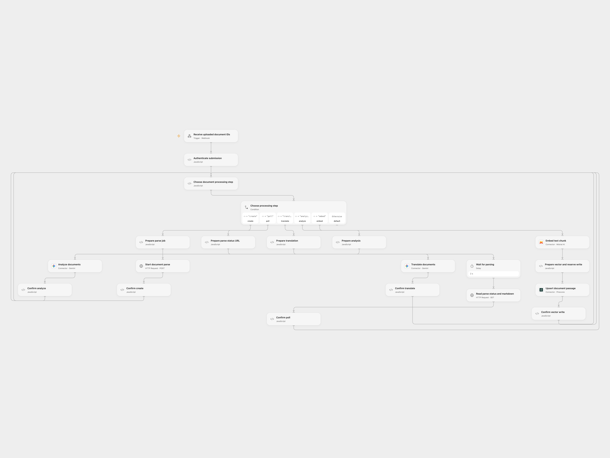

# Index Translated Document Analysis in Pinecone

Parse uploaded files and index their translated and analyzed text.

<!-- template-actions:start -->
 
<!-- template-actions:end -->

<picture>
  <source media="(prefers-color-scheme: dark)" srcset="preview-dark.png">
  
</picture>

## Setup

Configure LlamaCloud, Gemini, Mistral and a 1024-dimensional Pinecone index. In n8n connect Gemini, Mistral and Pinecone credentials and select the Pinecone index. Set a LlamaCloud Bearer Header Auth credential on the parsing and upload HTTP nodes, and select a Data Table with item_key and status text columns in the checkpoint nodes. In Choose form mode select direct, or relay to send uploaded file IDs to Open Flow; for relay set the Open Flow URL and Header Auth credential. In Open Flow set the Pinecone host, bind DOCUMENT_RELAY_AUTH to that same Authorization header, bind LLAMA_CLOUD_API_KEY, connect Gemini, Mistral and Pinecone, and enable persistent State. Both formats use the default Pinecone namespace.

## Use

Submit one or two files, an email address and a unique Request ID. Use the same ID when retrying. Text is sent to LlamaCloud, Gemini, Mistral and Pinecone. Protect execution history and the index. Avoid overlapping runs with the same ID. For an unknown parse creation or Pinecone write, inspect the destination. In Choose document processing step enter the pending key and confirmed or absent; for a confirmed parse also enter its job ID, then replay the original request. Clear recovery fields after resuming. In n8n inspect LlamaCloud and Pinecone and manually repair any partial ingestion before clearing the Data Table checkpoint. The relay acknowledges admission, not completion.

Inspiration &amp; credits

Extract the independently triggered ingestion branch; use current parsing and deterministic vector IDs.

Adapted from [My workflow 3](https://github.com/Zie619/n8n-workflows/blob/ae8cf6dc5b873cbb4f74587aa9180ed3a9f70682/workflows/Code/1818_Code_Converttofile_Automate_Webhook.json) in [Zie619/n8n-workflows](https://github.com/Zie619/n8n-workflows). Attribution: Zie619 / n8n-workflows.

The collection’s [MIT notice](https://github.com/Zie619/n8n-workflows/blob/94007c1445d9258a7da116646b79473e7c7c3282/LICENSE) is pinned at a later revision. This is the collection notice at that revision; it does not establish a separate original template author's license. Our changes are listed above; see [repository licensing](../../README.md#licensing).

> MIT License
>
> Copyright (c) 2025 Zie619
>
> Permission is hereby granted, free of charge, to any person obtaining a copy
> of this software and associated documentation files (the "Software"), to deal
> in the Software without restriction, including without limitation the rights
> to use, copy, modify, merge, publish, distribute, sublicense, and/or sell
> copies of the Software, and to permit persons to whom the Software is
> furnished to do so, subject to the following conditions:
>
> The above copyright notice and this permission notice shall be included in all
> copies or substantial portions of the Software.
>
> THE SOFTWARE IS PROVIDED "AS IS", WITHOUT WARRANTY OF ANY KIND, EXPRESS OR
> IMPLIED, INCLUDING BUT NOT LIMITED TO THE WARRANTIES OF MERCHANTABILITY,
> FITNESS FOR A PARTICULAR PURPOSE AND NONINFRINGEMENT. IN NO EVENT SHALL THE
> AUTHORS OR COPYRIGHT HOLDERS BE LIABLE FOR ANY CLAIM, DAMAGES OR OTHER
> LIABILITY, WHETHER IN AN ACTION OF CONTRACT, TORT OR OTHERWISE, ARISING FROM,
> OUT OF OR IN CONNECTION WITH THE SOFTWARE OR THE USE OR OTHER DEALINGS IN THE
> SOFTWARE.

