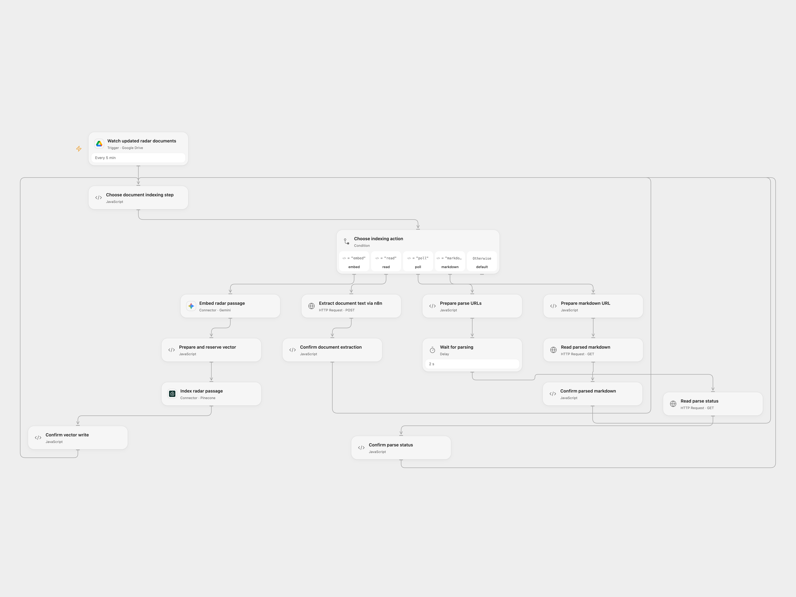

# Index Updated Tech Radar Documents

Index text from updated documents in a Drive folder.

<!-- template-actions:start -->
 
<!-- template-actions:end -->

<picture>
  <source media="(prefers-color-scheme: dark)" srcset="preview-dark.png">
  
</picture>

## Setup

Select the watched folder. Connect Google Drive, LlamaCloud, Gemini and Pinecone, and use a 3072-dimensional Pinecone index. Parsing is polled every two seconds with a bounded timeout. Protect the relay and execution history.

## Use

Updated files in the folder are parsed to text, split into overlapping passages and indexed. The relay extracts text and JSON directly and uses LlamaParse for PDF, DOCX, EPUB and CSV files, including Google Docs exported as DOCX. Other file types follow text extraction. LlamaParse can truncate text beyond 64 KB per page; review unusually dense documents. The relay upload must respond within the Open Flow HTTP timeout, and an uncertain upload must be reconciled as described below. Changes to a document create a new set of vectors; remove obsolete versions according to your index retention policy. Avoid overlapping executions for the same document.

For an uncertain relay upload or Pinecone write, inspect the destination, then set the pending key and confirmed or absent in **Choose document indexing step** and replay the same event batch. For a confirmed upload also enter its parse job ID. Clear recovery fields afterward. Relay uploads retain a separate checkpoint per file version; after an uncertain relay outcome inspect LlamaCloud before clearing it. Successful relay rows remain as a record and should be cleared only when a repeat upload is intended. The MySQL refresh and chat paths are separate from this component.

In n8n

In n8n configure the Data Table with item_key and status columns and select the index. For Open Flow enable the disabled n8n extraction webhook, configure its Header Auth as Authorization: Bearer plus a secret and the LlamaCloud Bearer credential on **Parse relay file**, set its URL in **Extract document text via n8n**, bind RADAR_RELAY_TOKEN and LLAMA_CLOUD_API_KEY, and enable persistent State. For an absent upload clear the corresponding n8n relay checkpoint before replay. In n8n inspect and repair the index before clearing the pending Data Table row.

Inspiration &amp; credits

Extract the Drive ingestion path, use current Gemini embeddings and a LlamaParse relay for common document formats, and add write checkpoints.

Adapted from [Tech Radar](https://github.com/Zie619/n8n-workflows/blob/ae8cf6dc5b873cbb4f74587aa9180ed3a9f70682/workflows/Code/1836_Code_Googledocs_Automation_Webhook.json) in [Zie619/n8n-workflows](https://github.com/Zie619/n8n-workflows). Attribution: Zie619 / n8n-workflows.

The collection’s [MIT notice](https://github.com/Zie619/n8n-workflows/blob/94007c1445d9258a7da116646b79473e7c7c3282/LICENSE) is pinned at a later revision. This is the collection notice at that revision; it does not establish a separate original template author's license. Our changes are listed above; see [repository licensing](../../README.md#licensing).

> MIT License
>
> Copyright (c) 2025 Zie619
>
> Permission is hereby granted, free of charge, to any person obtaining a copy
> of this software and associated documentation files (the "Software"), to deal
> in the Software without restriction, including without limitation the rights
> to use, copy, modify, merge, publish, distribute, sublicense, and/or sell
> copies of the Software, and to permit persons to whom the Software is
> furnished to do so, subject to the following conditions:
>
> The above copyright notice and this permission notice shall be included in all
> copies or substantial portions of the Software.
>
> THE SOFTWARE IS PROVIDED "AS IS", WITHOUT WARRANTY OF ANY KIND, EXPRESS OR
> IMPLIED, INCLUDING BUT NOT LIMITED TO THE WARRANTIES OF MERCHANTABILITY,
> FITNESS FOR A PARTICULAR PURPOSE AND NONINFRINGEMENT. IN NO EVENT SHALL THE
> AUTHORS OR COPYRIGHT HOLDERS BE LIABLE FOR ANY CLAIM, DAMAGES OR OTHER
> LIABILITY, WHETHER IN AN ACTION OF CONTRACT, TORT OR OTHERWISE, ARISING FROM,
> OUT OF OR IN CONNECTION WITH THE SOFTWARE OR THE USE OR OTHER DEALINGS IN THE
> SOFTWARE.

