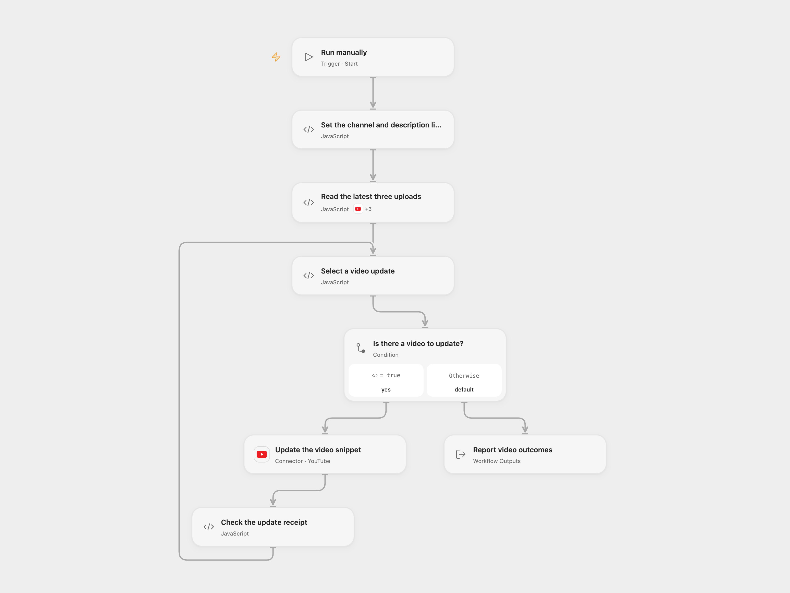

# Insert a Line in Recent YouTube Video Descriptions

Insert a line between two markers in the latest three uploads on your YouTube channel.

<!-- template-actions:start -->
 
<!-- template-actions:end -->

<picture>
  <source media="(prefers-color-scheme: dark)" srcset="preview-dark.png">
  
</picture>

## Setup

1. In **Set the channel and description lines**, enter the ID of your YouTube channel and set `rowBefore`, `rowAfter`, and `rowToInsert`. Each value must be a single line.
2. In **Read the latest three uploads** and **Update the video snippet**, bind the same YouTube connection with permission to edit that channel. Run the workflow manually.

## Behavior

The workflow checks the three most recent entries in your channel’s uploads playlist. It inserts the new text immediately after the first matching `rowBefore` if the first matching `rowAfter` occurs later. It ignores surrounding whitespace when matching the marker lines. It skips descriptions that already contain the exact new line, that have missing or reversed markers, or whose channel or metadata cannot be confirmed.

The update retains the video title, category, tags, and default language. Only the snippet is sent to YouTube, so the request leaves privacy, publishing schedule, and localizations alone. The request uses the video’s ETag and reports a precondition failure if YouTube says the video has changed. Check the video before rerunning after an unconfirmed update. [YouTube Videos API](https://developers.google.com/youtube/data/reference/rest/v3/videos/update)

In n8n

Enter the same configuration in **Set the channel and description lines**. Attach the same OAuth2 API credential to **Check the connected YouTube channel**, **Read the channel uploads playlist**, **Read the selected video snippets**, and **Update the video snippet**. Use a Google OAuth2 client with the YouTube Data API enabled, an authorization-code grant and the `https://www.googleapis.com/auth/youtube.force-ssl` scope. Authorize the channel owner and use the redirect URL shown by n8n. Run manually. If all videos are skipped, the workflow stops at **Plan exact description updates** without an update result.

Inspiration &amp; credits

Adapted from [Automatically Update YouTube Video Descriptions with Inserted Text](https://github.com/Zie619/n8n-workflows/blob/ae8cf6dc5b873cbb4f74587aa9180ed3a9f70682/workflows/Code/0773_Code_Manual_Update_Triggered.json) in [Zie619/n8n-workflows](https://github.com/Zie619/n8n-workflows). Attribution: Zie619 / n8n-workflows.

The collection’s [MIT notice](https://github.com/Zie619/n8n-workflows/blob/94007c1445d9258a7da116646b79473e7c7c3282/LICENSE) is pinned at a later revision. This is the collection notice at that revision; it does not establish a separate original template author's license. Our changes are listed above; see [repository licensing](../../README.md#licensing).

> MIT License
>
> Copyright (c) 2025 Zie619
>
> Permission is hereby granted, free of charge, to any person obtaining a copy
> of this software and associated documentation files (the "Software"), to deal
> in the Software without restriction, including without limitation the rights
> to use, copy, modify, merge, publish, distribute, sublicense, and/or sell
> copies of the Software, and to permit persons to whom the Software is
> furnished to do so, subject to the following conditions:
>
> The above copyright notice and this permission notice shall be included in all
> copies or substantial portions of the Software.
>
> THE SOFTWARE IS PROVIDED "AS IS", WITHOUT WARRANTY OF ANY KIND, EXPRESS OR
> IMPLIED, INCLUDING BUT NOT LIMITED TO THE WARRANTIES OF MERCHANTABILITY,
> FITNESS FOR A PARTICULAR PURPOSE AND NONINFRINGEMENT. IN NO EVENT SHALL THE
> AUTHORS OR COPYRIGHT HOLDERS BE LIABLE FOR ANY CLAIM, DAMAGES OR OTHER
> LIABILITY, WHETHER IN AN ACTION OF CONTRACT, TORT OR OTHERWISE, ARISING FROM,
> OUT OF OR IN CONNECTION WITH THE SOFTWARE OR THE USE OR OTHER DEALINGS IN THE
> SOFTWARE.

