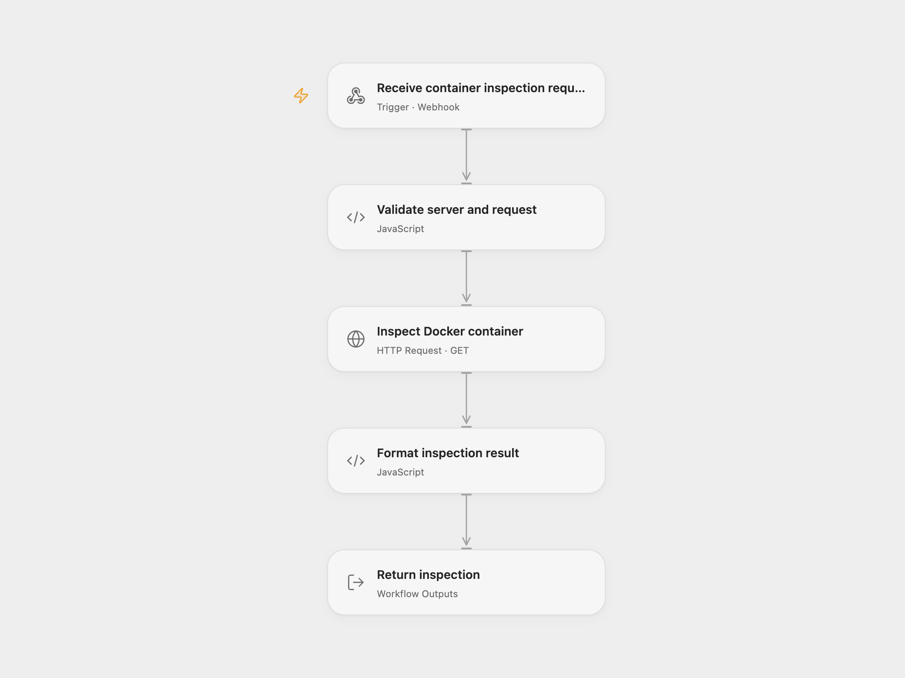

# Inspect a Nextcloud Host Container

Return Docker inspection details for an Nextcloud host container.

<picture>
  <source media="(prefers-color-scheme: dark)" srcset="preview-dark.png">
  
</picture>

[Open Flow JSON](templates/inspect-nextcloud-host-container.openflow.json) · [n8n JSON](templates/inspect-nextcloud-host-container.n8n.json)

## Setup

Provide a Docker Engine v1.44 endpoint behind an HTTPS gateway that authenticates Bearer tokens and is restricted to container inspection. Set the gateway URL and expected two server domains and corresponding gateway URLs in **Validate server and request**. Bind INSPECTION_WEBHOOK_AUTH to the complete Authorization header expected from callers and DOCKER_GATEWAY_TOKEN to the gateway token accepted by both gateways. Secure all endpoints. In n8n configure the incoming Header Auth and Docker gateway Bearer credentials, the expected server domain and gateway URL.

## Use

POST a JSON object with server_domain, domain and command set to container_information_inspect. The workflow inspects the container named by domain. A missing container returns an empty inspect object. Docker inspection details can contain environment variables and other sensitive configuration; restrict access to responses and execution history.

Inspiration &amp; credits

Extract container inspection and use the Docker Engine API in place of SSH.

Adapted from [Docker Nextcloud API](https://github.com/Zie619/n8n-workflows/blob/ae8cf6dc5b873cbb4f74587aa9180ed3a9f70682/workflows/Code/1832_Code_Webhook_Automation_Webhook.json) in [Zie619/n8n-workflows](https://github.com/Zie619/n8n-workflows). Attribution: Zie619 / n8n-workflows.

The collection’s [MIT notice](https://github.com/Zie619/n8n-workflows/blob/94007c1445d9258a7da116646b79473e7c7c3282/LICENSE) is pinned at a later revision. This is the collection notice at that revision; it does not establish a separate original template author's license. Our changes are listed above; see [repository licensing](../../README.md#licensing).

> MIT License
>
> Copyright (c) 2025 Zie619
>
> Permission is hereby granted, free of charge, to any person obtaining a copy
> of this software and associated documentation files (the "Software"), to deal
> in the Software without restriction, including without limitation the rights
> to use, copy, modify, merge, publish, distribute, sublicense, and/or sell
> copies of the Software, and to permit persons to whom the Software is
> furnished to do so, subject to the following conditions:
>
> The above copyright notice and this permission notice shall be included in all
> copies or substantial portions of the Software.
>
> THE SOFTWARE IS PROVIDED "AS IS", WITHOUT WARRANTY OF ANY KIND, EXPRESS OR
> IMPLIED, INCLUDING BUT NOT LIMITED TO THE WARRANTIES OF MERCHANTABILITY,
> FITNESS FOR A PARTICULAR PURPOSE AND NONINFRINGEMENT. IN NO EVENT SHALL THE
> AUTHORS OR COPYRIGHT HOLDERS BE LIABLE FOR ANY CLAIM, DAMAGES OR OTHER
> LIABILITY, WHETHER IN AN ACTION OF CONTRACT, TORT OR OTHERWISE, ARISING FROM,
> OUT OF OR IN CONNECTION WITH THE SOFTWARE OR THE USE OR OTHER DEALINGS IN THE
> SOFTWARE.

