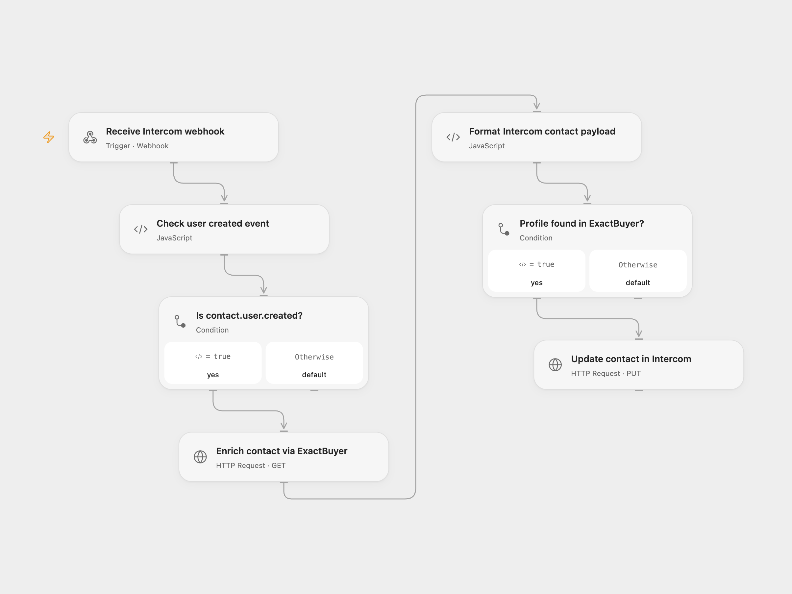

# Enrich Intercom Contacts with ExactBuyer

Enrich newly created Intercom user contacts with ExactBuyer social profiles, phone, avatar, and location data.

<!-- template-actions:start -->
 
<!-- template-actions:end -->

<picture>
  <source media="(prefers-color-scheme: dark)" srcset="preview-dark.png">
  
</picture>

## Setup

1. Create two secret variables in Open Flow:
   - `EXACTBUYER_API_KEY`: Your ExactBuyer API key (sent in the `X-API-Key` header).
   - `INTERCOM_ACCESS_TOKEN`: Your Intercom Bearer access token with contact write permissions.
2. Register this workflow's webhook URL in your Intercom Developer Hub webhook settings and subscribe to the `contact.user.created` topic.
3. For the n8n template, configure Header Auth credentials for ExactBuyer (`X-API-Key`) and Intercom (`Authorization: Bearer <token>`).

## Behavior

- Filters incoming Intercom webhook payloads for `topic === "contact.user.created"` with a non-empty contact `id` and `email`; other webhook topics exit without external API calls.
- Queries `GET https://api.exactbuyer.com/v1/enrich` with `email` and `required=work_email,personal_email,email`.
- If ExactBuyer returns a matching profile, formats `social_profiles`, `location`, `phone`, `avatar`, `name`, and `email`, then updates the contact via `PUT https://api.intercom.io/contacts/{id}` with `Intercom-Version: 2.10`. Non-2xx or empty ExactBuyer responses stop cleanly without updating Intercom.

Inspiration &amp; credits

## Changes to the source

- Fixed the `Update data in Intercom` `email` field mapping so it sends `current_work_email` instead of concatenating `current_work_email` and `full_name`.
- Bound ExactBuyer (`EXACTBUYER_API_KEY`) and Intercom (`INTERCOM_ACCESS_TOKEN`) credentials to secret variables in Open Flow.

Adapted from [Enrich new Intercom users with contact details from ExactBuyer](https://github.com/Zie619/n8n-workflows/blob/ae8cf6dc5b873cbb4f74587aa9180ed3a9f70682/workflows/Intercom/0413_Intercom_Code_Create_Webhook.json) in [Zie619/n8n-workflows](https://github.com/Zie619/n8n-workflows). Attribution: Zie619 / n8n-workflows.

The collection’s [MIT notice](https://github.com/Zie619/n8n-workflows/blob/94007c1445d9258a7da116646b79473e7c7c3282/LICENSE) is pinned at a later revision. This is the collection notice at that revision; it does not establish a separate original template author's license. Our changes are listed above; see [repository licensing](../../README.md#licensing).

> MIT License
>
> Copyright (c) 2025 Zie619
>
> Permission is hereby granted, free of charge, to any person obtaining a copy
> of this software and associated documentation files (the "Software"), to deal
> in the Software without restriction, including without limitation the rights
> to use, copy, modify, merge, publish, distribute, sublicense, and/or sell
> copies of the Software, and to permit persons to whom the Software is
> furnished to do so, subject to the following conditions:
>
> The above copyright notice and this permission notice shall be included in all
> copies or substantial portions of the Software.
>
> THE SOFTWARE IS PROVIDED "AS IS", WITHOUT WARRANTY OF ANY KIND, EXPRESS OR
> IMPLIED, INCLUDING BUT NOT LIMITED TO THE WARRANTIES OF MERCHANTABILITY,
> FITNESS FOR A PARTICULAR PURPOSE AND NONINFRINGEMENT. IN NO EVENT SHALL THE
> AUTHORS OR COPYRIGHT HOLDERS BE LIABLE FOR ANY CLAIM, DAMAGES OR OTHER
> LIABILITY, WHETHER IN AN ACTION OF CONTRACT, TORT OR OTHERWISE, ARISING FROM,
> OUT OF OR IN CONNECTION WITH THE SOFTWARE OR THE USE OR OTHER DEALINGS IN THE
> SOFTWARE.

