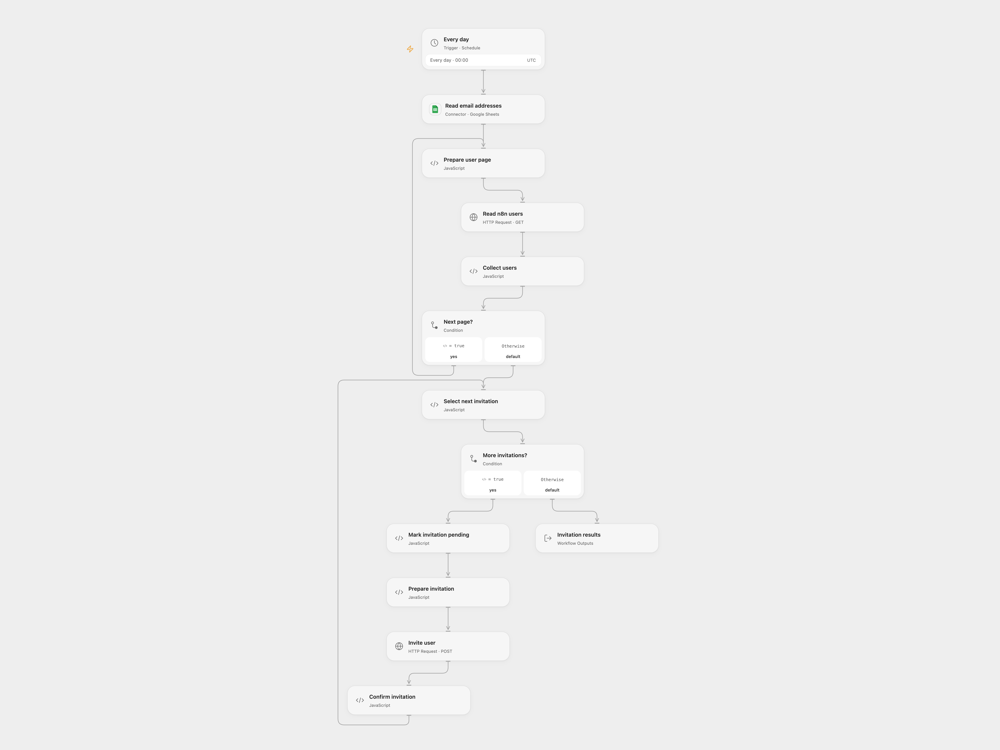

# Invite Sheet Contacts to n8n

Invite email addresses from a Google Sheet that are not yet n8n users.

<picture>
  <source media="(prefers-color-scheme: dark)" srcset="preview-dark.png">
  
</picture>

[Open Flow JSON](templates/invite-sheet-contacts-to-n8n.openflow.json) · [n8n JSON](templates/invite-sheet-contacts-to-n8n.n8n.json)

## Setup

Connect Google Sheets and set a single-column range whose first row is a header and remaining rows contain email addresses. Set the spreadsheet ID and HTTPS n8n base URL. Store an API key with user list and user create permissions in Secret Variable N8N_API_KEY. Enable persistent State and prevent overlapping runs.

In n8n select Sheets and n8n credentials, set the sheet and n8n URL, and name the email column `Email Address`. Create a Data Table with text columns email and status, select it in the checkpoint nodes, and prevent overlapping runs. Activate one format.

## Behavior

At 00:00 UTC daily, compare email addresses against all n8n users and invite missing users as members. Email addresses are normalized to lowercase and duplicate rows are processed once. Invitations can send email and add users to the instance. The API key and account must have the required user-management access.

Checkpoint records persist and prevent a later automatic invitation for the same address even if that user is removed; clear a confirmed record deliberately when reinvitation is wanted. Pending checkpoints prevent an automatic resend when an invitation fails or has an unknown outcome. Inspect n8n before resolving it. In Open Flow enter the pending email in **Select next invitation → acknowledgeEmail** to mark it handled after checking, then clear the field. In n8n mark the Data Table row sent if handled or delete it only after confirming that a retry is safe. The results include whether each email was sent and may include an invitation link when email delivery is unavailable; protect the results and execution history.

Inspiration &amp; credits

## Changes to the source

- Configure the sheet and instance, normalize duplicate addresses, and reserve each invitation before writing.
- Open Flow uses UTC; the original schedule used the n8n instance timezone.

Adapted from [Invite spreadsheet contacts to n8n](https://github.com/Zie619/n8n-workflows/blob/ae8cf6dc5b873cbb4f74587aa9180ed3a9f70682/workflows/Code/0794_Code_Schedule_Create_Scheduled.json) in [Zie619/n8n-workflows](https://github.com/Zie619/n8n-workflows). The source export does not identify a separate template author or license.

The collection’s [MIT notice](https://github.com/Zie619/n8n-workflows/blob/94007c1445d9258a7da116646b79473e7c7c3282/LICENSE) is pinned at a later revision. This is the collection notice at that revision; it does not establish a separate original template author's license. Our changes are listed above; see [repository licensing](../../README.md#licensing).

> MIT License
>
> Copyright (c) 2025 Zie619
>
> Permission is hereby granted, free of charge, to any person obtaining a copy
> of this software and associated documentation files (the "Software"), to deal
> in the Software without restriction, including without limitation the rights
> to use, copy, modify, merge, publish, distribute, sublicense, and/or sell
> copies of the Software, and to permit persons to whom the Software is
> furnished to do so, subject to the following conditions:
>
> The above copyright notice and this permission notice shall be included in all
> copies or substantial portions of the Software.
>
> THE SOFTWARE IS PROVIDED "AS IS", WITHOUT WARRANTY OF ANY KIND, EXPRESS OR
> IMPLIED, INCLUDING BUT NOT LIMITED TO THE WARRANTIES OF MERCHANTABILITY,
> FITNESS FOR A PARTICULAR PURPOSE AND NONINFRINGEMENT. IN NO EVENT SHALL THE
> AUTHORS OR COPYRIGHT HOLDERS BE LIABLE FOR ANY CLAIM, DAMAGES OR OTHER
> LIABILITY, WHETHER IN AN ACTION OF CONTRACT, TORT OR OTHERWISE, ARISING FROM,
> OUT OF OR IN CONNECTION WITH THE SOFTWARE OR THE USE OR OTHER DEALINGS IN THE
> SOFTWARE.

