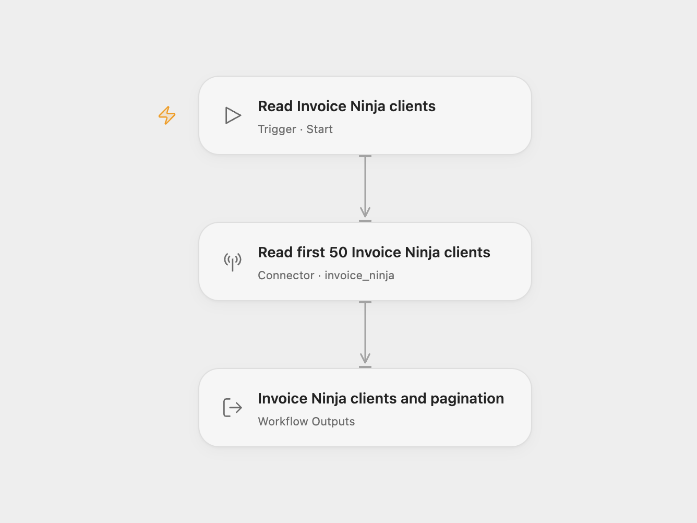

# Invoice Ninja Client Reader

Read up to 50 clients from an Invoice Ninja v5 instance, including their contact and account properties.

<picture>
  <source media="(prefers-color-scheme: dark)" srcset="preview-dark.png">
  
</picture>

[Open Flow JSON](templates/invoice-ninja-client-reader.openflow.json) · [n8n JSON](templates/invoice-ninja-client-reader.n8n.json)

## Setup

Select your Invoice Ninja account in **Read first 50 Invoice Ninja clients** and allow `invoice_ninja.list_clients`. Configure the v5 instance URL and API token in the connection. Your account needs permission to view clients. For hosted v5, the instance URL is `https://invoicing.co`; use your own HTTPS instance root for a self-hosted installation. The connection accepts the origin or its `/api/v1` URL; it does not support an installation under another path.

In n8n, select Invoice Ninja credentials in **Invoice Ninja**. Keep **API Version** set to **Version 5** and use a v5 API token. The optional credential secret can remain empty for this client read; Invoice Ninja uses that secret on its login route. Run manually. Both formats target v5; they do not connect to a v4 deployment.

Each run reads the first page of up to 50 clients, without search, ordering or related-resource filters. It retains the complete v5 client objects returned by the server. Open Flow also returns pagination metadata. An empty account returns an empty clients array. The workflow does not collect every page, create invoices or modify clients. A failed request stops the run without an automatic retry.

## Changes to the source

- Update the source’s v4 default to an explicit v5 configuration in both formats. v5 uses its current client response structure and hashed IDs; these records differ from v4 responses.
- Keep the source’s first-page, 50-client limit.
- Expose clients and pagination metadata in Open Flow.

## Source and license

Adapted from [Invoice Ninja client list workflow](https://github.com/Zie619/n8n-workflows/blob/ae8cf6dc5b873cbb4f74587aa9180ed3a9f70682/workflows/Manual/1003_Manual_Invoiceninja_Automate_Triggered.json) in [Zie619/n8n-workflows](https://github.com/Zie619/n8n-workflows). The source export does not identify a separate template author or license.

The collection’s [MIT notice](https://github.com/Zie619/n8n-workflows/blob/94007c1445d9258a7da116646b79473e7c7c3282/LICENSE) is pinned at a later revision. This is the collection notice at that revision; it does not establish a separate original template author's license. Our changes are listed above; see [repository licensing](../../README.md#licensing).

> MIT License
>
> Copyright (c) 2025 Zie619
>
> Permission is hereby granted, free of charge, to any person obtaining a copy
> of this software and associated documentation files (the "Software"), to deal
> in the Software without restriction, including without limitation the rights
> to use, copy, modify, merge, publish, distribute, sublicense, and/or sell
> copies of the Software, and to permit persons to whom the Software is
> furnished to do so, subject to the following conditions:
>
> The above copyright notice and this permission notice shall be included in all
> copies or substantial portions of the Software.
>
> THE SOFTWARE IS PROVIDED "AS IS", WITHOUT WARRANTY OF ANY KIND, EXPRESS OR
> IMPLIED, INCLUDING BUT NOT LIMITED TO THE WARRANTIES OF MERCHANTABILITY,
> FITNESS FOR A PARTICULAR PURPOSE AND NONINFRINGEMENT. IN NO EVENT SHALL THE
> AUTHORS OR COPYRIGHT HOLDERS BE LIABLE FOR ANY CLAIM, DAMAGES OR OTHER
> LIABILITY, WHETHER IN AN ACTION OF CONTRACT, TORT OR OTHERWISE, ARISING FROM,
> OUT OF OR IN CONNECTION WITH THE SOFTWARE OR THE USE OR OTHER DEALINGS IN THE
> SOFTWARE.
