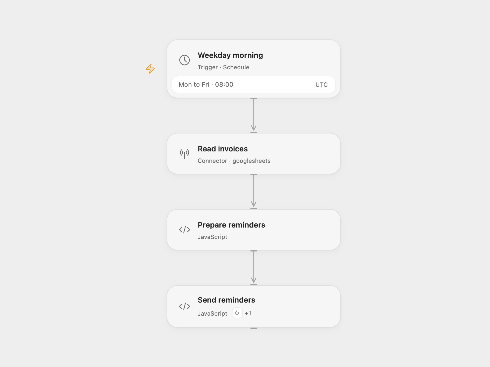

# Invoice Payment Reminders

Read invoices from Google Sheets at 08:00 on weekdays and send one Italian reminder per unpaid invoice due within three days or already overdue.

## Setup

Create a sheet named `Invoices` with these headers:

| Numero | Cliente | Email | Importo | Scadenza | Stato |
| --- | --- | --- | --- | --- | --- |
| INV-001 | Ada | ada@example.com | 120.00 | 13/11/2026 | da pagare |

Use `DD/MM/YYYY` for due dates. The exact status `pagata` marks a paid invoice, ignoring case and surrounding whitespace. Other statuses remain eligible. Every unpaid overdue invoice is included, regardless of its age.

For Open Flow, import the JSON and configure:

| Node | Configuration |
| --- | --- |
| Weekday morning | Confirm the schedule timezone; the template starts with UTC. |
| Read invoices | Connect Google Sheets and replace `YOUR_SPREADSHEET_ID`. The default range is `'Invoices'!A:F`. |
| Prepare reminders | Set `timezone` to the same timezone as the schedule and edit `signature`. |
| Send reminders | In Actions, connect Gmail for the selected Send Email action. |

For n8n, connect Google Sheets and Gmail, configure the spreadsheet in `Leggi fatture`, and edit the company signature in `Trova scadenze imminenti`. Confirm the workflow timezone before enabling it; the template starts with UTC.

Publish and enable the configured workflow. A run reads the complete configured sheet range, filters invoices, and sends reminders in sheet order. Empty results send no messages. A send failure stops later reminders. The workflow does not update invoice statuses or record delivery, so eligible invoices receive another reminder on the next weekday run. Retrying a partially completed run can resend earlier reminders.

## Changes to the source

- Reject impossible dates such as 31 February instead of rolling them into another month. Missing and malformed dates are skipped.
- Compare calendar dates in the configured timezone, including daylight saving changes.
- Validate eligible recipients before sending any reminders.
- Send plain-text email so the Italian message retains its paragraphs.
- Provide the required sheet headers, spreadsheet placeholder, signature, and explicit UTC starting timezone.

<picture>
  <source media="(prefers-color-scheme: dark)" srcset="preview-dark.png">
  
</picture>

[Open Flow JSON](templates/invoice-payment-reminders.openflow.json) · [n8n JSON](templates/invoice-payment-reminders.n8n.json)

Source and license

Adapted from [Automatic payment reminders from Google Sheets (Italian)](https://github.com/enescingoz/awesome-n8n-templates/blob/827110332c21cbe000ab13f6d292d5adb1f1f8db/Google_Drive_and_Google_Sheets/Automatic%20payment%20reminders%20from%20Google%20Sheets%20(Italian).json) in [enescingoz/awesome-n8n-templates](https://github.com/enescingoz/awesome-n8n-templates).

Source collection notice: © 2024–2026 Enes Cingoz, [CC BY 4.0](https://github.com/enescingoz/awesome-n8n-templates/blob/827110332c21cbe000ab13f6d292d5adb1f1f8db/LICENSE). The source export does not identify a separate template author or license. See [repository licensing](../../README.md#licensing) for the scope of OOMOL contributions and third-party material.

