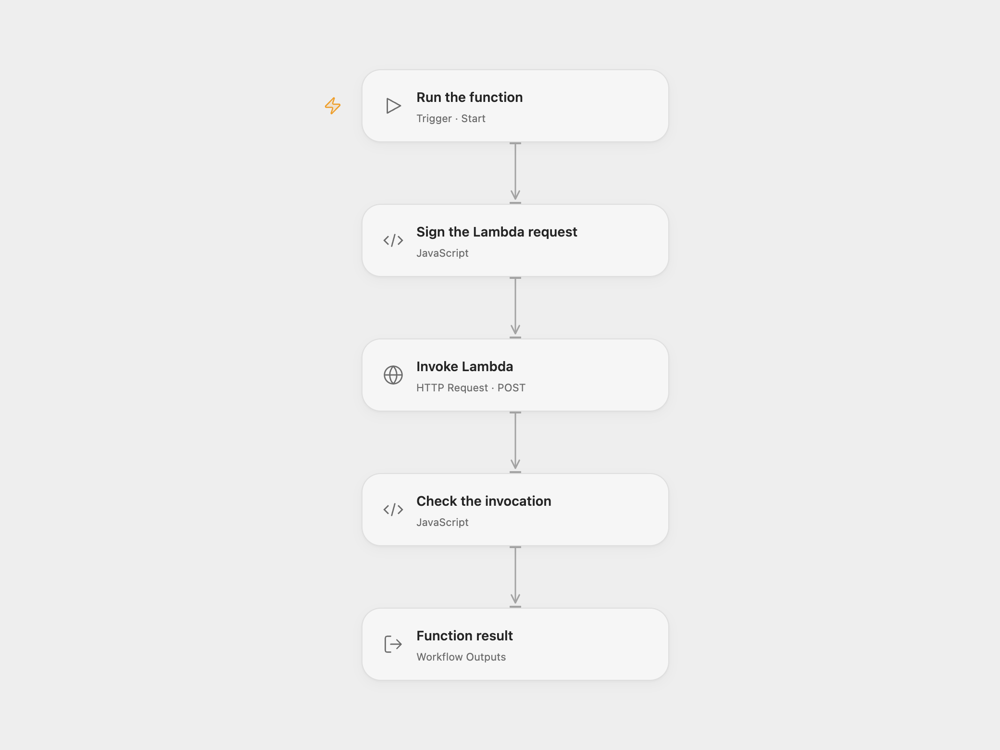

# Invoke an AWS Lambda Function

Invoke a Lambda function synchronously and return its result.

<picture>
  <source media="(prefers-color-scheme: dark)" srcset="preview-dark.png">
  
</picture>

[Open Flow JSON](templates/invoke-an-aws-lambda-function.openflow.json) · [n8n JSON](templates/invoke-an-aws-lambda-function.n8n.json)

## Setup and use

Choose a Lambda function name or ARN and its AWS region. In Open Flow, set both in **Sign the Lambda request**, bind access key ID and secret access key to secret Variables, and grant `lambda:InvokeFunction`. With temporary credentials, bind the same session token secret Variable to **Session Token** in the signing node and **X-Amz-Security-Token** in **Invoke Lambda**. Leave both unset for long-lived credentials. In n8n, configure the function and AWS credential in **AWS Lambda**. Run manually.

## Behavior

The workflow invokes `$LATEST` synchronously with an empty payload and returns the response. The example region is `ap-south-1`; use the function's actual region. Invocation and function errors stop the run. An uncertain invocation may already have executed; check the function's effects before retrying. Lambda responses are held in execution history.

Inspiration &amp; credits

## Changes to the source

- Replace the original account-specific function ARN with configuration. Open Flow signs the Lambda API request; n8n retains the native AWS Lambda node.

Adapted from [Invoke an AWS Lambda function](https://github.com/Zie619/n8n-workflows/blob/ae8cf6dc5b873cbb4f74587aa9180ed3a9f70682/workflows/Manual/0985_Manual_Awslambda_Automate_Triggered.json) in [Zie619/n8n-workflows](https://github.com/Zie619/n8n-workflows). The source export does not identify a separate template author or license.

The collection’s [MIT notice](https://github.com/Zie619/n8n-workflows/blob/94007c1445d9258a7da116646b79473e7c7c3282/LICENSE) is pinned at a later revision. This is the collection notice at that revision; it does not establish a separate original template author's license. Our changes are listed above; see [repository licensing](../../README.md#licensing).

> MIT License
>
> Copyright (c) 2025 Zie619
>
> Permission is hereby granted, free of charge, to any person obtaining a copy
> of this software and associated documentation files (the "Software"), to deal
> in the Software without restriction, including without limitation the rights
> to use, copy, modify, merge, publish, distribute, sublicense, and/or sell
> copies of the Software, and to permit persons to whom the Software is
> furnished to do so, subject to the following conditions:
>
> The above copyright notice and this permission notice shall be included in all
> copies or substantial portions of the Software.
>
> THE SOFTWARE IS PROVIDED "AS IS", WITHOUT WARRANTY OF ANY KIND, EXPRESS OR
> IMPLIED, INCLUDING BUT NOT LIMITED TO THE WARRANTIES OF MERCHANTABILITY,
> FITNESS FOR A PARTICULAR PURPOSE AND NONINFRINGEMENT. IN NO EVENT SHALL THE
> AUTHORS OR COPYRIGHT HOLDERS BE LIABLE FOR ANY CLAIM, DAMAGES OR OTHER
> LIABILITY, WHETHER IN AN ACTION OF CONTRACT, TORT OR OTHERWISE, ARISING FROM,
> OUT OF OR IN CONNECTION WITH THE SOFTWARE OR THE USE OR OTHER DEALINGS IN THE
> SOFTWARE.

