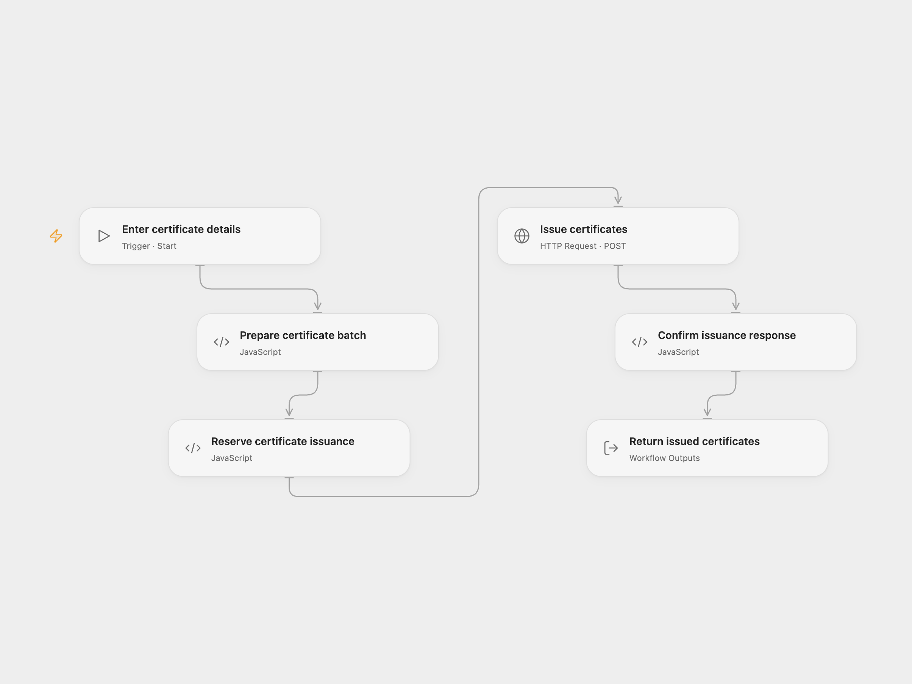

# Issue Verifiable Certificates

Issue verifiable certificates for a course and its recipients.

<!-- template-actions:start -->
 
<!-- template-actions:end -->

<picture>
  <source media="(prefers-color-scheme: dark)" srcset="preview-dark.png">
  
</picture>

## Setup and use

Enter the issuer, course, a list of recipients with names and optional email addresses, and a unique request ID. Enable persistent State in Open Flow.

The workflow sends one certificate batch to Attestify and returns the service response. Attestify creates public verification pages that display certificate details, including recipient names. Review the information before issuing.

Keep the same request ID while investigating and use a new ID for a new batch. Avoid overlapping submissions.

In n8n

In n8n configure the same values and a Data Table with item_key and status text columns. The service’s [documentation](https://github.com/novadyne-hq/n8n-nodes-attestify) describes its verification format. If issuance has an unknown result, check Attestify before resolving the pending request in State or the n8n Data Table.

Inspiration &amp; credits

Adapted from [Issue a verifiable certificate (Attestify)](https://github.com/enescingoz/awesome-n8n-templates/blob/827110332c21cbe000ab13f6d292d5adb1f1f8db/Other_Integrations_and_Use_Cases/Issue%20a%20verifiable%20certificate%20(Attestify).json) in [enescingoz/awesome-n8n-templates](https://github.com/enescingoz/awesome-n8n-templates).

Source collection notice: © 2024–2026 Enes Cingoz, [CC BY 4.0](https://github.com/enescingoz/awesome-n8n-templates/blob/827110332c21cbe000ab13f6d292d5adb1f1f8db/LICENSE). The source export does not identify a separate template author or license. See [repository licensing](../../README.md#licensing) for the scope of OOMOL contributions and third-party material.

