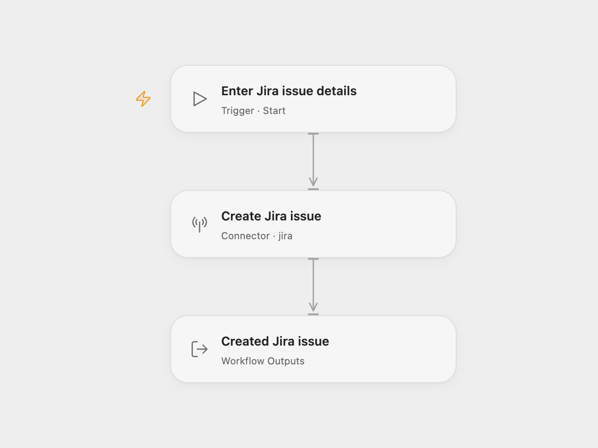

# Jira Issue Creator

Create a Jira Cloud issue with a project ID, issue type ID and summary.

<picture>
  <source media="(prefers-color-scheme: dark)" srcset="preview-dark.png">
  
</picture>

[Open Flow JSON](templates/jira-issue-creator.openflow.json) · [n8n JSON](templates/jira-issue-creator.n8n.json)

## Setup

Select your Jira account in **Create Jira issue**. Run with **Project ID**, **Issue Type ID** and **Summary**. Use a regular issue type whose required creation fields are satisfied by these values. If your project requires more fields, set them in the Action before running. In n8n, choose Jira Cloud credentials, the project and issue type, and set the summary in **Jira**. Add any required fields under **Additional Fields**.

The account needs permission to create and read issues in the project. Open Flow’s create Action creates the issue and then reads it to return the normalized issue with its raw fields. n8n checks the issue type before creation and returns Jira’s creation acknowledgment. Neither format assigns a user, sets a due date or changes the issue status in this template. Jira applies the project’s defaults and notification rules.

Each run can create another issue. No lookup, duplicate detection or workflow retry is configured. If the read after creation fails in Open Flow, the issue remains created. Check Jira before repeating an uncertain request.

## Changes to the source

- Replace the source’s project-specific issue type with user configuration.
- Require project ID, issue type ID and summary as Open Flow run inputs.
- Expose the create Action’s issue result in Open Flow.

## Source and license

Adapted from [Create a new issue in Jira](https://github.com/Zie619/n8n-workflows/blob/ae8cf6dc5b873cbb4f74587aa9180ed3a9f70682/workflows/Manual/1170_Manual_Jira_Create_Triggered.json) in [Zie619/n8n-workflows](https://github.com/Zie619/n8n-workflows). The source export does not identify a separate template author or license.

The collection’s [MIT notice](https://github.com/Zie619/n8n-workflows/blob/94007c1445d9258a7da116646b79473e7c7c3282/LICENSE) is pinned at a later revision. This is the collection notice at that revision; it does not establish a separate original template author's license. Our changes are listed above; see [repository licensing](../../README.md#licensing).

> MIT License
>
> Copyright (c) 2025 Zie619
>
> Permission is hereby granted, free of charge, to any person obtaining a copy
> of this software and associated documentation files (the "Software"), to deal
> in the Software without restriction, including without limitation the rights
> to use, copy, modify, merge, publish, distribute, sublicense, and/or sell
> copies of the Software, and to permit persons to whom the Software is
> furnished to do so, subject to the following conditions:
>
> The above copyright notice and this permission notice shall be included in all
> copies or substantial portions of the Software.
>
> THE SOFTWARE IS PROVIDED "AS IS", WITHOUT WARRANTY OF ANY KIND, EXPRESS OR
> IMPLIED, INCLUDING BUT NOT LIMITED TO THE WARRANTIES OF MERCHANTABILITY,
> FITNESS FOR A PARTICULAR PURPOSE AND NONINFRINGEMENT. IN NO EVENT SHALL THE
> AUTHORS OR COPYRIGHT HOLDERS BE LIABLE FOR ANY CLAIM, DAMAGES OR OTHER
> LIABILITY, WHETHER IN AN ACTION OF CONTRACT, TORT OR OTHERWISE, ARISING FROM,
> OUT OF OR IN CONNECTION WITH THE SOFTWARE OR THE USE OR OTHER DEALINGS IN THE
> SOFTWARE.
