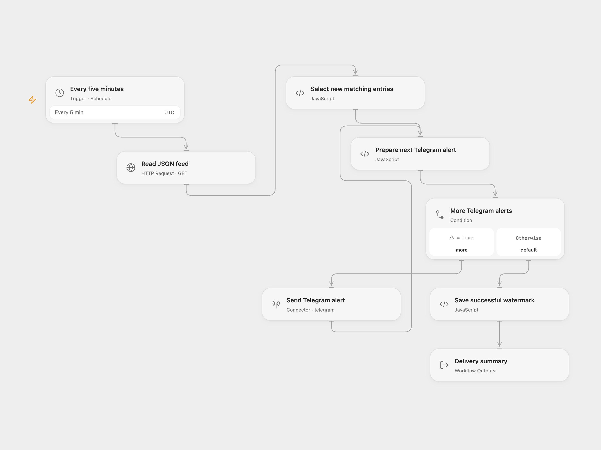

# JSON Feed Telegram Alert

Poll a JSON feed every five minutes. Send entries that pass your category filter and have a timestamp greater than the saved watermark to Telegram.

<picture>
  <source media="(prefers-color-scheme: dark)" srcset="preview-dark.png">
  
</picture>

[Open Flow JSON](templates/json-feed-telegram-alert.openflow.json) · [n8n JSON](templates/json-feed-telegram-alert.n8n.json)

## Setup

In Open Flow, replace the URL in **Read JSON feed** with your direct JSON endpoint. Configure the field names and filter values in **Select new matching entries**, connect your Telegram bot in **Send Telegram alert**, and replace the chat ID. Check the UTC schedule before publishing and enabling the workflow.

In n8n, configure the same URL on **Leggi il feed JSON**, the field names/filter values in **Solo voci nuove e filtrate**, and your bot credential and chat ID on **Manda su Telegram**. Check the workflow timezone before enabling it. n8n saves workflow static data during successful active executions; manual tests do not persist this watermark.

The default feed shape is:

```json
{
  "items": [
    { "tipo": "warning", "ts": "2026-11-10T10:05:00Z", "message": "Example alert" },
    { "tipo": "info", "ts": "2026-11-10T10:00:00Z", "message": "Example update" }
  ]
}
```

| Setting | Default | Meaning |
| --- | --- | --- |
| `arrayField` | `items` | Top-level array containing entries. |
| `filterField` | `tipo` | Entry field compared with the allowed categories. |
| `filterValues` | `[]` | Case-sensitive strings; an empty list accepts every category. |
| `timestampField` | `ts` | Entry timestamp used for the watermark. |

Use timestamps whose string order matches time order, such as fixed-format UTC ISO timestamps. The comparison is lexicographic, including numeric timestamps converted to strings; mixed formats, timezones, or unpadded numbers can give the wrong order. Missing or empty timestamps are skipped. This workflow reads JSON, despite “RSS” in the source name; it does not parse XML RSS or Atom.

## Delivery behavior

The first run has an empty watermark and sends every matching entry with a nonempty timestamp. New entries are sent sequentially in ascending timestamp order. Equal timestamps retain feed order within the current run. A later entry at the already saved timestamp is skipped, so the feed must provide timestamps that suit that boundary.

Each message contains its category and the first 300 characters of the JSON entry. HTML characters are escaped for Telegram display. The workflow reads one feed response, without pagination, using a 10-second request/task timeout. Use a direct endpoint that returns JSON successfully; Open Flow does not follow HTTP redirects. HTTP failures, malformed arrays, invalid entries, or a Telegram failure stop the run without a new saved watermark. No workflow retry is configured.

Open Flow sends each alert through a separate Connector execution in the visible feedback loop. There is no 100-alert total cap. The selected feed and notification array must fit the platform's Code input and result budgets; the inspected host allows 1 MiB for each. A collection limit failure stops without advancing the watermark.

The watermark advances only after every selected notification succeeds. If a later send or state save fails, earlier messages can be sent again on the next poll. Overlapping runs can also duplicate messages; delivery is not exactly once. No matches sends nothing and leaves the watermark unchanged. Changing the feed or its timestamp format requires resetting the saved watermark before reuse.

Open Flow returns `sent` and `watermark` after the state save. n8n's final output is the Telegram send results; an empty batch ends before that node.

<details>
<summary>Inspiration &amp; credits</summary>

## Changes to the source

- Sort selected entries by their timestamp instead of assuming the feed arrives in reverse order.
- Use real line breaks, escape Telegram HTML, and omit the added platform signature.
- Use ordinary feed/chat configuration instead of environment expressions.
- Validate feed structure before sending. Open Flow persists its watermark after all sends, matching n8n's successful-run static-data persistence.
- Retain numeric zero as a timestamp and reject nonnumeric boolean or object timestamps.
- Set an explicit UTC schedule and JSON response format.

Adapted from [RSS Keyword Alert to Telegram](https://github.com/enescingoz/awesome-n8n-templates/blob/827110332c21cbe000ab13f6d292d5adb1f1f8db/Telegram/RSS%20Keyword%20Alert%20to%20Telegram.json) in [enescingoz/awesome-n8n-templates](https://github.com/enescingoz/awesome-n8n-templates).

Source collection notice: © 2024–2026 Enes Cingoz, [CC BY 4.0](https://github.com/enescingoz/awesome-n8n-templates/blob/827110332c21cbe000ab13f6d292d5adb1f1f8db/LICENSE). The source export does not identify a separate template author or license. This adaptation includes the changes listed above; see [repository licensing](../../README.md#licensing) for the scope of OOMOL contributions and third-party material.

</details>
